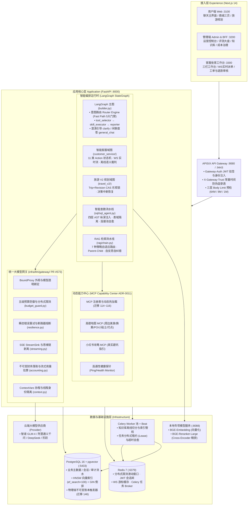

# Agent Platform

面向企业级电商与全场景业务的 AI Agent Platform —— RAG + NL2SQL + 智能客服 + 旅游规划，FastAPI · LangGraph · Next.js · APISIX · PostgreSQL (pgvector)。

平台将「知识问答、数据分析、智能客服、旅游规划」深度收敛到统一的 **Router / Runtime / Domain Agent / Skill / Tool** 架构上：请求经网关验签与防穿透安全校验进入，由意图路由引擎驱动 LangGraph 状态机流转，分流至能力直连、自动化工作流或垂直业务子图，所有模型调用均由统一大模型网关实施五级预算防御与容灾熔断，过程与结果通过全双工 SSE 实时回传。

> 本文件负责「快速理解全栈架构 + 本地一键拉起与验证」。运行契约、底层原理与安全规范以下文链接的文档为唯一事实源，README 保持严格一致的架构口径。

---

## 全平台系统架构

系统由三个 Next.js 前端经统一 APISIX API 网关进入 FastAPI 核心运行时；所有模型调用经过模块化大模型网关；能力层通过 Capability → Skill → Tool 分层，动态 MCP 能力中心支持外部工具热插拔。



部署拓扑、端口表、异步层与网关认证细节见 [system-overview.md](docs/architecture/system-overview.md)。

---

## 核心业务域与工程落地

### 1. 企业级智能查数 NL2SQL（AST 四层纵深防御）
- **完整的 7 阶段编排**：`precheck` $\rightarrow$ `_prepare_sql_question` $\rightarrow$ `select_tables` $\rightarrow$ `generate_sql` $\rightarrow$ `validate_and_rewrite` $\rightarrow$ `execute_sql_struct` $\rightarrow$ `_observe`；
- **四层 AST 纵深防御（`SQLPolicyGuard`）**：
  - Layer 1 权限门：`sql.read` 权限与 `user_id` 存在性（空身份 Fail-Closed 阻断，拒绝未绑定身份的旁路调用）；
  - Layer 2 语法与 6 层硬校验：只读 `exp.Select` 约束、拦截 DDL/DML 与锁语法、**全函数正向白名单（`POSITIVE_FUNCTION_ALLOWLIST`）** 拦截危险函数、强制物理 `LIMIT`（默认 100，最大 1000）；
  - Layer 3 真实表域判定：剥离 `exp.CTE` 别名伪装，对每一个物理表按 `shared` / `personal` / `internal` 校验范围；
  - Layer 4 基于 Select Scope 的三维租户条件原地注入：遍历所有 `exp.Select` 作用域（涵盖子查询、`UNION ALL`、CTE 查询体），调用 `sel.where(cond, copy=False)` 原地参数化注入 `%(sql_scope_*)s` 隔离条件，`resolve_self_value` 强制 PG 32位整型上限守卫（`2_147_483_647`）防溢出；
- **延迟优化**：显式注入 `thinking: {"type": "disabled"}` 彻底关闭隐式思维链，端到端生成耗时由 15s+ 压降至 1.8~2.5s。细节见 [sql.md](docs/domains/sql.md)。

### 2. 企业知识问答 RAG（策略驱动分块与 Agentic 自反思）
- **7 种专业切块策略矩阵（`chunkers/`，PR #570）**：
  - `Structure`（章节层级树与 Parent 800 / Leaf 200）、`Legal`（严格条款编号与标题继承）、`QA`（局部 Q/A 原子绑定，杜绝只列问题的虚假 Parent）、`Step`（SOP 步骤原子块）、`Financial`（数值表格与维度行块）、`Semantic`（向量余弦断崖语义切分）、`Recursive`（滑动窗口兜底）；
  - **局部内容单元分派（`ContentUnitDispatchStrategy`）**：复杂混合文档递归拆解局部单元并打上独立命名空间（`_namespace_content_unit_chunks`）；
  - **表格三层切分（`table_handler.py`）**：Layer 1 表级摘要 Parent + Layer 2 表头 Leaf + Layer 3 行级 KV Leaf 并挂载 `numeric_values` 数值过滤字典；自动跨页合并（`_merge_cross_page_tables`）；
  - **双重覆盖率审计**：`quality_gate.py::cleaning_coverage_audit`（Raw AST 对账防清洗造假）+ `chunkers/audit.py::coverage_audit`（Leaf 覆盖率 $\ge 98\%$ 硬门禁）；
- **混合检索与 RRF 算法偏置补偿**：
  - 稠密向量路（HNSW `ef_search=100` 事务级会话下发） + 稀疏全文路（PostgreSQL `tsvector + GIN`）；
  - **精准标识符特权补偿（`_EXACT_TOKEN_BONUS = max(vw, bw, 1.0) / rrf_k`）**：防止发票号/SKU 被双路平庸命中块挤出 Top-K；
  - **量纲跨界隔离**：RRF 分数（$\le 0.033$）与余弦相似度门禁（0.2）严格物理隔离；反问句过滤状态机（`_is_rhetorical`）杜绝虚假 Multi-Query 膨胀；
- **Agentic RAG 动态反思回路（`SelfCorrectionStrategy`）**：
  - 三道 Evidence Gate（检索门、重排门、LLM 自报元数据门）；
  - 动态自救与变体缓存复用（`_cached_rewrites`），程序化 `ClaimVerifier` 正则引擎对数字、日期、金额、时长执行一票否决核验。细节见 [rag.md](docs/domains/rag.md)。

### 3. 智能客服（双端工作台与 11 类 Action 状态机闭环）
- **双端架构**：用户端 `/customer-service`（组件在 `frontend/src/cs2/`） + 坐席工作台 `frontend-cs`（:3300 `/cs/*` 七大专业视图）；
- **11 类业务动作（Action）状态机**：
  - B1 咨询、B2 积分、B3 优惠券、B4 支付流水与防重退款（唯一约束 `098_cs_refund_order_unique.sql`）、B5 催办、B6 价保试算（`mall_wallet` 演示钱包）、B7 改址、B8 发票申请、B9 投诉、B10 工单转派、B11 人工接管；
  - 严格遵循 `proposed -> confirmed -> executing -> succeeded/failed` 状态机；
- **坐席工作台实时通信层（WebSocket）**：
  - `useAgentSocket` 短期一次性 Ticket 握手鉴权、`seq` 游标重放防丢帧、坐席 4 态（online/busy/away/offline）生命周期与 15s 派单 Offer 状态机（超时自动回退与 SLA 升级）；
- **离线确定性语义裁判（PR #569，`forbidden_facts`）**：
  - 严禁虚构未核实赔偿、严禁虚构退款到账时效，确定性红线规则一票否决。细节见 [customer-service.md](docs/domains/customer-service.md)。

### 4. 旅游规划 V2（Trip + Revision CAS 乐观锁并发与 MCP 外部增强）
- **V1 彻底退役，V2 全面接管**：正式行程全部由 `travel_v2` 承接，对话规划走 `POST /api/travel/v2/plan/stream`；
- **Trip + Revision CAS 乐观并发控制**：
  - 结构化原子操作 `POST /api/travel/v2/trips/{id}/edits` 强制要求 `Idempotency-Key` 与 `expected_revision`；
  - 数据库行级锁（`SELECT ... FOR UPDATE`）内比对版本号，版本冲突立即抛出 **HTTP 409 Conflict** 杜绝脏写覆盖，成功则原子追加不可变 Revision 记录；
- **自研自托管动态 MCP 增强**：高德地图 MCP（周边美食推荐、POI 体验小贴士、换乘路线与距离测算、静态轨迹缩略图）+ 小红书攻略 MCP；管理端支持实时 Ping 探针面板与热重载；
- **人工决策中断（Interrupt）与状态机恢复**：
  - 遭遇物理冲突时基于 Checkpointer 挂起生成加密 `decision_token`（绑定 checkpoint ID、身份、待决内容）；
  - 恢复执行时通过 PostgreSQL Advisory Lock 咨询锁串行化防重入。细节见 [travel.md](docs/domains/travel.md)。

### 5. 预算门禁、财务记账与质量评测
- **大模型统一网关（PR #573）与五级预算防御**：
  - L1 分布式限流 $\rightarrow$ L2 租户额度预检预占 $\rightarrow$ L3 模型单价等级门禁 $\rightarrow$ L4 上下文预算滑动截断 $\rightarrow$ L5 增量摘要与物理硬熔断；
  - **不可篡改财务账本（两阶段预占结算）**：数据库物理触发器 `trg_budget_resolution_audit_append_only`（迁移 146），底层禁止对核销审计行执行任何 UPDATE/DELETE；业务域独立额度轴（迁移 149：`main` / `travel` / `customer_service`）；不可变价格触发器（迁移 053）。细节见 [llm-budget-billing.md](docs/governance/llm-budget-billing.md)。
- **评测中心与安全红队（Evaluation Center）**：
  - 评测双轨统一投影（PR #568，`eval_run_records` / `078_eval_run_validity.sql`）；
  - 系统级安全红队与防越狱评测门禁（PR #566，提示词注入/角色扮演越狱 100% 拦截一票否决）；
  - 领域自动化 CI Smoke 门禁流水线（PR #567：SQL 与 Planner）；Release Gate 量化指标体系。细节见 [evaluation-governance.md](docs/evaluation/evaluation-governance.md)。

---

## 技术栈与核心选型

| 层次 | 选型技术与关键版本 | 关键工程职责与生产选型考量 |
|------|------|------|
| **接入与网关** | Apache APISIX 3.x（Standalone 模式） | 统一入口、SSL 卸载、Gateway-Auth 验签、`X-Gateway-Trust` 常量时间防穿透、三层 Body Limit 预检 |
| **应用与编排** | FastAPI 0.110+ · LangGraph 0.2+ | 异步状态机工作流（StateGraph + Send API + checkpointer 事务级恢复）、SSE 流式全双工事件 |
| **大模型网关** | 统一 Modular LLM Gateway（PR #573） | 责任链模式与外观模式，集成五级预算门禁、指数退避重试、断路器熔断降级、流式思维链剥离与财务记账 |
| **持久化与检索**| PostgreSQL 16 + pgvector 0.7+ | 单库 ACID 原子性，HNSW 向量索引（`ef_search=100`） + GIN `tsvector` 倒排全文检索，两阶段不可变账本物理触发器 |
| **缓存与消息** | Redis 7 + Celery 5.x | 分布式滑动窗口限流、JWT 会话闸、WS 游标补发缓存；Celery 双队列支撑离线任务与分布式租约（Lease）自愈 |
| **外部能力扩展**| MCP 动态能力中心（ADR-0011） | 数据库驱动热加载、高德地图 POI/路线 MCP、小红书攻略指引 MCP、实时连通性探针与失联优雅降级 |
| **可观测与观测**| OpenTelemetry + Prometheus + Grafana | 自研 Tracer（PostgreSQL 权威存储，镜像导出 OTLP），TTFT 首字延迟归因，Prometheus 低基数告警，4C8G 资源大盘 |
| **前端三端** | Next.js 14 (App Router) + React 18 + Tailwind | 用户端（:3100）、管理端（:3200）、客服坐席工作台（:3300），BFF 代理隔离与流式 SSE 渲染 |

---

## 快速开始

### 1. 环境准备
- **Docker Desktop**（本地开发与中间件全栈：APISIX、PG 16、Redis 7）；
- **Python 3.10**（后端运行时与评测环境）；
- **Node.js 18+**（前端三端环境）。
- **根目录 `.env` 是唯一生效配置**（`backend/.env` 不加载）：
  ```bash
  cp .env.example .env
  # 至少配置 PGPASSWORD / PG_READONLY_PASSWORD（Docker Compose 强校验，缺失无法启动）
  ```
- 大模型 Provider、模型标识与 API Key 统一由数据库 `sys_config` 与管理端「模型配置」维护，不进代码与版本控制。

### 2. 启停管理（Windows 一键脚本）
```bat
devctl.bat status                  :: 查看各端服务状态（空参 = status）
devctl.bat start all               :: 启动全部后端容器与三个前端
devctl.bat stop web /y             :: 只停用户端，免确认
devctl.bat restart all /y          :: 重启全部服务
devctl.bat rebuild /y              :: 重新构建镜像并重建后端服务（修改后端代码或 .env 后必用）
```

### 3. 服务访问入口
- **用户端 Web**：http://localhost:3100
- **管理端控制台**：http://localhost:3200
- **客服坐席工作台**：http://localhost:3300
- **API 交互式文档**：http://localhost:8000/docs
- **APISIX 网关入口**：http://localhost:9080

---

## 核心架构文档导航

| 领域分类 | 规范文档路径 | 核心规范与深度内容 |
| :--- | :--- | :--- |
| **全局协作规则** | [AGENTS.md](AGENTS.md) | 仓库级协作红线、马斯克五步法、Git Worktree 纪律与按需文档入口 |
| **架构与网关** | [system-overview.md](docs/architecture/system-overview.md) | 全平台分层架构、APISIX 穿透防御、统一大模型网关 6 大子包、动态 MCP 中心 |
| **AI 运行时** | [ai-runtime.md](docs/architecture/ai-runtime.md) | LangGraph 主图拓扑、Router 决策链路、Fast Path 5大门禁、SSE 流式生命周期 |
| **底层理论与选型** | [theory-and-tradeoffs.md](docs/architecture/theory-and-tradeoffs.md) | HNSW/GIN 数学原理、RRF 偏置补偿、四层 AST 注入源码、横向架构选型矩阵 |
| **企业查数 SQL** | [sql.md](docs/domains/sql.md) | 四层 AST 纵深注入（`copy=False`）、三维表域判定、连接池自愈、思考抑制 |
| **知识问答 RAG** | [rag.md](docs/domains/rag.md) | 7 种切块策略、Parent-Child 回溯、表格三层切分、双重覆盖率审计、自反思自纠错 |
| **智能客服** | [customer-service.md](docs/domains/customer-service.md) | 11 类 Action 状态机、WS 实时鉴权与游标补发、离线 `forbidden_facts` 语义裁判 |
| **旅游规划 V2** | [travel.md](docs/domains/travel.md) | Trip+Revision CAS 乐观并发冲突解决（HTTP 409）、高德/小红书 MCP、决策中断恢复 |
| **预算与计量** | [llm-budget-billing.md](docs/governance/llm-budget-billing.md) | 五级预算门禁、两阶段预占结算、DB 物理级不可变账本触发器、流式用量估算 |
| **评测与质量门禁** | [evaluation-governance.md](docs/evaluation/evaluation-governance.md) | 双轨统一投影、系统级安全红队（100% 拦截）、CI Smoke 流水线、Release Gate 门禁 |
| **可观测性** | [trace-model.md](docs/observability/trace-model.md) · [grafana-guide.md](docs/observability/grafana-guide.md) | OpenTelemetry Trace 规范、TTFT 延迟归因、Prometheus 规则与 4C8G 容器大盘 |
| **答辩与面试指南** | [interview-prep-guide.md](docs/interview-prep-guide.md) | 19 张技术架构精要卡片、真实踩坑与避坑血泪实证、高频架构追问防翻车话术 |

---

## License

**All rights reserved —— 保留全部权利。源码公开仅用于展示与技术交流，未经授权不得用于商业用途。**
