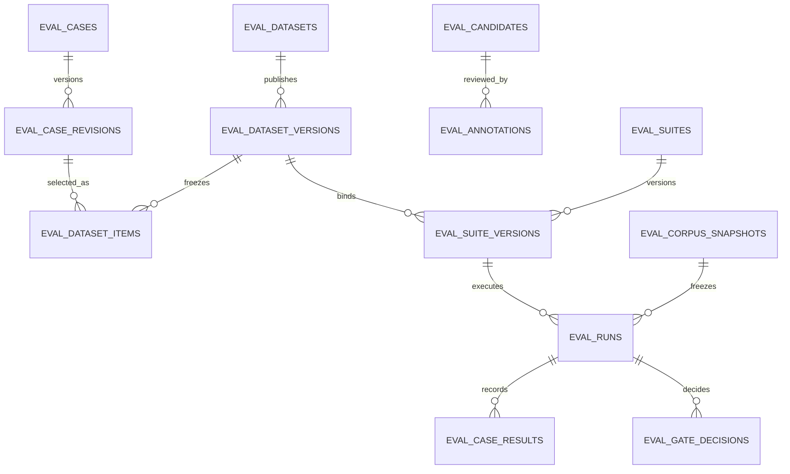

# ADR-0010：评测平台 V2 独立领域

- 状态：施工中
- 日期：2026-10-24
- 背景：评测资产分散在静态 JSONL、文件目录和旧版评测 API 中；新平台需要可信的候选审核、不可变版本、可复现运行和发布裁决。

## 决策

1. 新代码放在 `backend/evaluation_v2/`，HTTP 契约放在 `/api/evaluation/v2`。旧 `backend/evaluation` 仅作为 Runner、指标及历史读取 adapter；它不成为 V2 的数据注册表。
2. PostgreSQL `evaluation_v2` schema 保存事务性主数据、版本引用、任务状态、逐例索引、Gate 决策和审计。大体积、敏感的运行产物只能经受控 artifact storage adapter 保存；API 响应返回受授权的 artifact 引用，不回传原始 Trace 或凭据。
3. tenant 只从 `require_product_identity` 得到。Repository 的每个租户查询既写 `tenant_id` 条件，也在事务中 `SET LOCAL ROLE evaluation_v2_app` 并设置 `app.tenant_id` 供 RLS 检查；该 role 是 `NOSUPERUSER/NOBYPASSRLS`，避免现有应用数据库超级用户连接绕过 RLS。缺少可信 tenant 时拒绝请求。当前可访问租户由可信身份决定，不支持请求体、query 或 `X-Tenant-Id` 自行切换租户。
4. DatasetVersion、SuiteVersion、CorpusSnapshot、Evaluator 配置和启动后的 EvalRun 快照不可变。Run 的环境摘要包含脱敏 RAG 模式、embedding/reranker 配置和策略；Worker 在逐例边界复核，配置漂移时以 INVALID 终止，避免混合环境得出可比较 Gate。CaseRevision 和 Annotation 以追加方式保留历史；审核使用 revision CAS；发布在同一 DB 事务内写版本、明细和审计事件。
5. `job_status` 与 `gate_verdict` 是不同字段。排队/运行/失败等任务状态不能推导 PASS/FAIL；缺少完整固定快照、有效样本或可用的真实指标时裁决为 INVALID 或 BLOCKED。
6. 队列使用项目现有任务设施，业务 Runner 和 Evaluator 通过 adapter/插件契约接入。重复消费按 `(tenant_id, idempotency_key)` 和 `(run_id, case_id)` 唯一键幂等。
7. 迁移仅新增 schema，不移动或覆盖 `data/eval_runs`、旧数据集和知识库。新域验收前继续保留旧入口；切换与回滚单独实施。

## 领域关系

## 授权矩阵

| 操作 | 最低平台角色 | 资源范围 | 额外约束 |
| --- | --- | --- | --- |
| 查看目录、版本、方案、运行 | viewer | 身份 tenant | 查询同时受 RLS 与 tenant 条件约束 |
| 创建候选、编辑候选 | editor | 身份 tenant | 脱敏/去重；编辑使用 revision CAS |
| 审核候选 | admin | 身份 tenant | 审核理由、证据锚点、追加审计；操作者不能批准自己生成的高风险候选 |
| 发布 Golden / Suite | admin | 身份 tenant | 所有选中样本已审核且证据有效；原子发布、hash 校验、不可变 |
| 启动、取消运行 | admin | 身份 tenant | 固定输入快照、幂等键、预算与授权 preflight；外部副作用只走现有治理 |
| Gate Policy 修改与发布批准 | super_admin | 身份 tenant | 单独权限和不可变决策记录 |

平台当前只有 viewer/editor/admin/super_admin 基础角色，没有评测专用权限码。V2 先映射到最小平台角色并在服务端执行；细粒度权限码需先接入现有 RBAC 权限事实源，不能靠前端显隐。

## 迁移和回滚

- 迁移新增 `evaluation_v2` schema 和表，不改旧表；只登记到 `agent_memory`。
- 回滚应用时可撤下 V2 API 路由并继续用旧 API。数据表保留，避免误删任何资产；只有完成独立备份与停写确认后才能另行制定 drop 迁移。
- 切换前必须显式导入旧资产并把缺少证据审核的样本标记 `legacy_unverified`；旧版本和历史 Run 不重写。

## 未完成决定

- 对象存储当前部署没有为本任务确认可用的独立 bucket/凭据；实现需先提供本地隔离存储与生产对象存储 adapter，不把工作树目录当生产权威。
- 任务队列的持久化状态、真实费用记账与跨 worker 取消语义需在 Runner 批次落地并用隔离环境验证。
- 此 ADR 是目标边界；实际完整度以对应实现和测试证据为准。
