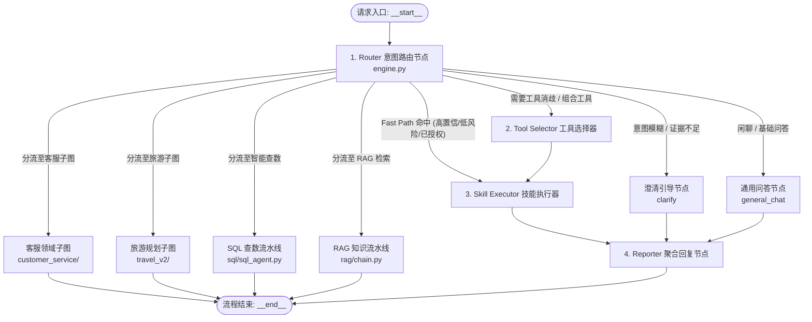

# AI 运行时、LangGraph 编排与主图状态机

本文系统说明平台核心 AI 运行时的架构设计，涵盖 LangGraph 主图拓扑、自适应路由决策链路、工具治理契约、SSE 流式生命周期以及多产品会话隔离机制。

---

## 一、 LangGraph 主图拓扑与执行状态机

主图构建于 `backend/orchestration/graph/builder.py`，基于状态机模式严格控制用户请求在各个认知节点之间的流转，杜绝循环死锁与状态串扰。



### 1. 核心内置节点与职责
- **`Router`（意图路由器）**：基于用户输入、历史上下文与意图信号，判定分发目标；
- **`Tool Selector`（工具选择器）**：当有多个候选工具或参数模糊时，在合法注册工具集合内进行语义消歧与参数预填；
- **`Skill Executor`（技能执行器）**：负责实际调用 Skill Runtime，处理副作用审计、权限再校验与执行结果封装；
- **`Reporter`（报告节点）**：接收 Skill 执行结果、知识片段或澄清建议，结合系统 Prompt 输出最终面向用户的结构化 Markdown；
- **`General Chat`（通用问答）**：无外部工具依赖的直答节点，挂载严格的整体执行时限 `GENERAL_CHAT_LLM_DEADLINE=30s`；
- **`Domain Graph Nodes`（领域子图节点）**：通过 `backend/domains/__init__.py` 与各业务域注册模块动态装载，不在主图代码中硬编码复制业务逻辑。

---

## 二、 路由引擎与决策链路（`backend/orchestration/router/engine.py`）

### 1. 两段式执行（Two-stage Execution）与直连分支
主路由依据 `route_selector` 的返回结果驱动图边转移：
- 当返回 `"skill_executor"` 时：严格映射到 `tool_selector → skill_executor → reporter` 两段式流水线；
- 当返回 `clarify` 或 `handoff`（转人工）时：直连 `reporter` 节点输出引导话术，跳过工具选择；
- 当返回 `domain_graph`（如客服、旅游、SQL、RAG）时：控制权直接下推给对应的领域独立子图或流水线。

### 2. 能力快速通道（Capability Fast Path）硬门禁
为降低端到端 RT，系统支持高频工具的 Fast Path 直通调用，但**必须同时满足以下 5 项严苛安全门禁**：
1. **置信度门槛**：模型或分类器自报得分 $Score \ge 0.85$；
2. **Top 分差安全余量**：$\Delta(Top1 - Top2) \ge 0.20$，杜绝边界模糊时的冒进调用；
3. **低风险等级（LOW Risk）**：只有无副作用的只读查询类工具允许 Fast Path；有副作用的写操作一律强制进入二次确认；
4. **系统白名单锁定**：工具必须显式声明在当前环境的 `fast_path_allowlist` 内；
5. **主体权限已就绪**：请求上下文通过预检确认已持有执行该工具所需的全部 RBAC 权限点。
*重要安全原则*：大模型自报的分数仅作为语义倾向提示，绝对不作为授权凭据；候选工具携带的 `risk`、`fast_path_enabled`、`permission_ready` 必须由服务端可信上下文二次核验。

### 3. 多维缓存指纹（Fingerprint）算法与一致性契约
为充分发挥大模型厂商的前缀缓存（Prefix Caching）并复用高频决策，Router 实现了严格的多维缓存指纹算法（`get_cache_fingerprint`）：
- **指纹组成维度**：
  $$\text{Fingerprint} = \text{Hash}(\text{会话上下文状态} + \text{租户 ID} + \text{权限集合} + \text{路由策略版本} + \text{Manifest 指纹} + \text{模型角色指纹} + \text{Prompt 版本哈希})$$
- **明确不缓存异常状态**：降级响应（Degraded）、澄清状态（Clarify）以及发生瞬态重试的结果明确禁止入缓存，防止系统将暂时的异常决策持久化。

---

## 三、 工具治理体系（Tool Governance）

工具执行绝不等于简单的函数反射，必须经过严格的运行时治理门禁（`backend/core/tool_governance/`）：

1. **语义契约校验（Semantic Contract）**：
   - 工具入参必须通过 Pydantic Schema 的强类型校验；
   - 包含文件路径、SQL 片段、Shell 命令的参数，强制经过对应业务安全过滤器的消毒（Sanitization）。
2. **副作用审计与幂等闭环**：
   - 带有写操作的 Tool 必须由调用方在 Header 中提供 `Idempotency-Key`；
   - 执行前在 `agent_actions` 表中生成记录并锁定（`status="pending"`），执行成功变更为 `executed`，失败变更为 `failed`，杜绝重复执行与状态伪装。
3. **资源级授权隔离**：
   - 严格基于服务端的 `AuthorizationContext`，不仅校验工具本身的调用权限，更在工具执行体内校验目标数据资源的归属（Tenant Scope 与 User Scope），杜绝水平越权（IDOR）。

---

## 四、 SSE 事件生命周期与恢复机制

全平台对话与流式生成严格遵循 `backend/orchestration/graph/event_schema.py` 约定的 SSE（Server-Sent Events）事件契约：

```
客户端                                           服务端 (FastAPI Runtime)
  │                                                        │
  ├────── POST /chat/agent/stream (带 Token) ─────────────►│
  │                                                        ├─► 身份校验与预算预检
  │◄───── event: start (会话与 Trace 元数据) ───────────────┤
  │                                                        │
  │◄───── event: reasoning (流式思维链思考分片) ──────────────┤ (仅调试模式/管理端流)
  │◄───── event: delta (正式文本内容增量分片) ────────────────┤
  │                                                        │
  │◄───── event: tool_start (调用工具名与入参摘要) ──────────┤
  │◄───── event: tool_end (工具执行完成元数据) ──────────────┤
  │                                                        │
  │◄───── event: citations (引用证据锚点: [E1], [E2]) ─────┤
  │◄───── event: done (最终 Token 用量、耗时与 TraceID) ────┤
  │                                                        │
```

### 1. 流式分片与思维链剥离协议
- **`delta` 事件**：输出清洗后的纯净业务回答，直接面向终端用户渲染；
- **`reasoning` 事件**：承载云端思考型模型生成的原始思维链，仅当请求显式声明调试权限时才会输出，且两类事件的 Token 在网关层分别计量。

### 2. 断线重连与恢复
- 当客户端网络抖动中断连接时，客户端可携带上次收到的事件 `seq` 序号向恢复接口发起查询；
- 后端在 Redis 中维护滑动事件窗口，支持游标级的重放补发，确保移动端弱网环境下的流式体验完整。

---

## 五、 产品隔离与 Conversation-First 目标架构

根据系统架构决策 ADR-0002，平台对不同业务入口实施了严格的**物理级隔离机制**：

1. **多产品端点物理隔离**：
   - 主助手独占：`/chat/agent/*` 与 `/memory/agent/*`；
   - 客服独占：`/chat/customer-service/*` 与 `/memory/customer-service/*`；
   - 身份必须由路由鉴权组件固定，禁止以请求体中的 `domain_hint` 或前端传参作为跨产品越权访问的依据。
2. **存量共享路由收口**：
   - 历史遗留的共享端点 `/chat/*`（`PUBLIC_PRODUCT`）在 `router_node.py` 中被强制静态下沉为仅能访问 `general_chat`（`product_scope="public_only"`），彻底杜绝公共对话访问私有持久记忆与高级业务工具。
3. **上下文预算事件的严格作用域校验**：
   - 后台触发的记忆修剪或预算预警事件，其作用域必须完整包含 Product、Tenant、User、Session 与 Request；
   - 任何作用域不完全匹配、超时或晚到的事件严禁泄露至当前 SSE 通道，事件 payload 仅允许包含脱敏后的元数据结构，坚决不携带原始问题与摘要正文。
