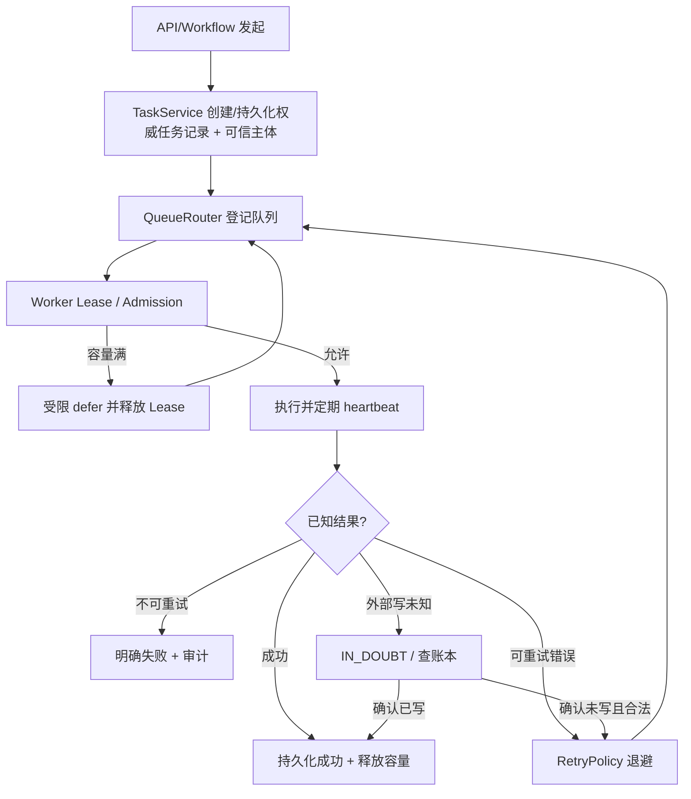

# Celery 异步任务、队列与副作用统一治理规范

> 本文是跨业务异步任务标准。原有 `backend/tasks/` 中 QueueRouter、Admission、Lease/Heartbeat、Retry、Recovery、Idempotency 已有多种机制，本规范明确它们的职责分工，**不另外创建 Task Runtime 或第二张状态表**。

## 控制面与数据面

| 组件 | 源码 | 只回答的问题 |
| --- | --- | --- |
| `TaskService` | `backend/services/task_service.py` | 创建并持久化任务记录、任务状态/Lease 的数据库写读边界 |
| `TaskManager` | `backend/tasks/task_manager.py` | 已持久化任务的入队/重投、任务级暂停/取消/恢复（`pause_task`/`cancel_task`/`resume_task`）及 SSE/事件通知。注意：这是**任务级控制 API**，与「用户经 Chat/旅游/客服入口主动暂停对话运行时」不同（后者见运行时生命周期规划，尚未实现） |
| `QueueRouter` | `backend/tasks/queue_router.py` | workflow/task 到哪个逻辑 workload / 物理 queue |
| `AdmissionController` | `backend/tasks/admission/controller.py` | 容量、请求/租户并发是否可进入执行 |
| Lease / Heartbeat | `backend/tasks/lease_heartbeat.py` 与任务服务 | 当前哪个 execution 有权写任务状态（fencing） |
| RetryPolicy | `backend/tasks/retry_policy.py` | 已知临时失败的退避和次数边界 |
| Pending Recovery | `backend/tasks/pending_recovery.py` | Worker 死亡、租约过期后能否重新领取 |
| Side Effect Ledger | `backend/tasks/side_effect.py`、`backend/shared/idempotency.py` | 外部写操作有没有实际发生、是否可安全重试 |
| Celery | `backend/tasks/celery_app.py` | broker、worker、beat 的执行和投递 |

**关键区别**：TaskService=创建/持久化；TaskManager=投递/控制；QueueRouter=去哪里；Admission=能不能进；Lease=谁能执行；Ledger=写过没有；Retry=已知可恢复错误；Recovery=进程死亡后的重新协调。不能通过 Celery `autoretry_for` 代替不确定副作用账本。

## 生命周期与不变量

- 身份、tenant、`task_id`、`execution_id`、幂等 key 互相不替代。重试/recovery/resume 保留稳定业务幂等键，`execution_id` 可更换但只证明 Lease Owner；失去 Lease 的执行者不得继续写数据。
- 任务状态以现有持久 TaskRecord/TaskStatus 为准。Redis 标志、pub/sub 与内存进度只负责控制与 UI 通知，不能代替任务正式终态。
- 取消与暂停在约定安全边界生效，不保证已执行的外部副作用自动撤销。进度 UI 必须标明 queued/running/retrying/blocked/completed/failed/unknown 的真实映射（以现有枚举为准），不能伪造完整通用枚举。
- 未登记的 workflow 默认由 QueueRouter 拒绝，只有运维明确开启受审计 fallback 才可走兼容路径。异步调度、定时 beat、手动重放都要通过该表。
- 对未知 Provider 写入、数据库提交不明、下游订单确认等不得以“超时”推定未执行；按 [幂等运维手册](../operations/idempotency-runbook.md) 查询、人工裁决或有证明地恢复。

## 新异步任务的研发顺序

首先写清：请求目标、业务 owner、资源权限、队列归属、持久化位置、时间预算、并发与容量、可重试错误列表、最多次数、外部写幂等 key、取消/恢复边界、Trace/进度、最终失败通知。然后复用已存在任务注册与消息路线；禁止把新 Celery task 写完就直接假定消费者/beat/监控自动发现。

## AT-01～AT-10 验收

| 编号 | 必须有的证据 |
| --- | --- |
| AT-01 | 未登记任务拒绝入队，登记任务路由、Worker 消费队列一致 |
| AT-02 | Admission 满额触发 bounded defer，不占用悬挂 Lease |
| AT-03 | Worker crash/Heartbeat 丢失后只能合法 Owner 接管 |
| AT-04 | 重复投递/恢复不会使账单、退款、预订等写操作重复 |
| AT-05 | 超时后写入结果未知 → 账本查询，不盲重试 |
| AT-06 | 用户/租户/服务身份在队列消息及重试中保持合法且不可伪造 |
| AT-07 | 取消/暂停/恢复后前端进度与真实任务终态一致 |
| AT-08 | Redis/PG/Broker 故障不会被标为业务成功，队列错误可定位 |
| AT-09 | 索引、记忆、预算对账、客服及旅行等实际任务有各自定向回归 |
| AT-10 | Trace/告警能关联 task_id、execution_id、队列/重试，记录清洗敏感载荷 |

验证先使用隔离任务/队列及假 Provider 的副作用测试，再按风险执行真实 Worker E2E；未接本机 Docker、Redis、PG 的项保持 NOT VERIFIED。
