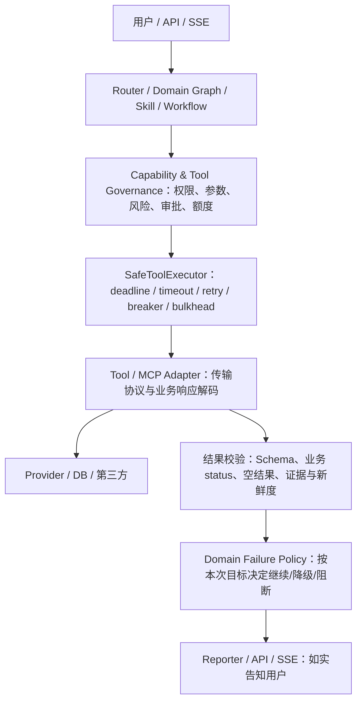

# Tool / Provider 失败语义与降级规范

> **性质：跨域开发规范（2026-10-11）**。适用于 Chat、RAG、SQL、客服、旅游、选品及后续业务域；不意味着所有存量调用点已验收符合。本文定义「该如何做」，实现细节、可用字段和现状以源码、schema、测试为准。不得为执行本规范另造一套 Tool Runtime、ErrorEnvelope 或 Registry。

## 1. 分层与唯一责任

- **HTTP/SDK** 负责传输状态；**Tool Runtime** 负责执行可靠性及 `ToolResult` 归一；**Tool Governance / 边界适配器** 负责结构化输出、Schema 和业务失败判定；**Domain** 根据用户硬约束和依赖决定业务终态；**Reporter / SSE** 只展示已确定的业务状态。
- `backend/core/tool_runtime/models.py` 的 `ToolStatus` 目前包含 `success / degraded / timeout / unavailable / rate_limited / invalid_request / unauthorized / failed`。域内 `BLOCKED` 表示**用户硬约束无法安全满足**，不得机械等同于 `ToolStatus.FAILED`；具体领域字段由其现有状态契约定义。
- `Node Runtime` 只治理节点级 timeout/exception/hook，不重复实现 Tool 重试或熔断。MCP 是协议适配层，不是新的执行、授权或降级真相源。
- 现有 Raw `SafeToolExecutor.run` 对返回值完成调用即包为执行层 `SUCCESS`；**这不等于上游业务成功**。调用方不得仅凭 HTTP 200、无 Python 异常或执行层 `SUCCESS` 判定任务成功；必须在相应业务边界解析 provider/body 的失败、空值和 schema。

## 2. 状态轴不能合并

| 轴 | 例子 | 判定人 | 禁止行为 |
| --- | --- | --- | --- |
| 传输 | HTTP 200/4xx/5xx、连接超时 | HTTP/MCP Adapter | 用 HTTP 200 当业务成功 |
| 执行 | success、timeout、unavailable、rate_limited | Tool Runtime | 把异常字符串交给 LLM 猜结果 |
| 业务 | status=failed、ORDER_NOT_OWNED、empty、partial | Tool 结果校验 / 域适配器 | 把 failed 封套当内容继续生成 |
| 用户目标 | 完成、允许降级、BLOCKED、内部 FAILED | Domain Failure Policy | 把硬依赖失败伪装为完整成功 |
| 展示 | 普通成功、标明缺失的部分结果、明确拒绝/失败 | Reporter / API / SSE | SSE `done` 或界面成功状态掩盖业务失败 |

结构化 Tool 成功使用 `{"status":"success","data":...}`，失败使用 `{"status":"failed","error":...}`；Skill/Workflow 按 `backend/shared/tool_envelope.py` 和当前实现解析。Tool Governance 侧另有 `backend/core/tool_governance/result_validator.py` 的 `success / empty / failed` 判定。两种数据形状在**既有适配边界**转换，不自行扩展第三种通用封套。返回纯文本的 Skill 不强行 JSON 包装，但也不能把 HTML 错误页、文本“失败”或缺证据视作正常事实。

## 3. 失败分类与处理矩阵

| 条件 | 处理原则 | 可以降级吗？ |
| --- | --- | --- |
| 连接失败、502/503、429、熔断 OPEN、并发舱满 | 先由 SafeToolExecutor 按 Tool Policy + Deadline 决策；可用其它已授权来源或明确缺失 | 仅非硬依赖且替代结果满足业务约束时 |
| 读超时 / 剩余预算不足 | 不穿透请求预算；默认不盲重试读超时；给出可解释结果 | 同上 |
| 400/422、Schema 不匹配、Provider 业务 failed | 修正输入/契约、停止错误链路；不得以自动重试掩盖确定性错误 | 只有定义了可信的业务替代方案才可 |
| 401/403、越权、租户范围不符 | **Fail-closed**，终止当前受保护操作；记录安全事件 | **不得**换更宽的凭据/SQL/MCP 路径 |
| 200 + status=failed / 有明确业务错误码 | 以业务失败为准，保留错误码与不可重试原因 | 不可变成成功事实 |
| 合法空结果 | 明确 `empty` / 暂无可用数据；与失败区分 | 可建议其它查询条件，不得虚构 |
| 部分成功 / 非实时缓存 | 保留成功子结果、失败项、来源、核验时间与限制说明 | 可标记 `DEGRADED`，不得标记完全核实 |
| 内部算法 Bug、状态损坏、未知契约异常 | 内部 `FAILED`，告警并阻止无效后续处理 | 不把内部错误伪装为外部 Provider 降级 |
| 写操作超时 / 响应丢失 / 效果未知 | `UNKNOWN / IN_DOUBT`；查询账本或 Provider 状态，必要时人工裁决 | 不自动重投，不声明成功或失败 |

`error_mapper.py`、`retry.py`、`policy.py` 和 `executor.py` 是执行层事实源；不能在各域散落自行实现通用 sleep/retry/try-except 吞错。原始异常仅用于受保护的诊断，不返给最终用户。

## 4. 动态依赖与降级决策

调用前对**当前用户目标**判定依赖级别；默认静态 Tool policy 的 criticality 只是基线，不覆盖用户的硬约束：

- `REQUIRED`：若不能核验关键条件，终态 `BLOCKED`（例如“必须找到 9 点前抵达的高铁，否则不要生成行程”）。
- `IMPORTANT`：优先真实数据；失败可给标明未核验/缺失的部分方案，但不能声称满足失败字段。
- `OPTIONAL`：可跳过非核心增强步骤，返回的业务数据必须仍满足原目标。

决策顺序：**先判授权与副作用 → 核验业务状态/证据 → 结合 brief/用户约束确定硬依赖 → 按允许的 fallback 选择来源或降级 → 输出业务终态和证据**。任何分支都不允许 `False Success`。可用的备用 Provider 必须满足相同租户/权限/用途约束；不能把无来源、过期或不同地域的数据当实时信息。已降级但仍有有效部分结果时记录失败原因为 `DEGRADED`；无法安全满足硬约束时终止业务处理。

领域参考：旅游 12306 失败的动态判断与用户披露见 `backend/travel/services/tool_failure_policy.py` 和 `backend/tests/travel/test_tool_failure_policy.py`；RAG 不足证据必须拒答/澄清；SQL 验证/鉴权失败绝不转为宽权限执行；客服确认/退款和旅行预订遵循状态机与幂等账本。

## 5. 写操作、安全与重试边界

- READ 可重试与否由错误类型、策略、剩余预算决定，不能通用地“失败必重试三次”；真正连接失败等可有限重试，超时有可能在对端已执行，必须按具体语义审查。
- WRITE 强制**零盲重试**。必须先做服务器端授权、用户确认/审批和幂等键登记；写后超时属于可能已发生，保持 UNKNOWN/IN_DOUBT 并查状态。
- 如果幂等账本/权限服务不可用，**fail-closed**；不绕过 ledger、审批、租户过滤或安全校验继续执行。
- 重放、人工裁决及未知写结果处置沿用 [幂等运维手册](../operations/idempotency-runbook.md)。`asyncio.CancelledError` 应传播，不能因统一降级吞掉取消。SSE 断线与 Tool 重试是两种不同语义，不得导致副作用重复发生。

## 6. 返回前的最低证据与用户披露

每个对外使用的 Provider 结果，按业务需要维护来源 / observed_at 或等价时效证据 / verification_status 或等价校验结果；字段名以现有域 schema 为准，**不以本文新增通用数据库字段**。缺事实就写“无法核实”，禁止填猜测车次、酒店价格、库存、营业时间、订单状态和退款执行结果。Reporter 必须能区分：成功、部分可用且明确警告、硬约束无法满足、内部错误。API/SSE 按原有事件 schema 输出合法终态，不新增未经消费端验证的事件名。

推荐 Trace / 结构化日志至少能关联：`trace_id/run_id`、域、能力/工具 ID、provider 类型、执行层 status、业务状态或安全错误码、依赖级别、是否阻断、`fallback_used/fallback_provider`、`retry_count`、耗时、版本/来源标识（若适用）。已有指标及属性以真实埋点为准；不把用户名、密钥、原始凭据或敏感请求体写入 Trace。工具失败率、降级率、熔断次数、超时及业务阻断应可被按域定位；告警和图表须先核对指标实际存在。

## 7. 新增 Tool / Provider 必须验收（按风险选择 T0–T3）

| # | 场景 | 必须断言 |
| --- | --- | --- |
| F-01 | HTTP 200 + 业务 `failed` / 业务错误码 | 不进入 success/正常 Reporter |
| F-02 | 401/403 / 跨租户 / 不属于本人资源 | 终止并不绕过授权，数据零泄漏 |
| F-03 | 超时、429、502/503、熔断、并发舱满 | 受 Deadline/RetryPolicy 约束，有确定终态 |
| F-04 | 非硬依赖 Provider 挂掉 | 主要任务可继续时标记 DEGRADED + 展示限制 |
| F-05 | 同一 Provider 在硬依赖请求中挂掉 | BLOCKED；不产生假满足约束的结果 |
| F-06 | Provider 无结果、脏 Schema、HTML 错页 | empty 与 failed 分开；绝不编造 |
| F-07 | 内部代码异常 | FAILED；不降级为“外部数据暂不可用” |
| F-08 | 写操作响应丢失或超时 | 效果未知、不盲重试、ledger/状态可查 |
| F-09 | 执行失败、业务失败、任务结果、API/SSE/页面 | 各状态一致、可解释；前端不假报成功 |
| F-10 | 取消 / SSE 断线 / 同一请求重放 | 取消传播，副作用无重复执行 |
| F-11 | Trace、指标、日志 | 可追溯原因和 fallback，脱敏且无泄漏 |
| F-12 | 备用 Provider 失败或证据过时 | 最终安全退出、告知无法核实 |

未有证据的项写 `NOT VERIFIED` / `BLOCKED`，不能标为 PASS。历史域的缺口作为独立整改任务排期，不要借文档提交宣称生产可用。测试选择与淘汰旧测试见 [testing-guide](../development/testing-guide.md)。
