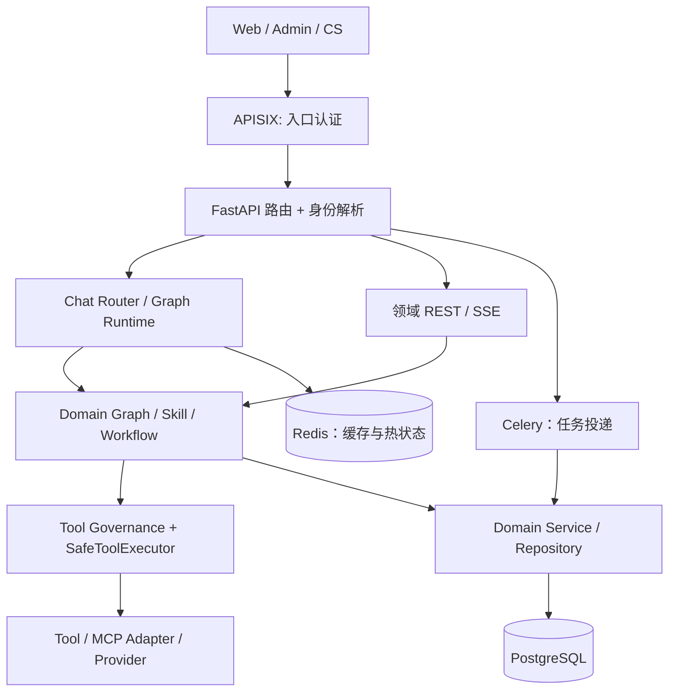

# 全平台架构分层与模块边界

> **规范，不是现状验收报告。** 保持现有 FastAPI + LangGraph + APISIX + Next.js + PostgreSQL/Redis/Celery 架构；不为“统一”引入第二套 Router、Tool Runtime 或业务库。变更代码前定位当前注册表和契约测试。部署拓扑参见 [system-overview](system-overview.md)，主图参见 [ai-runtime](ai-runtime.md)。

## 1. 请求与状态的两条通路

图表示主要职责，不表示全部 API 都通过 Chat Router。领域 V2 独立 API 允许直接走领域应用服务。同步请求的 SSE、异步任务和 LangGraph Checkpoint 是不同的生命周期，不能混用“完成”或“重试”。

## 2. 责任、允许依赖和禁止事项

| 层 | 当前位置/事实源 | 负责 | 不负责 |
| --- | --- | --- | --- |
| Gateway / API | `apisix/`、`backend/app/api/` | 身份验证、输入 DTO、HTTP/SSE/WS 接口、安全边界、路由装配 | 私自执行领域副作用、放宽身份 |
| Router / Runtime | `backend/orchestration/`、`backend/core/node_runtime/` | 意图归宿、状态执行、Checkpoint、节点协调、会话投影 | 自建领域数据库状态机或 Tool 重试 |
| Domain / Application | `backend/travel*/`、`customer_service/`、`rag/`、`sql/`、`selection*/` | 领域规则、真实业务状态、版本 CAS、领域失败策略 | 重做公共认证、Tool 治理或模型计费 |
| Capability / Skill / Workflow | `backend/orchestration/router/capabilities.yaml`、`backend/skills/`、`backend/orchestration/workflow*/` | 可路由声明、能力组合、执行步骤 | 自建第二份 Tool 注册事实源 |
| Tool Governance / Runtime | `backend/core/tool_governance/`、`backend/core/tool_runtime/` | 参数/风险/预算、授权、超时/重试/熔断、结果归一 | 自动断言用户业务目标已满足 |
| Infrastructure / Provider | `backend/infra/`、`backend/providers/`、`mcp_servers/` | 数据源适配、协议、外部服务/连接资源 | 绕过治理链、替用户确认、伪造实时数据 |
| Persistence | `backend/sql/migrations/`、领域 repository | 事务、租户/资源隔离、索引、数据库状态 | 根据前端 user_id 建立权限 |

**依赖规则**：业务接口调用领域 Application/Runtime，领域通过稳定端口调用 Tool/Provider/Repository；共享底座不得反向依赖具体前端页面或领域 UI。允许因现有架构出现的反向 import 必须先登记、写测试再消除，不得在重构中批量改 import 假装兼容。

## 3. 五条跨模块红线

1. **身份与授权**：网关身份头必须由网关验证；后端再次校验请求上下文，读写都查租户及资源级权限；不信任前端传 user_id。
2. **业务状态权威**：数据库中的正式实体、revision、工单/退款状态是事实源；LLM、UI 草案、Redis 热状态、Checkpoint 均不可直接覆盖。冲突用 CAS/受控迁移，不采用无条件覆盖。
3. **输出与错误**：HTTP、Tool 执行、Tool 业务、Domain 结果、Reporter 展示分别有状态，详见 [failure-degradation](failure-degradation.md)。工具失败不等于全图失败，硬条件失败不可假成功。
4. **模型治理**：Prompt 版本、LLM 代理、token/价格、上下文预算由统一链路归因。不得各领域直接散落第二份模型计费、Prompt 缓存或默认配置。
5. **可观测与安全**：记录决策、耗时、版本与错误类别；日志/Trace 不得泄露敏感参数。详见 [Trace 契约](../observability/trace-model.md) 与 [身份架构](../auth/README.md)。

## 4. 如何新增或迁移模块

先画 **入口 → 调用方 → 事实源 → 写路径 → 失败路径 → 回滚路径**，确定归属层与唯一注册口，核对 `AGENTS.md`、[开发指南](../development/tool-skill-guide.md) 和 [目录规范](../development/repository-layout.md)。跨层变动写 ADR、兼容性与对应 T2 守卫。模块合并/移动不以文件名相似作为证据：`workflow` / `workflows` 或 `selection` / `selection_funnel` 必须审查职责及引用后再裁决。
