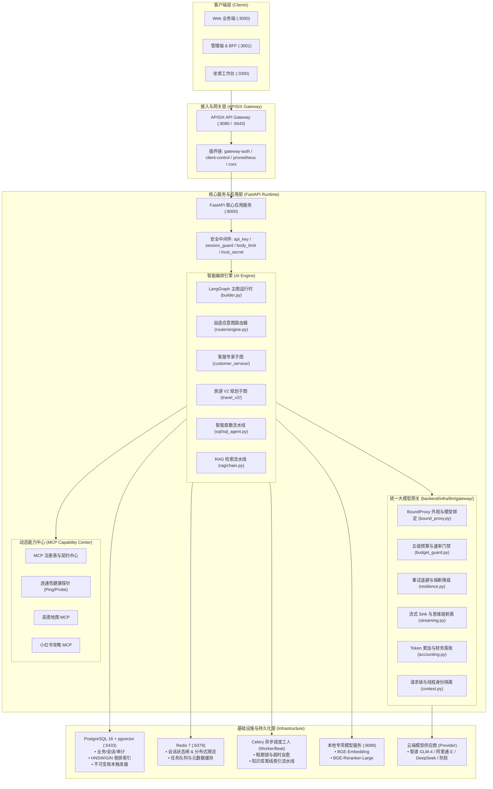

# 系统概览与全平台服务架构

本文档系统说明平台的整体部署边界、服务拓扑、网关安全防护机制及统一基础设施。运行端口、镜像构建参数、环境变动与物理开关由 Docker Compose、APISIX 与配置体系统一维护。

---

## 一、 全平台端到端服务架构拓扑

平台采用现代云原生分层架构，从流量接入、API 网关、核心推理编排到多模型网关与底层持久化实现严格的职责解耦：



---

## 二、 网关与身份接入纵深防御

APISIX 是全平台唯一的外部受信任网络流量入口，网关与应用层之间建立了基于**零信任架构的三重防御体系**：

### 1. 身份注入与伪造穿透防御（`GATEWAY_TRUST_SECRET`）
- **网关身份注入**：外部请求通过 APISIX 时，`gateway-auth` 插件对 JWT 或 Cookie 进行验签，向请求头中提取并强行注入 `X-User-Id`、`X-Tenant-Id`、`X-User-Roles`；
- **防止直连绕过（Anti-Bypass）**：为防止攻击者在内网直接向 FastAPI 宿主机端口（`8000`）发起请求伪造身份头，系统设计了 `GATEWAY_TRUST_SECRET` 机制。APISIX 向上游发送请求时自动附带 `X-Gateway-Trust` 签名；FastAPI 中间件对该头执行**常量时间比对（Constant-Time Compare）**，签名不匹配或缺失直接返回 403 阻断，坚决杜绝身份穿透。
- **公开路由默认租户注入**：`apisix/apisix.yaml` 对公开认证路由（`/api/auth/*`、`/api/sys/users/register`、`/api/sys/users/captcha`）无条件强行注入 `X-Tenant-Id: "default"`；对客服 WebSocket（`/ws/cs/*`）与报表文件流放行至对应专业中间件做二次 Ticket 鉴权。

### 2. 三层请求体（Body Limit）纵深拦截链
针对大文件上传与网络 DoS 攻击，平台设计了三层逐级收紧的预检机制：
1. **Layer 1（APISIX 全局与路由级）**：
   - 全局 `client_max_body_size` 设定为 64 MiB（满足 RAG 超大 PDF/DOCX 知识库上传）；
   - 对自动化回调（`/webhooks/automations/*`）等高风险端点，在 APISIX 路由插件层单独收紧至 1 MiB。
2. **Layer 2（FastAPI 应用中间件 `body_limit.py`）**：
   - 在进入业务 Controller 之前，中间件依据请求 `Content-Length` 做二次精准拦截：Webhook 限制 1 MiB、RAG 上传为配置的 `RAG_MAX_FILE_SIZE` 加上 multipart 协议余量、其余常规业务 API 严格限制为 8 MiB。
3. **Layer 3（管理端 BFF 预检）**：
   - BFF 服务在转发客户端 Payload 前按 `BFF_MAX_BODY_BYTES`（默认 64 MiB）执行预读检查。针对无 `Content-Length` 的 Chunked 流式请求，依靠网关层实际收包字节数做物理级熔断阻断。

---

## 三、 统一大模型网关体系（Modular LLM Gateway）

在 PR #573 中，平台彻底废除了历史 2876 行的单体 `proxy.py`，采用**责任链模式与外观模式（Facade）**重构为高度模块化的子系统 `backend/infra/llm/gateway/`：

```
backend/infra/llm/gateway/
├── __init__.py           # 门面导出层：保持 100% 向后兼容历史调用签名
├── base.py               # 动态探针与穿透辅助：提供底层代理穿透与运行时自省能力
├── bound_proxy.py        # BoundProxy 外观：bind_tools_for_model / bind_llm_for_role 参数绑定
├── budget_guard.py       # 五级预算与速率门禁：分布式限流、上下文预算动态滑动截断
├── resilience.py         # 韧性容灾体系：瞬态错误识别、指数退避重试、断路器与降级响应
├── streaming.py          # 流式分片处理：SSE StreamSink 管理与 reasoning_content 思考分片剥离
├── accounting.py         # 计量记账引擎：Token 累加、流式用量估算与财务数据库不可变落账
└── context.py            # 线程与协程上下文：Thread-Local 与 ContextVars 身份隔离与调用诊断
```

### 1. 核心子模块职责与关键技术机制
- **`bound_proxy.py`（模型绑定与工具门面）**：
  封装 `_BoundLLMProxy` 对象，依据运行时上下文动态绑定目标模型及工具集（`bind_tools_for_model`），实现对 LangChain / 原生云端 SDK 的无感透明包装。
- **`budget_guard.py`（五级预算防御与截断）**：
  实现生产级预算防御：包含 Redis 分布式滑动窗口速率限制、调用前模型输入价格等级门禁（`_enforce_model_input_price_tier`）、上下文预算超限动态滑动截断（`_truncate_messages_to_budget`），以及极端超长时的 L5 触发比例检测（`_l5_trigger_ratio`）。
- **`resilience.py`（高可用容灾与断路器）**：
  维护细粒度瞬态错误判定表（`_TRANSIENT_MARKERS`，精准识别超时、429 速率限制、上游连接重置）；内置断路器（Circuit Breaker），当供应商失败率超标时快速下线并路由到备用 Provider；在遭遇不可恢复的终态失败时，优雅组装 `_degraded_answer`，确保业务主流程永不因大模型崩溃而发生未捕获的 Panic。
- **`streaming.py`（流式解析与思维链分离）**：
  管理 SSE 通道生命周期。精确剥离思考型模型的思维链分片（`extract_chunk_reasoning`）与正式文本分片（`extract_chunk_text`），支持管理端实时调试流与用户端纯净回答流的双轨输出。
- **`accounting.py`（不可变财务记账）**：
  维护请求与轮次级用量累加器（`_turn_usage_var`），基于 DB 登记的不可变单价计算财务成本，并在 SSE 流结束或中断时调用 `_settle_estimated_stream_usage` 执行精确结算。
- **`context.py`（作用域环境隔离）**：
  基于 Python `contextvars` 维护 `_thread_local_user_id` 与诊断上下文，确保在高并发异步协程调度中，各租户与用户的身份、模型覆盖参数完全隔离互不串扰。

---

## 四、 动态能力中心（MCP Capability Center）

平台遵循 ADR-0011 规范建立了数据库驱动的 **MCP 动态能力中心**（基于迁移 `114_mcp_capability_center.sql`、`115_http_api_tools.sql` 与 `116_capability_bundles.sql`）：

1. **热加载与运行时治理**：
   - 外部扩展能力（如高德地图 POI、小红书攻略、外部 ERP 查询）统一注册至 `mcp_servers` 表，支持热插拔与动态重载，无需重启核心服务；
   - 治理层提供统一的调用频次限制、权限点绑定与审计记录。
2. **实时连通性健康探针**：
   - 后台调度器定期执行心跳探测（`mcp_health_monitor`），动态更新 MCP 节点状态（`healthy` / `degraded` / `unhealthy`）；
   - 当外部 MCP 失联时，主图运行时自动熔断该工具并降级提示用户，严禁模型在工具宕机时虚构未核验数据。
3. **能力打包与租户一致性约束**：
   - 迁移 `130_mcp_grant_tenant_consistency.sql` 引入了强约束触发器，保证租户对 MCP 插件的授权粒度与租户自身生命周期绝对一致。

---

## 五、 基础设施与多存储协同机制

- **PostgreSQL 16 + pgvector**：
  承载全平台业务主数据、会话历史、Trace 归因以及向量/全文检索。通过分区与索引优化（HNSW 向量索引 + GIN `tsvector` 倒排索引）支撑千万级知识检索；
- **Redis 7**：
  承载高频分布式锁（Redis Lease）、分布式滑动窗口限流桶、JWT Token 黑名单/会话闸以及 LangGraph 状态临时缓存；
- **Celery 异步调度体系**：
  负责重型非阻塞任务（如知识库离线切分、批量向量计算、定时用量对账），严格遵循租期锁与幂等协议（见 [async-task-governance.md](async-task-governance.md)）；
- **本地专项模型服务（127.0.0.1:8088）**：
  容器内通过 `host.docker.internal:8088` 访问。专门承担文本 Embedding（BGE 系列）与重排（Reranker），彻底杜绝本地部署推理大模型占用宝贵的 4C8G 容器计算资源。
