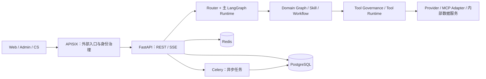

# 系统概览

本文说明部署边界和服务关系。端口、镜像参数、环境变量和运行开关由 Docker Compose、APISIX 与配置文件维护；本文不复制动态配置清单。

## 服务关系

- Web、管理端和客服工作台通过 APISIX 进入 FastAPI。
- FastAPI 承载 REST、Chat Runtime 与主 LangGraph Runtime。
- RAG 可以由应用内 Pipeline 执行，也可以经客户端接入独立 RAG 服务；远程模式以当前配置和服务实现为准。
- MCP 服务暴露现有 Tool 的协议入口，不替代应用内 Tool Runtime。
- PostgreSQL 保存业务、会话、运行状态和检索数据；Redis 提供缓存及任务消息基础设施。
- Celery 承载明确声明为异步的任务；/chat/stream 的请求执行与 SSE 生命周期遵循 Runtime 契约。
- Java 业务系统是独立部署边界；本仓库只维护已有的 Python 接入适配器。

## 网关与身份

APISIX 是外部请求入口。身份头由网关验证并注入，后端只接受已验证的服务端身份上下文；不能信任客户端自带的用户或租户标识。网关身份协议见 [identity-header-protocol.md](../contracts/identity-header-protocol.md)。

## 数据与运行边界

- 数据库结构及升级以 backend/sql/migrations/ 和实际数据库代码为准。
- Provider 凭据由受控配置/凭据来源提供，不能写入文档、日志或客户端构建产物。
- 外部服务、任务队列与模型不可用时按具体业务契约返回失败或降级；不得静默丢任务。
- 部署与运维操作参考仓库 Compose 文件及 [commands.md](../operations/commands.md)。

## 稳定层次与请求路径

上述是**职责拓扑**，不是每个请求都必须经过主图。部分旅游 V2、RAG、管理端接口可由领域 REST 入口直接调用业务服务；是否经过 Router、是否启用 Checkpoint、是否投递 Celery，必须到相应 API 实现和配置核验，不能仅凭图假定。Web 请求 SSE 生命周期不等于 Celery 异步任务；主请求、异步任务均应具有可追踪的业务终态。

## 横向架构红线

- 身份和 tenant 在 APISIX/后端可信边界校验后传递；领域服务及存储仍必须做资源级授权，不能因为经过网关就省略。
- 跨层只传稳定契约：Router 判归宿，Graph/Skill 负责编排，Tool Governance 审权限与副作用，Tool Runtime 处理执行可靠性，Provider Adapter 负责协议与真实数据；禁止在每个领域复制一份相同治理链。
- 对外可见的失败由 [统一失败与降级规范](failure-degradation.md) 约束；Provider 读故障不必然导致业务失败，写操作结果未知不得自动重投。跨域共享能力只由当前注册表和现有服务入口提供。

## 全平台开发视角

逻辑的 **接入 / 编排 / 领域应用 / 执行 / 模型 / 工具与数据 / 可观测** 七类职责；**RBAC、幂等、评测、发布等治理机制是跨层约束，不单独替代领域应用层**。上述七类的组件归属，以 [全平台模块边界](module-boundaries.md#5-七层架构核心组件与职责统一开发归属表) 为唯一详细说明；本文件专注服务部署和实际网络关系。新增 Provider、角色、RAG 或评测能力时按对应专项规范维护，不在服务概览中复制注册表内容。
