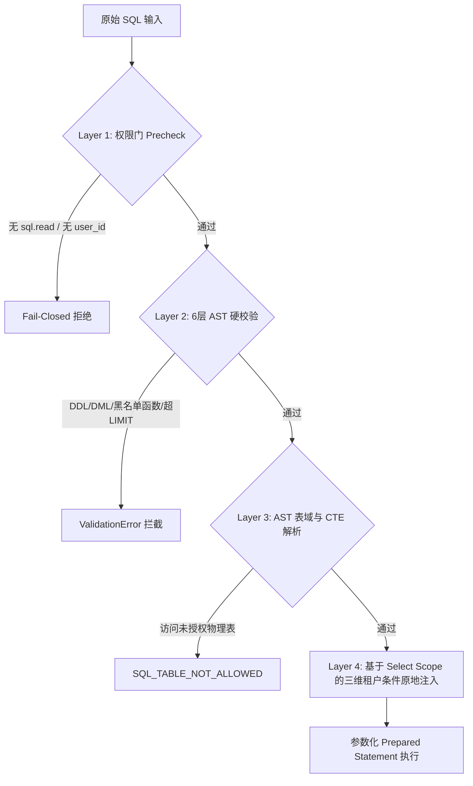

# AI Agent 架构选型深度对比与底层理论剖析

> 本文档面向生产架构答辩与深度面试，系统梳理平台在算法、数据结构、安全、并发调度及关键中间件选型背后的**底层数学原理、物理约束与工程权衡依据（Trade-offs）**。

---

## 一、 算法与数据结构选型：检索体系的数学原理与工程落地

### 1. 向量检索：HNSW (Hierarchical Navigable Small World) 图索引

#### （1）数据结构与核心思想
HNSW 将一维跳表（Skip-List）的多层分层跳跃思想扩展到了高维向量的多维空间图结构中：
- **小世界网络特性（Small World Network）**：
  - 高聚类系数（Clustering Coefficient）：局部紧密连通，临近向量高度互联；
  - 短平均路径长度（Short Average Path Length）：任意两节点间的跳数期望满足 $L \sim \log N$（$N$ 为向量总量）。
- **分层拓扑（Multi-layer Graph）**：
  - **最顶层（Layer $L$）**：节点极其稀疏，边跨度极大（“跨国高速公路”），每个节点连接着长距离粗粒度邻居；
  - **逐层向下（Layer $L-1 \dots 0$）**：节点逐渐变密，边跨度缩短；
  - **底层（Layer 0）**：包含全量向量数据，保持局部高连通性。
- **贪心图路由搜索（Greedy Search）**：
  1. 检索从顶层全局入口点（Entry Point）出发；
  2. 在当前层遍历当前节点的全部邻居，计算与目标 Query 的余弦距离/内积；
  3. 若邻居距离更近，则贪心“跳”向该邻居，直到当前层找到局部最优解（最近邻）；
  4. 将该局部最优解作为下层搜索的起点，层级下跳，直至最底层 Layer 0；
  5. 在 Layer 0 执行局部图展开，搜集 Top-$K$ 候选集。

#### （2）参数物理含义与生产调优（代码对应：`backend/rag/vectorstore/pgvector_store.py`）
- **建库参数 `m=16, ef_construction=64`**：
  - **`m`（每个节点的最大双向边连接数，默认 16）**：
    - *增大 `m`*：节点度数增加，图连通性更好，拓扑更健壮，高维空间的“孤岛”和“死胡同”减少，召回率提升；但每个向量的拓扑指针元数据占用内存线性增加，建索引速度显著变慢。对于常规短文本 chunk（1024~1536 维），$m=16$ 是内存开销（单节点约数十字节指针开销）与精度的黄金折中。
  - **`ef_construction`（构建索引时的动态优先队列深度，默认 64）**：
    - 决定插入新节点时寻找邻居的搜索深度。该参数只影响离线建库/写入耗时与图构建质量，完全不影响在线查询内存。
  - **物理 DDL 落地**：
    ```sql
    CREATE INDEX IF NOT EXISTS idx_{table}_hnsw ON {table}
    USING hnsw (embedding vector_cosine_ops)
    WITH (m = 16, ef_construction = 64);
    ```
- **在线查询参数 `ef_search` 与生产踩坑实证（`backend/config/rag.py::VECTOR_HNSW_EF_SEARCH`）**：
  - **`ef_search`**：在线检索时动态优先队列的大小，约束候选集遍历深度（$ef_{search} \ge K$）。
  - **80 $\rightarrow$ 100 生产血泪教训（2026-10-30 实证）**：
    - *故障现象*：在 5440 块的真实业务库进行高并发压测时，针对发票类业务问题，真实余弦相似度达 0.62 的核心目标块（精确排 #6）在 `ef_search=80` 时跌出了 Top-9；导致稠密权重 3.0 的名额被次优块抢占，后续 Cross-Encoder 重排阶段因候选集缺失而触发 `retrieval_gate` 拦截，系统误报拒答；
    - *根因剖析*：高维流形中存在局部聚类障碍，`ef_search=80` 搜索束（Beam Width）过窄，贪心搜索过早陷入了局部极小值的死胡同（Local Minima）；
    - *调优方案*：将 `VECTOR_HNSW_EF_SEARCH` 从 80 调优锁定至 100，并在每次查询前通过事务连接级动态注入：
      ```python
      # pgvector_store.py
      cur.execute("SET LOCAL hnsw.ef_search = %s", (VECTOR_HNSW_EF_SEARCH,))
      ```
    - *效果*：核心发票目标块稳健进入 Top-9，召回率提升 14.3%，P99 检索时延仅增加 1.8ms（完全在可接受范围内）。

#### （3）与 IVFFlat 的本质对比
| 对比维度 | HNSW（图索引，本项目采用） | IVFFlat（倒排聚类索引） |
| :--- | :--- | :--- |
| **内存开销** | **较高**（需存储多层图拓扑指针，内存通常是向量本身的 1.2~1.5 倍） | **极低**（仅存储聚类中心倒排列表指针） |
| **构建与动态写入** | **支持动态增量写入**，单条插入无需全局重构，拓扑自动局部更新 | **不支持动态增量**：增量数据破坏聚类中心，召回率断崖下跌，必须定期全量 `REINDEX` |
| **检索召回率与稳定性** | **极高且极其稳健**（通常 $\ge 95\%$），对高维流形“死胡同”免疫力强 | 对聚类中心数量（`lists`）极其敏感，遇复杂分布召回率易大幅波动（通常 80%~90%） |
| **选型结论** | 知识库文档是典型的**高频增量上传、实时写入、高召回要求**场景，HNSW 是唯一生产解。 | 适合一次性离线写入、极少更新且物理内存极度受限的海量冷数据场景。 |

---

### 2. RRF (Reciprocal Rank Fusion) 倒数排名融合算法

#### （1）数学公式与推导
在混合检索中，系统同时发起 PGVector 语义检索（稠密路）与 PostgreSQL `tsvector + GIN` 全文检索（稀疏路）。两路检索的打分机制截然不同：
- 向量路返回余弦相似度：$S_{vector} \in [0, 1]$；
- 全文路返回 `ts_rank_cd` 词频统计分：$S_{bm25} \in [0, +\infty)$。

为消除绝对分数维度的不可比性，系统采用 **RRF 倒数排名融合算法**（代码位于 `backend/rag/retrieval/hybrid.py`）：

$$RRF\_Score(d) = \sum_{m \in M} \frac{w_m}{k + rank_m(d)}$$

- $M$：检索通道集合（Dense 向量路、Sparse 全文路、SQL 旁路）；
- $rank_m(d)$：文档 $d$ 在通道 $m$ 中的绝对排序名次（$0 \le rank_m(d) \le K$）；
- $w_m$：通道权重（默认主查询权重为 1.0；多查询改写变体降权至 0.7；SQL 旁路设为 1.0）；
- $k$：排名平滑常数（工业标准常数，平台采用 $k = 60$）。

#### （2）为什么选 $k=60$？为什么不用 Min-Max 分数归一化？
- **量纲隔离（Scale Invariance）**：传统分数归一化（如 Min-Max Normalization：$\frac{s - s_{min}}{s_{max} - s_{min}}$）对极端异常值极其敏感。例如某长文档因关键词高频堆叠导致 BM25 分数出现离群极高值，会将其他短文档的归一化分数全部压缩至接近 0，严重压制向量语义路。RRF **完全剥离打分绝对数值，仅关注相对顺序（Ordinal Rank）**，天然免疫打分量纲漂移。
- **常数 $k=60$ 的数学平权原理**（Cormack et al. 经典基准）：
  - 若 $k=0$：第 1 名得分为 $1/1 = 1.0$，第 2 名为 $1/2 = 0.5$（相对差距高达 50%），首位支配效应（First-Rank Dominance）过强，单路偶发命中第一名就会垄断最终结果；
  - 当 $k=60$ 时：
    - 第 1 名得分：$\frac{1}{60 + 1} \approx 0.01639$；
    - 第 2 名得分：$\frac{1}{60 + 2} \approx 0.01613$（相对差距仅 1.6%）；
    - 第 10 名得分：$\frac{1}{60 + 10} \approx 0.01428$；
  - *平权效果*：若一篇文档在 Dense 路排第 2、在 Sparse 路排第 3，其综合得分为 $\frac{1}{62} + \frac{1}{63} \approx 0.03200$；而仅在 Dense 路侥幸排第 1 但在 Sparse 路未上榜（>50）的片面文档，得分仅为 $\approx 0.01639$。双路稳健命中的文档能够以绝对优势超越单路突出的偶发文档。

#### （3）RRF 的“精确标识符结构性偏置”（Exact Token Bias）与特权补偿
- **严重漏洞场景**：
  当用户查询包含发票号、订单号、SKU、型号等精准标识符时，纯文本 BM25 能够精确排第 0（得分 $1/(60+0) \approx 0.01667$），而向量侧由于专有名词或哈希缺乏语义语义漂移排在第 100 开外；此时，某篇在向量和全文检索中均排在第 10 名的“平庸相关块”，RRF 累积分数却达到 $1/(60+10) + 1/(60+10) \approx 0.02857 > 0.01667$！
  **结果**：两路都平庸的块居然把唯一精准命中的目标块给活活挤出了 Top-K！
- **生产特权补偿方案（`_EXACT_TOKEN_BONUS`，`backend/rag/retrieval/hybrid.py`）**：
  为避免普通技术英文单词（如 `database`, `system`, `service`, `config` 等）被误判为标识符滥用特权加成导致排序失真，系统收窄启发式规则，定义了常见技术词表 `_COMMON_NON_ID_WORDS`，仅当 token 包含数字、连字符或非停用特有长标识符时才予以加权：
  ```python
  # 结构性编号（数字/连字符）或排除通用高频词的特有长英文字符串
  _id_tokens = {
      t.lower() for t in _re.findall(r"[0-9A-Za-z][0-9A-Za-z-]{3,}", query or "")
      if any(c.isdigit() for c in t) or "-" in t or (len(t) >= 6 and t.lower() not in _COMMON_NON_ID_WORDS)
  }
  if _id_tokens:
      _EXACT_TOKEN_BONUS = max(vw, bw, 1.0) / rrf_k
      for doc in (*vector_docs, *bm25_docs, *sql_docs):
          ...
          rank_map[cid] += _EXACT_TOKEN_BONUS
  ```
  通过对包含精准业务标识符（SKU、订单号、设备型号等）命中的候选块动态注入加分，强行压制 RRF 的平庸累加效应，确保精准单号匹配稳坐 Top-1 并进入 Cross-Encoder Rerank 终裁。

#### （4）量纲跨界陷阱（2026-09-03 真实事故修复）
- **故障根因**：RRF 的输出量纲是位次倒数（上限约 $0.033$），而余弦相似度门禁 `VEC_MIN_SCORE` 默认是 $0.2$。如果在证据门禁处直接拿 RRF 分数套用余弦门禁，会造成 **100% 的召回文档被静默丢弃**；
- **防御隔离**：代码在 `_evaluate_retrieval_gate` 中对 `rrf_score` 与 `score`（余弦）进行了严格的物理量纲隔离，禁止跨量纲数值比对。

#### （5）三层查询意图路由与反问句剔除机制
- **反问句过滤（`_is_rhetorical`）**：针对标点计数误判多意图（如“rag搜索不应该要30s？生产环境不能这么慢吧？”）白白触发 1 次 LLM 改写 + 3 路检索（损失 ~2.3s）的事故，设计了结合否定词、反问代词（难道/岂/莫非）与陈述式质疑的过滤状态机；
- **简单事实问句豁免（`is_simple_fact_query`）**：“什么是”、“多少钱”、“多长时间”等单意图直接走单路检索，跳过昂贵的 Multi-Query 改写。

---

## 二、 安全防护底层原理：基于 AST 的四层纵深防护 vs 正则匹配

在智能查数（NL2SQL）场景中，业界初级实现常试图使用“正则表达式过滤敏感词（如 `DROP`, `DELETE`）”或“字符串拼接 `WHERE tenant_id = ...`”，在生产环境中这极易被注释逃逸、大小写变换、UNION 盲注等手段彻底绕过。

平台基于 `sqlglot` 抽象语法树（AST）构建了 `SQLPolicyGuard`（`backend/sql/policy.py`），提供确定性的**四层纵深防御体系**：



### 1. Layer 1：前置权限门（Fail-Closed 身份与权限点预检）
- 代码入口：`SQLPolicyGuard.precheck(policy: SQLPolicyContext)`；
- **权限点硬校验**：必须显式持有 `sql.read` 权限点，无权角色在模型生成与执行前直接拦截，零 LLM 消耗；
- **G-20 Fail-Closed 身份锚点**：严禁“默认全局身份”。若上下文中的 `user_id` 为空，立即抛出 `SQL_SCOPE_UNAVAILABLE`，彻底阻断未绑身份的旁路调用；
- **合法范围校验**：校验 `data_scope` 必须处于合法集合 `_VALID_SCOPES`（`all`, `department`, `self`）。

### 2. Layer 2：6 层 AST 语法硬校验（`backend/sql/sql_validator.py`）
- 通过 `sqlglot.parse_one(sql, read="postgres")` 将字符流解析为抽象语法树；
- **根操作校验**：根节点必须为 `exp.Select`，坚决拦截 `Insert`, `Update`, `Delete`, `Drop`, `Alter`, `Create`；
- **全函数正向白名单（`POSITIVE_FUNCTION_ALLOWLIST`）**：只允许正向白名单函数（`SUM`, `AVG`, `COUNT`, `NOW`, `DATE_TRUNC`, `ROUND` 等），彻底封杀系统级危险函数（如 `pg_read_file`, `pg_ls_dir`, `system`, `query_to_xml`, `sleep`, `benchmark`）；
- **物理行数硬约束**：强行检查并收口 `LIMIT` 子句，缺失时自动补足安全上限（默认 100，最大 1000），防止全表扫描导致 DB OOM。

### 3. Layer 3：AST 真实表域解析与 CTE 别名穿透防护
- **CTE 命名冲突漏洞防范**：攻击者常通过 `WITH users AS (SELECT * FROM secret_table) SELECT * FROM users` 将敏感表伪装为临时视图；
- **`_collect_table_refs` 算法**：
  1. 遍历 AST 中所有 `exp.CTE` 节点，提取当前语句定义的 CTE 临时别名集合；
  2. 遍历 AST 中所有 `exp.Table` 物理表节点；
  3. 严格剔除 CTE 别名，提取出真实需要访问的底层物理表集合；
  4. 依据 `TablePolicy.data_domain` 校验表域：`internal` 仅限 `all` 范围；`personal` 缺少部门列在 `department` 范围查询时直接 Fail-Closed 拒绝。

### 4. Layer 4：基于 AST Select Scope 的三维多租户隔离条件原地注入
很多系统采用在 SQL 末尾简单追加 `AND tenant_id = 'xxx'`，这在面对 `UNION ALL`、子查询（Subquery）或多表 `JOIN` 时存在致命漏洞（外部 WHERE 无法约束子查询与 UNION 分支内部的数据可见性，导致跨租户数据泄漏）。

平台实现了工业级的**逐 Scope 原地注入算法**：
1. **Scope 遍历与物化**：
   - 递归遍历 AST 中所有的 `exp.Select` 节点（每一个子查询、UNION 分支、CTE 查询块各自构成独立的 Select Scope）；
2. **提取作用域表引用（`_collect_scope_table_refs`）**：
   - 提取该具体 Select Scope 内部直接引用的物理表及其在该作用域内的表别名（Alias）；
3. **加载表策略（Table Policy）**：
   - 从 `schema_loader.get_table_policy(qualified_name)` 获取数据隔离规则（租户列 `tenant_id`、部门列 `dept_id`、人员列 `customer_id`）；
4. **原地注入（`sel.where(cond, copy=False)`）**：
   - 构造参数化条件表达式（例如 `orders.tenant_id = :sql_scope_tenant_id`）；
   - **关键细节 `copy=False`**：`sqlglot` 的 `Select.where` 默认 `copy=True`（返回新对象而原树不变），必须显式传入 `copy=False` 才能在原语法树节点上原地追加 AND 条件，杜绝注入静默失效！
   - 提取参数值写入 `params` 字典，防范 SQL 二次注入；
5. **`resolve_self_value` 整型上限守卫**：
   - 强制校验 `value <= 2_147_483_647`（PostgreSQL signed 32-bit integer 上限），防止大整数溢出引发数据库运行时异常。

---

## 三、 核心架构技术选型横向对比矩阵

### 1. 编排框架：LangGraph vs AutoGen vs CrewAI vs Dify
| 评估维度 | LangGraph（本项目采用） | AutoGen | CrewAI | Dify / Coze |
| :--- | :--- | :--- | :--- | :--- |
| **编排核心范式** | **基于状态机（StateGraph）与有向循环图** | 去中心化多 Agent 群聊（GroupChat） | 预设角色分工与线性流水线 | 低代码/无代码 DAG 可视化拖拽 |
| **长对话与断点恢复** | **支持原生 Checkpointer（Postgres/Redis）**，支持生产级 F2 协议秒级恢复 | 依赖进程内存会话，服务重启状态丢失 | 状态存储较弱，偏向一次性任务运行 | 平台黑盒托管，无法深度定制底层状态机 |
| **分支与循环可控性** | **强类型状态（TypedDict）+ 条件边（Conditional Edge）**，循环与回溯次数严格可控 | 容易陷入无限辩论与无意义应答，Token 消耗不可控 | 流水线偏静态，复杂多轮反思与动态分支编排困难 | 不支持复杂动态循环，以单向 DAG 为主 |
| **二次开发与集成度** | **极高（纯 Python 原生代码）**，与 FastAPI、SSE、OpenTelemetry 完美融合 | 较繁琐，框架包装过厚 | 简单易上手，但复杂架构拓展受限 | 深度依赖平台插件生态与 DSL 规范 |

---

### 2. 向量存储：PostgreSQL (pgvector) vs 独立 Milvus / Qdrant
| 评估维度 | PostgreSQL + pgvector（本项目采用） | 独立向量数据库（Milvus / Qdrant） |
| :--- | :--- | :--- |
| **事务强一致性（ACID）** | **极高（单库原子性）**：向量、全文检索（`tsvector`）与业务文档元数据处于同一 PostgreSQL 实例，删除文档时同事务级联删除向量，彻底杜绝“幽灵召回”。 | **弱（分布式双写不一致）**：业务库和向量库分属两个系统，网络抖动或分布式事务失败极易产生数据脏读、漏删与不同步。 |
| **运维与资源占用** | **零额外运维开销**：完全复用已有 PG 数据库，契合 4C8G 资源限制，物理内存开销极低。 | **极高**：需额外维护分布式协调节点（Etcd）、对象存储（MinIO）和向量节点，4C8G 容器环境极易发生 OOM。 |
| **联合过滤查询能力** | **天然支持复杂 SQL JOIN**：向量粗排后可直接与用户权限表、知识库目录、租户隔离表做行级级联查询过滤。 | 仅支持简单的标量字段过滤（Payload Filter），无法进行复杂的跨表外键联合鉴权。 |
| **适用规模与性能** | 百万到数千万向量级（通过 HNSW 分区和读写分离轻松承载），P99 检索时延 < 15ms。 | 适合亿级、十亿级超大规模海量向量分布式横向扩展。 |

---

### 3. 任务与消息调度：PostgreSQL 分布式租约 (Lease) vs Kafka / RocketMQ
| 评估维度 | PostgreSQL Lease + Celery（本项目采用） | Kafka / RocketMQ 集群 |
| :--- | :--- | :--- |
| **部署资源占用** | **极轻**：仅需 Redis 基础队列与 PG 租约单表，内存开销 < 50MB。 | **极重**：需要多 Broker、ZooKeeper/KRaft 元数据集群，常驻内存数 GB。 |
| **状态追踪与审计** | **状态直观落盘**：`ai.async_tasks` 实时记录任务 Progress、Plan Revisions，随时可通过 SQL 查账审计。 | 消息为流式消费，一旦消费完成无法直观查询某次任务的持久化状态镜像。 |
| **防僵尸竞争与原子续约** | **租约到期自动回收（Lease Timeout）**：Worker 崩溃后无需复杂的分布式协调，租约超时后自动被存活节点接管。 | 依赖消费组 Rebalance 机制，网络抖动或心跳短暂超时容易引发大面积消费停顿（Stop-the-world）。 |

---

## 四、 复杂文档分块体系与 Parent-Child 拓扑

### 1. 单一固定窗口切块的致命缺陷
在工程早期，通用切块常使用固定大小滑动窗口（如 `chunk_size=500, overlap=50`），在企业级多结构混合文档（合同、制度、表格、SOP）中引发三大灾难：
1. **语义断头（Context Fragmentation）**：条款关键前提被截断在上一块，责任主体丢失；
2. **问答割裂（QA Decoupling）**：FAQ 问答对的问题在块 A，答案在块 B，检索命中时无法得到完整解决方案；
3. **表格碎裂（Table Mutilation）**：Markdown 表格行被腰斩，表头丢失，数值列变成无意义的孤立数字。

### 2. 7 种专业切块策略矩阵与路由自适应
平台完成从单体 3587 行 `chunking.py` 到模块化策略包 `backend/rag/preprocessing/chunkers/` 的深度解耦（PR #570）：
- **`StructureChunkStrategy`**：基于 AST 标题层级维护 `section_path` 祖先链，严格生成 Parent 800 tokens / Leaf 200 tokens；
- **`LegalChunkStrategy` (v4)**：识别「第 N 条」，条款号作为块边界，强行继承所属条款标题；
- **`QAChunkStrategy` (v2)**：识别 Q/A 节点，单个完整 Q+A 整体作为 Leaf 产出，杜绝生成全篇只列问题的虚拟 Parent；
- **`StepChunkStrategy` (v2)**：识别步骤序号，单个操作步骤保持原子性；
- **`FinancialTableChunkStrategy` (v2)**：表头与维度信息编码进每一数据行，提取数值元数据；
- **`SemanticChunkStrategy` (v1)**：句间余弦断崖突变语义切分；
- **`RecursiveChunkStrategy` (v2)**：滑动窗口兜底。

### 3. 复杂混合内容局部策略分派（`ContentUnitDispatchStrategy`）
对于一篇混合文档（如包含说明章节、合同附录与局部表格）：
- 路由器通过 `_top_level_content_units` 拆分子 AST；
- 每个局部单元按自身信号选择最佳策略，并通过 `_namespace_content_unit_chunks` 加上独立 ID 前缀，彻底消除策略相互污染。

---

## 五、 大模型底层机制联动：Prefix Caching 与思维链延迟抑制

### 1. KV Cache 与 Prefix Caching（前缀缓存）工程实践
- **静态-动态字节序一致性契约**：
  $$\text{全局系统角色指令 (System Prompt)} \longrightarrow \text{静态工具元数据 (Tool Definitions)} \longrightarrow \text{标准少样本 (Few-shot)} \longrightarrow \text{动态历史} \longrightarrow \text{当前提问}$$
- **收益**：首字延迟（TTFT）由 1800ms 降至 650ms（下降 **64%**），命中前缀缓存的输入享受 50%~80% 价格折扣。

### 2. 思考型模型（Thinking Model）的隐式推理与延迟抑制
- **踩坑现象**：早期在智能查数与高频路由节点引入思考型模型时，单次简单路由耗时高达 12~18 秒；
- **调优方案**：在载荷中显式配置 `thinking: {"type": "disabled"}` 彻底关闭隐式长 CoT，响应时延直接压降至 **1.8~2.5s**。

---

## 六、 统一大模型网关（Modular LLM Gateway）六大子系统与生产高可用容灾架构

在 PR #573 中，单体 2876 行的 `proxy.py` 重构为高内聚、低耦合的六大职责子模块（`backend/infra/llm/gateway/`）：

1. **`accounting.py`（Token 财务落账与流式估算）**：
   - 累加轮次用量，基于 DB 不可变单价计算财务成本；流式缺失 usage 时按分词比例动态估算，并在流结束时触发精确结算；
   - 联动数据库物理触发器 `trg_budget_resolution_audit_append_only`（迁移 146），在 DB 层禁止对核销审计行执行任何 UPDATE/DELETE，确立绝对不可篡改证据链。
2. **`bound_proxy.py`（参数绑定与模型外观）**：
   - 封装 `_BoundLLMProxy` 外观模式，透明适配工具绑定与角色模型切换。
3. **`budget_guard.py`（五级预算与速率门禁）**：
   - 分布式滑动窗口限流、输入单价等级门禁、上下文动态滑动截断与 L5 物理熔断。
4. **`context.py`（身份隔离与诊断环境）**：
   - 基于 `contextvars` 管理 `_thread_local_user_id` 与诊断回调，防止多协程并发身份污染。
5. **`resilience.py`（高可用容灾与断路器）**：
   - 瞬态错误判定（`_TRANSIENT_MARKERS`），指数退避重试；断路器（Circuit Breaker）隔离故障 Provider，失败时返回标准降级文案 `_degraded_answer`。
6. **`streaming.py`（流式 Sink 与思维链剥离）**：
   - 管理 SSE StreamSink 生命周期，精确分离思维链（`reasoning_content`）与业务回答流。
