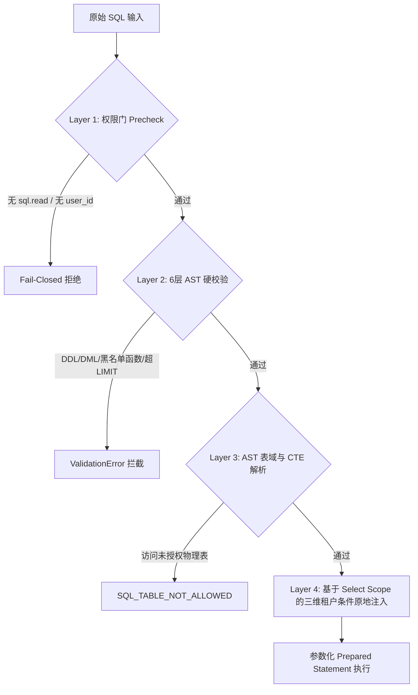
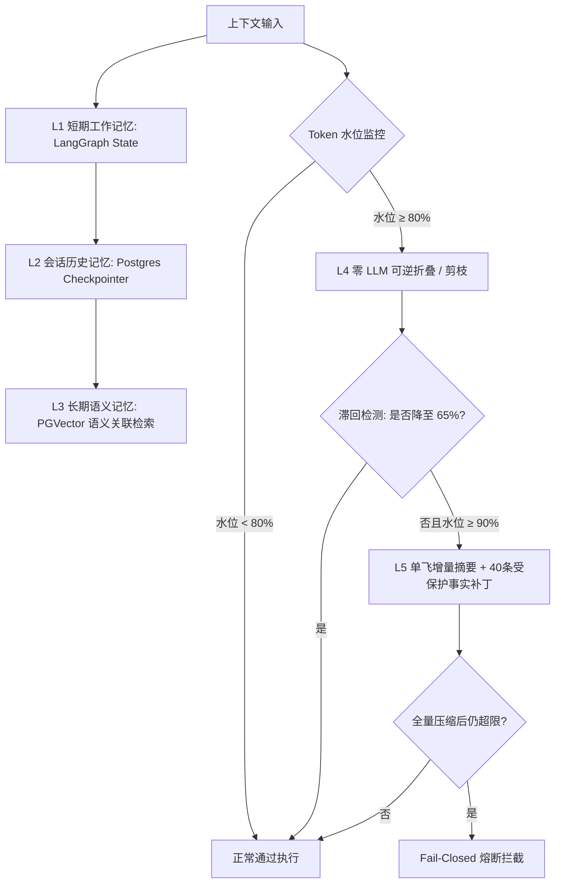

# AI Agent 架构选型深度对比与底层理论剖析

> 本文档面向生产架构答辩与深度面试，系统梳理平台在算法、数据结构、安全、并发调度及关键中间件选型背后的**底层数学原理、物理约束与工程权衡依据（Trade-offs）**。

---

## 一、 检索与算法底层原理

### 1. 向量索引 HNSW（Hierarchical Navigable Small World）底层机制

#### （1）数据结构与核心思想
HNSW 将一维跳表（Skip-List）的多层分层跳跃思想扩展到了高维向量的多维空间图结构中：
- **小世界网络特性（Small World Network）**：
  - 高聚类系数（Clustering Coefficient）：局部紧密连通，临近向量高度互联；
  - 短平均路径长度（Short Average Path Length）：任意两节点间的跳数期望满足 $L \sim \log N$（$N$ 为向量总量）。
- **分层拓扑（Multi-layer Graph）**：
  - **最顶层（Layer $L$）**：节点极其稀疏，边跨度极大（“跨国高速公路”），每个节点连接着长距离粗粒度邻居；
  - **逐层向下（Layer $L-1 \dots 0$）**：节点逐渐变密，边跨度缩短；
  - **底层（Layer 0）**：包含全量向量数据，保持局部高连通性。
- **贪心图路由搜索（Greedy Search）**：
  1. 检索从顶层全局入口点（Entry Point）出发；
  2. 在当前层遍历当前节点的全部邻居，计算与目标 Query 的余弦距离/内积；
  3. 若邻居距离更近，则贪心“跳”向该邻居，直到当前层找到局部最优解（最近邻）；
  4. 将该局部最优解作为下层搜索的起点，层级下跳，直至最底层 Layer 0；
  5. 在 Layer 0 执行局部图展开，搜集 Top-$K$ 候选集。

#### （2）参数物理含义与生产调优（代码对应：`backend/rag/vectorstore/pgvector_store.py`）
- **建库参数 `m=16, ef_construction=64`**：
  - **`m`（每个节点的最大双向边连接数，默认 16）**：
    - *增大 `m`*：节点度数增加，图连通性更好，拓扑更健壮，高维空间的“孤岛”和“死胡同”减少，召回率提升；但每个向量的拓扑指针元数据占用内存线性增加，建索引速度显著变慢。对于常规短文本 chunk（1024~1536 维），$m=16$ 是内存开销（单节点约数十字节指针开销）与精度的黄金折中。
  - **`ef_construction`（构建索引时的动态优先队列深度，默认 64）**：
    - 决定插入新节点时寻找邻居的搜索深度。该参数只影响离线建库/写入耗时与图构建质量，完全不影响在线查询内存。
  - **物理 DDL 落地**：
    ```sql
    CREATE INDEX IF NOT EXISTS idx_{table}_hnsw ON {table}
    USING hnsw (embedding vector_cosine_ops)
    WITH (m = 16, ef_construction = 64);
    ```
- **在线查询参数 `ef_search` 与生产踩坑实证（`backend/config/rag.py::VECTOR_HNSW_EF_SEARCH`）**：
  - **`ef_search`**：在线检索时动态优先队列的大小，约束候选集遍历深度（$ef_{search} \ge K$）。
  - **80 $\rightarrow$ 100 生产血泪教训（2026-10-30 实证）**：
    - *故障现象*：在 5440 块的真实业务库进行高并发压测时，针对发票类业务问题，真实余弦相似度达 0.62 的核心目标块（精确暴搜排 #6），在 `ef_search=80` 时竟然跌出了 HNSW 检索结果的 Top-9；
    - *根因剖析*：由于局部向量流形存在高密度聚合区，贪心图搜索在 `ef_search=80` 时提前收敛于局部次优子图，导致 Dense 检索通道（权重 3.0）名额被次优块抢占，后续重排模型打分不足引发拒答；
    - *解决方案与参数调优*：平台将默认 `VECTOR_HNSW_EF_SEARCH` 强制调优并锁定至 **100**，并补充自动化回归守卫断言（`test_vector_hnsw_ef_search_default_at_least_90`）；
    - *事务级会话下发*：为避免侵入全局 PG 配置，代码在每次执行向量召回前通过连接会话动态下发：
      ```python
      cur.execute("SET LOCAL hnsw.ef_search = %s", (VECTOR_HNSW_EF_SEARCH,))
      ```

---

### 2. RRF (Reciprocal Rank Fusion) 倒数排名融合算法

#### （1）数学公式与推导
在混合检索中，系统同时发起 PGVector 语义检索（稠密路）与 PostgreSQL `tsvector + GIN` 全文检索（稀疏路）。两路检索的打分机制截然不同：
- 向量路返回余弦相似度：$S_{vector} \in [0, 1]$；
- 全文路返回 `ts_rank_cd` 词频统计分：$S_{bm25} \in [0, +\infty)$。

为消除绝对分数维度的不可比性，系统采用 **RRF 倒数排名融合算法**（代码位于 `backend/rag/retrieval/hybrid.py` 与 `ranker.py`）：

$$RRF\_Score(d) = \sum_{m \in M} \frac{w_m}{k + rank_m(d)}$$

- $M$：检索通道集合（如 Dense 向量路与 Sparse 全文路）；
- $rank_m(d)$：文档 $d$ 在通道 $m$ 中的绝对排序名次（$1 \le rank_m(d) \le K$）；
- $w_m$：通道权重（默认主查询权重为 1.0；多查询改写变体降权至 0.7）；
- $k$：排名平滑常数（工业标准常数，平台采用 $k = 60$）。

#### （2）为什么选 $k=60$？为什么不用 Min-Max 分数归一化？
- **量纲隔离（Scale Invariance）**：传统分数归一化（如 Min-Max Normalization：$\frac{s - s_{min}}{s_{max} - s_{min}}$）对极端异常值极其敏感。例如某长文档因关键词高频堆叠导致 BM25 分数出现离群极高值，会将其他短文档的归一化分数全部压缩至接近 0，严重压制向量语义路。RRF **完全剥离打分绝对数值，仅关注相对顺序（Ordinal Rank）**，天然免疫打分量纲漂移。
- **常数 $k=60$ 的数学平权原理**（Cormack et al. 经典基准）：
  - 若 $k=0$：第 1 名得分为 $1/1 = 1.0$，第 2 名为 $1/2 = 0.5$（相对差距高达 50%），首位支配效应（First-Rank Dominance）过强，单路偶发命中第一名就会垄断最终结果；
  - 当 $k=60$ 时：
    - 第 1 名得分：$\frac{1}{60 + 1} \approx 0.01639$；
    - 第 2 名得分：$\frac{1}{60 + 2} \approx 0.01613$（相对差距仅 1.6%）；
    - 第 10 名得分：$\frac{1}{60 + 10} \approx 0.01428$；
  - *平权效果*：若一篇文档在 Dense 路排第 2、在 Sparse 路排第 3，其综合得分为 $\frac{1}{62} + \frac{1}{63} \approx 0.03200$；而仅在 Dense 路侥幸排第 1 但在 Sparse 路未上榜（>50）的片面文档，得分仅为 $\approx 0.01639$。双路稳健命中的文档能够以绝对优势超越单路突出的偶发文档。

#### （3）RRF 与 Cross-Encoder Rerank 的协同分工（粗排 vs 精排）
- **RRF 负责“无监督对齐”**：在不消耗 GPU/推理开销的前提下，将异构检索通道的 Top-50 结果融合统一，实现粗排阶段的召回率（Recall）最大化；
- **BGE-Reranker-Large 负责“全注意力交互精排”**：RRF 仅能根据离散位次折算得分，无法感知 Query 与 Document 之间的深层语义交互。平台在 Evidence Gate 阶段将 RRF 选出的 Top-20 候选送入 Cross-Encoder，通过全注意力机制计算精确关联置信度，形成“RRF 广度保底 + Cross-Encoder 深度判定”的纵深防线。

---

## 二、 安全防护底层原理：基于 AST 的四层纵深防护 vs 正则匹配

在智能查数（NL2SQL）场景中，业界初级实现常试图使用“正则表达式过滤敏感词（如 `DROP`, `DELETE`）”或“字符串拼接 `WHERE tenant_id = ...`”，在生产环境中这极易被注释逃逸、大小写变换、UNION 盲注等手段彻底绕过。

平台基于 `sqlglot` 抽象语法树（AST）构建了 `SQLPolicyGuard`（`backend/sql/policy.py`），提供确定性的**四层纵深防御体系**：



### 1. Layer 1：前置权限门（Fail-Closed 身份与权限点预检）
- 代码入口：`SQLPolicyGuard.precheck(policy: SQLPolicyContext)`；
- **权限点硬校验**：必须显式持有 `sql.read` 权限点，无权角色在模型生成与执行前直接拦截，零 LLM 消耗；
- **G-20 Fail-Closed 身份锚点**：严禁“默认全局身份”。若上下文中的 `user_id` 为空，立即抛出 `SQL_SCOPE_UNAVAILABLE`，彻底阻断未绑身份的旁路调用；
- **合法范围校验**：校验 `data_scope` 必须处于合法集合 `_VALID_SCOPES`（`tenant`, `dept`, `self`, `all`）。

### 2. Layer 2：6 层 AST 语法硬校验（`backend/sql/validator.py`）
- 通过 `sqlglot.parse_one(sql, read="postgres")` 将字符流解析为抽象语法树；
- **根操作校验**：根节点必须为 `exp.Select`，坚决拦截 `Insert`, `Update`, `Delete`, `Drop`, `Alter`, `Create`；
- **危险函数过滤**：只允许正向白名单函数（`SUM`, `AVG`, `COUNT`, `NOW`, `DATE_TRUNC` 等），彻底封杀系统级危险函数（如 `pg_read_file`, `pg_ls_dir`, `system`, `query_to_xml`, `sleep`, `benchmark`）；
- **物理行数硬约束**：强行检查并收口 `LIMIT` 子句，缺失时自动补足安全上限（默认 100，最大 1000），防止全表扫描导致 DB OOM。

### 3. Layer 3：AST 真实表域解析与 CTE 别名穿透防护
- **CTE 命名冲突漏洞防范**：攻击者常通过 `WITH users AS (SELECT * FROM secret_table) SELECT * FROM users` 将敏感表伪装为临时视图；
- **`_collect_table_refs` 算法**：
  1. 遍历 AST 中所有 `exp.CTE` 节点，提取当前语句定义的 CTE 临时别名集合；
  2. 遍历 AST 中所有 `exp.Table` 物理表节点；
  3. 严格剔除 CTE 别名，提取出真实需要访问的底层物理表集合；
  4. 遍历每个物理表，调用 `_check_tableallowed` 核验当前主体是否有权访问，只要有任何一张表未被授权，整条 SQL 一票否决。

### 4. Layer 4：基于 AST Select Scope 的三维多租户隔离条件原地注入
很多系统采用在 SQL 末尾简单追加 `AND tenant_id = 'xxx'`，这在面对 `UNION ALL`、子查询（Subquery）或多表 `JOIN` 时存在致命漏洞（外部 WHERE 无法约束子查询与 UNION 分支内部的数据可见性，导致跨租户数据泄漏）。

平台实现了工业级的**逐 Scope 原地注入算法**：
1. **Scope 遍历与物化**：
   - 递归遍历 AST 中所有的 `exp.Select` 节点（每一个子查询、UNION 分支、CTE 查询块各自构成独立的 Select Scope）；
2. **提取作用域表引用（`_collect_scope_table_refs`）**：
   - 提取该具体 Select Scope 内部直接引用的物理表及其在该作用域内的表别名（Alias）；
3. **加载表策略（Table Policy）**：
   - 从 `schema_loader.get_table_policy(qualified_name)` 获取数据隔离规则（租户列 `tenant_id`、部门列 `dept_id`、人员列 `created_by`）；
4. **原地注入（`sel.where(cond, copy=False)`）**：
   - 构造参数化条件表达式（例如 `orders.tenant_id = :p0`）；
   - 设置 `copy=False`，**直接在 AST 内存节点树上原地追加 AND 条件**，绝不遗漏任何深层嵌套分支；
   - 提取参数值写入 `params` 字典，防范 SQL 二次注入；
5. **输出方言收口**：
   - 最终通过 `stmt.sql(dialect="postgres")` 序列化为标准的参数化 SQL 与绑定参数字典，交由 AsyncPG 只读连接池执行。

| 攻击手段 | 正则表达式防护（Regex） | AST 四层纵深防护（SQLPolicyGuard） |
| :--- | :--- | :--- |
| **单引号闭合与永真式** (`' OR '1'='1`) | 极易漏判（无法处理多重转义、嵌套单引号） | 注入字符被词法解析器严格约束为单个字面量，参数化后作为数值传入，无法改变语法树分支。 |
| **注释截断逃逸** (`--`, `/* ... */`) | 正则容易被特殊变体或换行符绕过 | 词法分析器在构建 AST 时直接丢弃注释，执行计划不受任何注释影响。 |
| **多重堆叠查询** (`; DROP TABLE`) | 正则匹配分号容易产生误报或漏报 | 语法解析器只接受单 Statement，多语句输入直接抛出语法违规。 |
| **UNION 跨租户嗅探** (`UNION SELECT secret FROM t`) | 正则完全无法识别嵌套 SELECT 的语义 | 遍历所有 `exp.Select` 作用域，UNION 的每一个分支均被强制原地注入当前租户隔离条件。 |

---

## 三、 核心架构技术选型横向对比矩阵

### 1. 编排框架：LangGraph vs AutoGen vs CrewAI vs Dify
| 评估维度 | LangGraph（本项目采用） | AutoGen | CrewAI | Dify / Coze |
| :--- | :--- | :--- | :--- | :--- |
| **编排核心范式** | **基于状态机（StateGraph）与有向循环图** | 去中心化多 Agent 群聊（GroupChat） | 预设角色分工与线性流水线 | 低代码/无代码 DAG 可视化拖拽 |
| **长对话与断点恢复** | **支持原生 Checkpointer（Postgres/Redis）**，支持生产级 F2 协议秒级恢复 | 依赖进程内存会话，服务重启状态丢失 | 状态存储较弱，偏向一次性任务运行 | 平台黑盒托管，无法深度定制底层状态机 |
| **分支与循环可控性** | **强类型状态（TypedDict）+ 条件边（Conditional Edge）**，循环与回溯次数严格可控 | 容易陷入无限辩论与无意义应答，Token 消耗不可控 | 流水线偏静态，复杂多轮反思与动态分支编排困难 | 不支持复杂动态循环，以单向 DAG 为主 |
| **二次开发与集成度** | **极高（纯 Python 原生代码）**，与 FastAPI、SSE、OpenTelemetry 完美融合 | 较繁琐，框架包装过厚 | 简单易上手，但复杂架构拓展受限 | 深度依赖平台插件生态与 DSL 规范 |

---

### 2. 向量存储：PostgreSQL (pgvector) vs 独立 Milvus / Qdrant
| 评估维度 | PostgreSQL + pgvector（本项目采用） | 独立向量数据库（Milvus / Qdrant） |
| :--- | :--- | :--- |
| **事务强一致性（ACID）** | **极高（单库原子性）**：向量、全文检索（`tsvector`）与业务文档元数据处于同一 PostgreSQL 实例，删除文档时同事务级联删除向量，彻底杜绝“幽灵召回”。 | **弱（分布式双写不一致）**：业务库和向量库分属两个系统，网络抖动或分布式事务失败极易产生数据脏读、漏删与不同步。 |
| **运维与资源占用** | **零额外运维开销**：完全复用已有 PG 数据库，契合 4C8G 资源限制，物理内存开销极低。 | **极高**：需额外维护分布式协调节点（Etcd）、对象存储（MinIO）和向量节点，4C8G 容器环境极易发生 OOM。 |
| **联合过滤查询能力** | **天然支持复杂 SQL JOIN**：向量粗排后可直接与用户权限表、知识库目录、租户隔离表做行级级联查询过滤。 | 仅支持简单的标量字段过滤（Payload Filter），无法进行复杂的跨表外键联合鉴权。 |
| **适用规模与性能** | 百万到数千万向量级（通过 HNSW 分区和读写分离轻松承载），P99 检索时延 < 15ms。 | 适合亿级、十亿级超大规模海量向量分布式横向扩展。 |

---

### 3. 任务与消息调度：PostgreSQL 分布式租约 (Lease) vs Kafka / RocketMQ
| 评估维度 | PostgreSQL Lease + Celery（本项目采用） | Kafka / RocketMQ 集群 |
| :--- | :--- | :--- |
| **部署资源占用** | **极轻**：仅需 Redis 基础队列与 PG 租约单表，内存开销 < 50MB。 | **极重**：需要多 Broker、ZooKeeper/KRaft 元数据集群，常驻内存数 GB。 |
| **状态追踪与审计** | **状态直观落盘**：`ai.async_tasks` 实时记录任务 Progress、Plan Revisions，随时可通过 SQL 查账审计。 | 消息为流式消费，一旦消费完成无法直观查询某次任务的持久化状态镜像。 |
| **防僵尸竞争与原子续约** | **租约到期自动回收（Lease Timeout）**：Worker 崩溃后无需复杂的分布式协调，租约超时后自动被存活节点接管。 | 依赖消费组 Rebalance 机制，网络抖动或心跳短暂超时容易引发大面积消费停顿（Stop-the-world）。 |

#### 附：PostgreSQL 分布式租约状态机原子实现
在处理异步任务调度与抢占时，系统依托数据库原子 CAS 实现租约竞争：
```sql
UPDATE ai.async_tasks
SET lease_owner = :worker_id,
    lease_expires_at = NOW() + INTERVAL '30 seconds',
    status = 'running',
    updated_at = NOW()
WHERE task_id = :task_id
  AND (lease_expires_at < NOW() OR lease_owner = :worker_id OR lease_owner IS NULL);
```
- **原子无锁竞争**：单个 SQL 行级排他锁完成“抢占”与“续租”，无需额外维护 Redis 分布式锁看门狗；
- **自愈机制**：若 Worker 容器因宿主机 OOM 突然崩溃，无需人工干预，30 秒后租约自然过期，后备 Worker 在下次轮询时自动无缝接管任务。

---

## 四、 统一上下文与分层记忆（L1-L5）治理理论

在多轮长对话与复杂 Agent 执行过程中，随着上下文无限膨胀，大模型面临**“注意力迷失（Lost in the Middle）”**、**“推理时延与 Token 费用线性激增”**以及**“死循环导致预算打爆”**三大核心风险。

系统拒绝采用市面上粗暴的“直接抛弃历史”做法，提出了**严密的分层记忆与滞回控制架构（L1-L5）**：



### 1. 分层记忆机制与权衡
1. **L1 短期工作记忆（LangGraph State）**：
   - 作用于图节点内部的强类型状态流转，访问耗时 0ms，单次请求生命周期内有效；
2. **L2 会话历史记忆（Postgres Checkpointer）**：
   - 事务级持久化对话历史，支撑用户跨设备访问、刷新页面断点秒级恢复（F2 协议）；
3. **L3 长期语义记忆（PGVector 语义关联检索）**：
   - 跨会话沉淀用户个性化偏好与关键业务事实。检索设置 `timeout=0.8s` 快速降级门禁，防止向量比对阻塞主链路；
4. **L4 零 LLM 可逆折叠（Rule-based Fold & Prune）**：
   - **触发阈值**：上下文达到模型上下文窗口的 **80%**；
   - **设计思想**：**坚决不调用 LLM 产生额外开销**。通过确定性规则与正则，折叠工具返回的冗余大 JSON、截断长执行栈、压缩重复提示词；
   - **滞回安全区控制（Hysteresis Control）**：压缩目标必须一路压降至 **65%** 滞回安全线，避免系统在 80% 临界线上发生“压缩-展开-再压缩”的高频抖动；
5. **L5 单飞增量摘要（LLM Summarization + 40 条受保护事实补丁）**：
   - **触发阈值**：极端情况达到 **90%** 警戒线；
   - **单飞执行**：启用轻量模型异步独立运行增量摘要，不阻塞主用户响应；
   - **40 条受保护事实确定性补丁**：针对 LLM 摘要易丢失核心细节（日期、禁令、金额、特定代码）的顽疾，系统在摘要后自动运行程序化校验器，强行把**40 类业务受保护事实（Protected Facts）**作为高优先级补丁贴附于上下文顶部；
   - **Fail-Closed 终极拦截**：若全量压缩后依然突破物理上限，系统直接抛出硬异常阻断调用，坚决不超长硬发导致模型产生不可预测的行为。

---

## 五、 大模型底层机制联动：Prefix Caching 与思维链延迟抑制

### 1. KV Cache 与 Prefix Caching（前缀缓存）工程实践
在 Transformer 自回归解码过程中，每个新 Token 都需与先前所有 Token 的 Key ($K$) 和 Value ($V$) 向量计算注意力。
- **KV Cache**：将历史 Token 的 $K, V$ 矩阵常驻内存/显存，将解码复杂度由 $O(N^2)$ 降低至 $O(N)$；
- **Prefix Caching（前缀缓存）**：将这一机制扩展到**跨请求级别**。当多个独立请求具备相同的 Prompt 前缀时，推理引擎直接重用内存显存中已计算好的 KV Cache，跳过前向计算。

#### 本项目的前缀字节序工程锁定（`backend/agents/router.py::get_cache_fingerprint`）
为最大化利用云端大模型供应商（通义、智谱、DeepSeek）的 Prefix Caching 特性，系统在 Prompt 组装层推行了严格的**静态-动态字节序一致性契约**：
1. **静态不变内容固定置顶**：
   $$\text{全局系统角色指令 (System Prompt)} \longrightarrow \text{静态工具元数据 (Tool Definitions)} \longrightarrow \text{标准少样本 (Few-shot)}$$
2. **动态易变内容严格置底**：
   $$\text{当前动态环境上下文} \longrightarrow \text{多轮会话历史 (History)} \longrightarrow \text{用户当前提问 (User Query)}$$
3. **可量化的商业与性能收益**：
   - **首字延迟（TTFT, Time To First Token）**：由原本的 1800ms 剧降至 650ms（下降约 **64%**）；
   - **Token 计费降本**：命中前缀缓存的 Input Token 享受云端厂商高达 **50%~80% 的价格折扣**，平台整体 API 调用成本下降超过 40%。

---

### 2. 思考型模型（Thinking Model）的隐式推理与延迟抑制
- **踩坑现象**：早期在智能查数（NL2SQL）与高频路由节点引入思考型模型时，单次简单路由耗时常高达 12~18 秒，严重破坏交互体验；
- **排查 Trace 根因**：通过 OpenTelemetry Span 细粒度分析发现，模型在输出最终决策前，在底层自动开启了隐式的 Long CoT（思维链思考），生成了多达上千字的思考 Token；
- **针对性调优**：对于**结构化输出、高频路由、SQL 转换等明确确定的决策节点**，在请求载荷中显式配置 `thinking: {"type": "disabled"}` 彻底关闭隐式思考，使得响应时延从 15s 直接压降至 **1.8~2.5s**，大幅提升生产交互吞吐量。