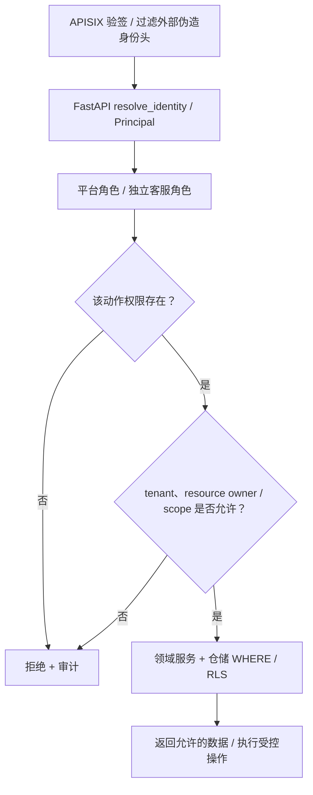

# RBAC、资源级授权与租户隔离开发规范

> **横向安全契约，不等于当前全部端点已经验收。** 本文统一“认证 AuthN、平台角色 RBAC、权限码、资源对象 AuthZ、租户 Data Scope”的边界。具体角色与权限映射以 `backend/security/authorization.py`、`backend/app/api/routes/rbac.py`、可信身份上下文及实际 SQL/repository 为准；不要用前端隐藏按钮或只配置 APISIX 规则冒充后端授权。

## 1. 五种校验不同，不可互相替代

| 检查 | 回答的问题 | 执行层 |
| --- | --- | --- |
| Authentication | 当前是谁？JWT/会话是否有效、是否撤销？ | APISIX + FastAPI 身份链 |
| RBAC | 当前人的平台/客服角色是什么？有权调用哪些管理操作？ | `backend/security/authorization.py`、各管理路由 |
| Permission | 是否有 `rag.read / sql.read / admin.users.write` 等动作权限？ | `AuthorizationContext.has_permission()` |
| Resource-level AuthZ（防 IDOR） | 同租户 Alice 是否有权访问 Bob 的会话/Trace/行程/文档？ | 领域服务 + repository 中的资源所有者/共享策略 |
| Tenant & Data Scope | 访问是否局限于可信 tenant，部门/本人数据行过滤是否真实生效？ | 后端查询条件或 DB RLS，与请求身份绑定 |

当前 `backend/app/api/routes/rbac.py` 有平台 `viewer / editor / admin / super_admin` 以及独立客服 `agent / supervisor` 角色，**不能把客服 supervisor 自动等同平台 admin**。平台权限码映射在 `backend/security/authorization.py` 中；其中 `data_scope` 注释为“未来 SQL 行级范围表达位”，不能据此认定所有业务 SQL 当前已经实现统一 RLS。正式放行须核对每一个实际 SELECT/UPDATE 的作用域。

## 2. 请求授权路径

对同一资源 ID，**先把授权范围写入查询条件**，并处理查不到/越权的等价拒绝；只在前端检查 `user_id` 或 DB 查询后丢弃越权数据都不能替代安全查询。任何写入除角色外还需确认、幂等、状态机与版本 CAS（如适用）。平台管理员跨租户能力必须有明确特权身份、审计，不默认所有 admin 都能跨租户。

## 3. 必须遵守的边界

1. **可信身份**：拒绝来自客户端的 `user_id/tenant_id/role` 覆盖；API Key 是服务凭据不自动映射成用户；后端直连与网关请求必须都受必要守卫。
2. **最小权限**：默认无权限；注册新用户、批量操作、管理员变更、客服席位都按明确规则；权限变更影响活跃会话时按 session revoke/刷新策略失效，不让旧令牌无限保权。
3. **后端权威**：`backend/security/principal.py`、`authorization.py` 的角色/权限上下文由服务端构建；新业务先定义资源 scope，再使用现有依赖或服务校验。不能每个 Agent 各写一张角色表。
4. **数据**：KB/文档、SQL、客服工单与会话、旅游 Trip/Revision、选品/订单、Memory、Trace、预算和管理 API 的**列表、详情、统计、搜索、导出、WS** 都按用户/租户隔离；不能只保护写接口。
5. **操作**：管理员改角色、禁用用户、密钥/模型/Prompt/预算变更属于治理写入，授权 + 审计 + 幂等/并发保护；不能通过另一条低权限 API、MCP 或 Workflow 绕过。
6. **异常**：身份缺失、租户上下文缺失、DB/策略不可验证时拒绝；资源不存在或无权查看可统一返回 404，避免泄露目标 ID 是否存在；具体错误契约以既有 API 为准。
7. **日志**：记录 actor/tenant/resource type/operation/deny reason/trace_id 的必要非敏感标识；不泄露 token、密钥、用户原文、受保护文档正文。

部门主数据由 `auth.departments` 按租户维护。创建、改名和停用仅允许平台管理员
通过 RBAC 管理路由执行，租户取自已验证身份；更新使用版本号 CAS，并与
`auth.department_audits` 在同一事务记录操作者和前后状态。部门编码创建后不可变，
停用使用软删除并拒绝仍有用户归属的部门；硬删除会破坏历史部门引用。启用部门可
用于用户归属。RAG 知识库目录存于 `auth.knowledge_bases`，沿用平台级共享目录；
`owner_depts` 是可多选的部门编码集合，`all` 单独表示全部部门。上传界面按当前
租户的启用部门与知识库关联求交集，服务端上传时再次检查部门状态和知识库范围。
知识库目录更新使用版本号 CAS，并与 `auth.knowledge_base_audits` 在同一事务留痕；
停用为软删除，既有文档保留但不再允许通过该知识库上传或检索。目录是平台级共享
资源，创建、编辑、停用和恢复均仅限 `super_admin`，避免租户管理员的改动传播到
其他租户；受众范围影响对客数据边界，也仅由 `super_admin` 管理。

104 号迁移为部门增加 `department_type` 和 `manager_user_id`。每租户最多一个
启用的 `customer_service` 类型部门，客服团队接口只读取该部门成员；客服角色、
容量和接单状态只能通过 `/sys/rbac/customer-service/team` 管理。平台用户列表及
详情不返回客服档案。用户离开客服部门或账号被停用时，客服档案在同一事务中停用，
并关闭接单状态。104 号迁移会停用无法关联到当前启用客服部门用户的历史客服档案；
确认人员归属后，管理员可在客服团队页为客服部门中的在职账号重新配置客服档案。

部门主管不是平台角色，也不继承客服 `supervisor` 权限。主管关联只能指向本租户、
本部门的启用用户。主管的用户列表 SQL 同时按租户、已授权部门和当前主管关联过滤；
主管只能修改本部门成员姓名、邮箱和账号状态，不能改平台角色、部门、客服档案、
密码或全局会话。停用或调离主管前须先清除/更换部门主管配置。页面显隐只是提示，
所有授权判断由 `/sys/rbac/context`、用户查询与写事务重新验证。

## 4. 新业务必须填写的资源权限矩阵

| 资源类型 | 读/列举/搜索 | 修改/删除/执行 | 必须校验的数据范围 |
| --- | --- | --- | --- |
| 管理端用户/角色 | `admin.users.read` 等真实权限点 | 角色提升必须授权及审计 | tenant + 操作者不能越权提升 |
| RAG 知识库/上传文件 | `rag.read` + KB/部门范围 | `rag.upload/review/admin` 与资源归属 | tenant + kb_id + department/owner |
| SQL 数据分析 | `sql.read` + 白名单 | 只读安全角色 | tenant + department/self 行级范围（需实测） |
| 客服会话/工单 | 坐席角色 + 可见资源 | 确认/接管/退款审批与状态机 | tenant + conversation/customer ownership |
| 旅游行程/版本 | owner 或明确分享权限 | revision CAS / 分享快照权限 | tenant + trip owner + share revision |
| Tool/MCP/模型/Prompt/预算 | 可信 user / service actor | 风险审批、确认、幂等、审计 | tenant + role + scope + resource |

矩阵给出检查**类别**，不宣称上述所有领域的权限码均已注册。新增权限码必须同步审查 `ROLE_PERMISSION_CODES`、角色管理 UI、API 依赖、跨租户测试和服务身份策略。

## 5. 验收（AU-01～AU-12）

| 编号 | 最低证明 |
| --- | --- |
| AU-01 | 未登录、过期/伪造 JWT、API-Key-only 不可调用用户私有 API |
| AU-02 | viewer/editor/admin/super_admin 与客服角色权限矩阵明确且通过 |
| AU-03 | 同租户 Alice 读写 Bob 私人资源被拒，列表/详情/统计/搜索/导出均不可漏 |
| AU-04 | tenant A 无法通过 header、query、body 或 WS 读取 tenant B |
| AU-05 | SQL/检索的范围落实在 repository 查询和行级结果，不止 Python 角色判断 |
| AU-06 | role 与 department、owner、shared scope 改变后立即或按受控版本规则生效 |
| AU-07 | 管理角色提升、撤销、并发更新、幂等重复与审计严格符合策略 |
| AU-08 | 权限 DB/Redis 不可用时 fail-closed，不回退全库可读 |
| AU-09 | 网关调用、后端直连、MCP、定时任务的服务身份各走合法守卫 |
| AU-10 | 资源不存在和拒绝访问不泄露他人对象及敏感属性 |
| AU-11 | 非授权角色不可查看他人 Trace、成本、Prompt、管理 API |
| AU-12 | 前端按钮展示与后端权限状态一致，但安全判断不依赖前端 |

关联 [身份头协议](../contracts/identity-header-protocol.md)、[认证导航](README.md)、[数据库](../DATABASE.md)、[Tool 失败/拒绝](../architecture/failure-degradation.md)。特别关注安全测试中的真实 tenant/owner SQL 结果断言与 WS 消息订阅；仅模拟 403 不等于证明无数据泄漏。
