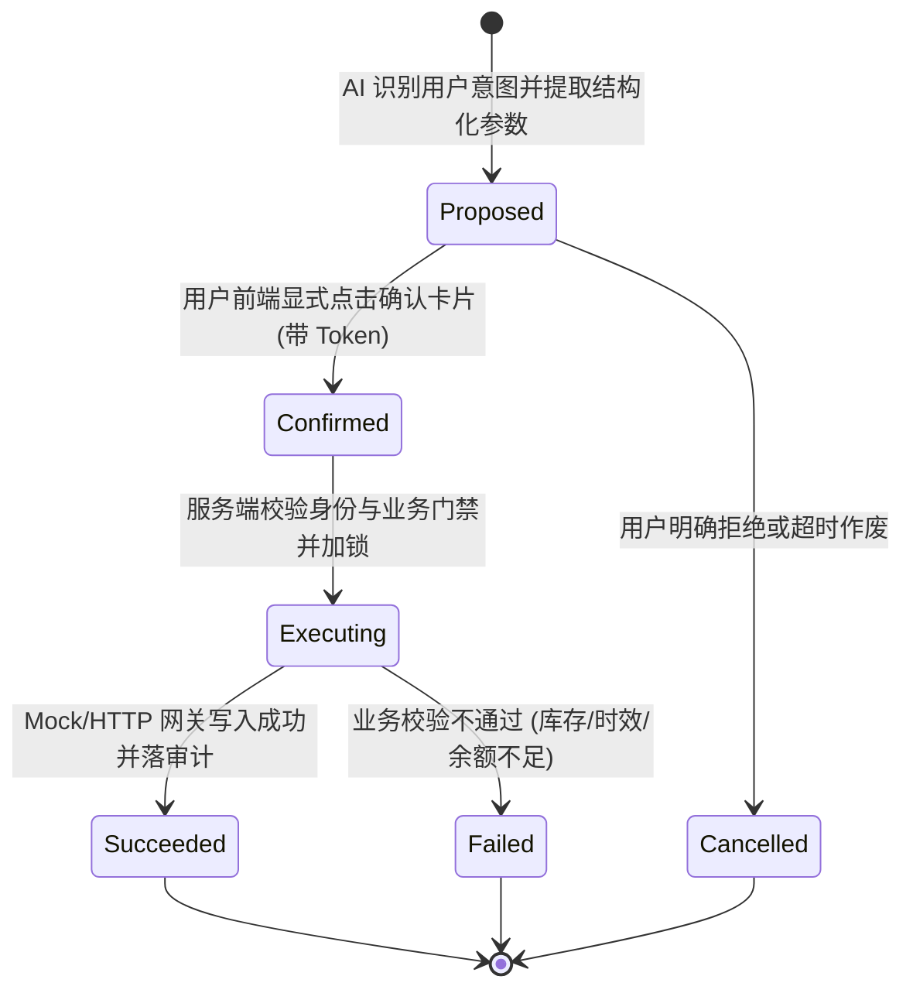

# 智能客服业务域与双端工作台架构指南

本文档全面梳理平台智能客服（Customer Service）的端到端架构设计，涵盖用户端 AI 对话工作台、坐席端管理控制台、11 类业务动作（Action）状态机与沙盒模拟、WebSocket 实时通信协议，以及离线 `forbidden_facts` 确定性裁判安全机制。

---

## 一、 系统架构与双端交互拓扑

智能客服包含两套完全独立但数据互通的工作台界面与后端运行环境：

```
┌────────────────────────────────────────────────────────────────────────┐
│                        用户端 (User Experience)                        │
│ • 访问路由: /customer-service (组件在 frontend/src/cs2/)               │
│ • 核心能力: AI 会话流 (SSE 全事件)、候选点选、确认卡片、转人工 4 态横幅 │
│ • 资金交互: 商城三页 (/mall, /my-orders)、退款折叠卡、演示钱包账本     │
└───────────────────────────────────┬────────────────────────────────────┘
                                    │ HTTP / SSE / REST
                                    ▼
┌────────────────────────────────────────────────────────────────────────┐
│                   客服领域子图 (backend/customer_service/)             │
│ • 图注册: register.py (通过 cs_graph_node.py 接入主图)                 │
│ • 图编排: graph_builder.py (State -> 待确认处理 -> Supervisor -> 专家) │
│ • 业务子模块: context / actions / dispatch / tickets / qa / rules     │
└───────────────────────────────────┬────────────────────────────────────┘
                                    │ WebSocket / REST API
                                    ▼
┌────────────────────────────────────────────────────────────────────────┐
│                        坐席工作台 (Agent Workstation)                  │
│ • 访问路由: frontend-cs (:3300) 的 /cs/* 七大专业视图                  │
│ • 实时层: WS useAgentSocket (Ticket 鉴权、Seq 游标补发、降级轮询)      │
│ • 七大视图: workspace (三栏工作台)、conversations (会话回放)、tickets  │
│   (工单)、refunds (退款审核)、qa (质检)、dashboard (看板)、knowledge  │
└────────────────────────────────────────────────────────────────────────┘
```

---

## 二、 11 大业务动作（Action）状态机与沙盒机制

为保障电商核心业务安全，客服域将所有业务交互严格建模为具备**提案（Proposal） $\rightarrow$ 确认（Confirmation） $\rightarrow$ 授权执行（Execution） $\rightarrow$ 幂等持久化（Idempotency）**的有限状态机：



### 11 类专业业务动作全景矩阵

| 动作编号 | 业务动作分类 | 核心业务校验与安全门禁 | 状态流转与持久化表 | 沙盒与开关控制 |
| :--- | :--- | :--- | :--- | :--- |
| **B1** | **售后与基础咨询** | 依 RAG 知识库检索官方政策，严格防幻觉 | 状态无需额外持久化，直接输出 Markdown | 知识库检索只读 |
| **B2** | **会员积分与等级** | 查询当前用户的积分余额、过期日与等级权益 | 读取 `cs_points` 账本 | 演示沙盒只读映射 |
| **B3** | **优惠券核销校验** | 校验券状态（未用/已用/过期）、门槛金额与品类互斥 | 查询 `cs_coupon`，强校验订单金额限制 | 只读查询 |
| **B4** | **支付流水与退款** | 检查订单支付状态，强制唯一性防重退（迁移 098） | `cs_payment` 流水表 + `098_cs_refund_order_unique.sql`（`order_id` 唯一锁） | `CS_REFUND_REQUEST_MODE=disabled`<br>`CS_AUTO_DUPLICATE_REFUND_MODE=mock` |
| **B5** | **在途催办登记** | 校验物流状态，限制同一订单 24 小时内催办频次 | 写入 `cs_urge_requests` 催办记录表 | `135_cs_urge_request_action_type.sql` |
| **B6** | **价保退差价入账** | 校验价保期、自营商品标价差额；必须双端开启 mock | 写入演示钱包 `mall_wallet`，写 `agent_actions` 审计 | `CS_PRICE_MATCH_MODE=mock`<br>`CS_PRICE_MATCH_WINDOW_DAYS>0` |
| **B7** | **在途收货改址** | 校验快递是否已出库/签收；已揽收由快递拦截接口校验 | 写入 `cs_address_changes`，记录新旧地址哈希 | `137_cs_address_change_action_type.sql` |
| **B8** | **发票抬头与申请** | 校验企业税号格式、订单履约状态（完成订单才可开票） | 写入 `cs_invoices` 记录表，支持电票/专票分类 | `138_cs_invoice_business.sql` |
| **B9** | **客户纠纷投诉** | 严重不满情绪捕获，要求填写诉求明细与联系电话 | 写入 `cs_cases` 纠纷工单，打标严重等级 | 触发转人工升级 |
| **B10** | **工单流转与转派** | 跨部门协助或复杂疑难问题转交后台专员 | 写入 `cs_tickets`，记录派单轨迹与处理 SLA | 遵循工单状态机 |
| **B11** | **人工接管 (Handoff)**| AI 无法解决或触发敏感词，将控制权移交坐席 | 更新会话 `status="waiting_human"`，触发派单 Offer | 详见坐席状态机 |

---

## 三、 坐席工作台实时通信层（WebSocket）与派单状态机

坐席端通过 WebSocket 长连接（`useAgentSocket`）实现秒级工单流转与实时消息同步：

### 1. 连接鉴权与断线游标补偿
- **Ticket 握手鉴权**：连接建立时不直接信任 Cookie，坐席首先通过 REST 接口获取短期一次性票据 `cs_ticket`，在 WS 握手路径 `/ws/cs/{agent_id}?ticket=...` 消费并销毁票据；
- **序列号游标重放（Seq Cursor）**：每个会话消息均包含严格单调递增的 `seq` 序号。当网络抖动导致重连时，客户端发送 `ack_seq`，服务端自动拉取并补发未确认的消息帧，杜绝丢消息；若重连持续失败，自动平滑降级为轮询模式。

### 2. 坐席 4 态生命周期与接单开关
坐席状态维护于 `customer_service.cs_agents`：
- **`online`（空闲在线）**：开启接单开关（`accepting=true`），具备分配候选资格；
- **`busy`（忙碌）**：当前活跃接待会话达到系统上限配额，暂停新分配；
- **`away`（小休/离开）**：主动挂起，暂停分配；
- **`offline`（离线）**：断开连接，所有会话回退或平滑转接。

### 3. 派单 Offer 状态机与 SLA 超时升级
```
[用户触发转人工] ──► 进入 waiting_human 全局队列
                            │
                            ▼
                    匹配最优空闲坐席
                            │
                            ▼
                   下发派单 Offer (倒计时 15s)
                    ┌───────┴───────┐
                    ▼               ▼
           [坐席点击认领]     [坐席拒绝 / 15s 超时]
                    │               │
                    ▼               ▼
           进入 active_chat   Offer 回退并记录超时惩罚，
                              重新分配至下一顺位坐席；
                              超时累计触发 SLA Warning/Breach
```

---

## 四、 离线确定性裁判与 Golden 事实安全校验（PR #569）

客服回答直接面对真实消费者，存在“虚构赔偿金额”、“误报发货/到账时效”的严重法律合规风险。平台在 PR #569 中落地了**基于 `forbidden_facts` 的离线确定性语义裁判与 Golden 评测门禁**：

1. **核心痛点与解决思路**：
   - 依赖 LLM 进行质检打分容易受到“语气温柔但事实胡说”的假象欺骗；
   - 平台构建了包含**绝对红线禁令规则库（Forbidden Rules）**与人工精标 Golden 数据集（`backend/sql/migrations/153_eval_case_golden.sql`）。
2. **确定性语义裁判机制**：
   - 自动扫描客服回答文本，强行匹配禁令特征：
     - *金额超限禁令*：如未授权擅自承诺“赔付 500 元现金”；
     - *时效虚构禁令*：如官方政策规定 7 个工作日退款，客服回答承诺“2小时极速到账”；
     - *政策篡改禁令*：对不支持 7 天无理由退货的特殊商品（如生鲜、虚拟权益）承诺退货。
   - 命中任何禁令规则，离线裁判引擎直接判定 `verdict="FAIL"` 并标记 `forbidden_facts_violation`，执行**一票否决**，结果直落质检报告表 `cs_qa_reports`。
