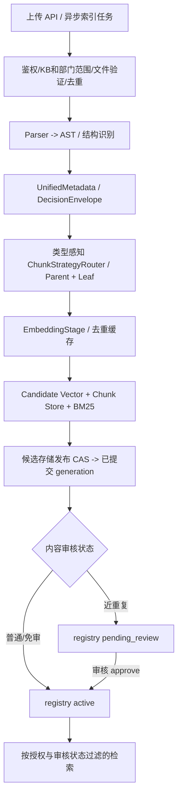

# RAG 域

## 入口与当前链路

- 检索问答链位于 backend/rag/chain.py，Pipeline 与索引能力位于 backend/rag/。
- 独立服务入口为 backend/services/rag_server.py；客户端、远程模式和服务挂载分别核对 backend/rag/client.py 与 API 路由。
- 当前存储、解析器和检索策略以实现及配置为准，不在本文手工维护模型、集合或 Provider 数量。

## 约束与错误边界

MultiQuery 改写使用 `multi_query` 角色、temperature=0、3 条查询和至少 1024
输出 tokens；默认子预算 6000ms，取角色策略与共享 8000ms 检索 deadline
剩余量的最小值。生产与评测使用同一口径，评测直接调用 retriever 时也绑定
该 deadline。达到输出上限回退原问题，查询不足标记 `rewrite_truncated`，
不计为完整改写成功。Trace 记录终止原因、用量、有效上限、耗时、查询数与
Prompt 模板 Hash/版本/来源；多查询重排诊断只复制候选 ID、文件名和分数，
不复制候选完整正文或私有 runtime 元数据。缺失或非法分数使评分状态降级。

云端三查询全候选评分使用独立线程池，进程内最多3路并发，共享原检索
deadline；按原问题优先消费结果，max聚合和阈值保持不变。原问题评分失败
仍降级透传，不能用变体评分冒充基线成功。每次Provider尝试独立预占和
结算；排队或预占后时间不足则不外呼，已发出的迟到调用仅结算usage，
不得修改已返回的文档。此并发策略不用于本地模型及无deadline的旁路调用。

普通混合召回等待沿用同一个共享 deadline；保留已完成路径，取消尚未启动
任务，全部超时且无证据时明确失败，不再启动降级召回。完整链路评测中
重排错误会阻断 case 通过，保留原质量指标并记录 `execution_complete=false`；
启用多查询的完整评测中，改写超时或错误退回原问题也记录未完成并阻断通过；
正常拒答、未触发改写的简单查询和显式消融实验按原契约处理。

向量过滤的 metadata 字段名仅接受 ASCII 字母/数字/下划线；`$contains`
按字面子串匹配，转义 SQL LIKE 通配符。多轮 contextualize 的 system/human
均来自当前治理模板，保留 history 占位符，无效模板回退内置默认。

解析分块缓存使用 v3 JSON，旧 pickle 不加载，失效后按正常流水线重新构建。
BM25 pickle 只可来自受信任服务目录：SHA256 缺失或不匹配均拒绝加载并走
既有重建/旧快照降级；SHA256 是损坏检测，不是来源认证。

远端 `/ask` 记录服务接收至 handler 等待、pipeline 获取、服务总耗时；客户端
按既有子 Trace 关联记录 HTTP 往返与服务外差值。该差值不能单独归因于网络、
连接池或上游排队；先按实际 Trace 定位，不预设历史 4 秒缺口的根因。

检索结果作为生成依据；遵循当前 Evidence Gate、引用和拒答契约。索引不可用、证据不足、模型拒答与基础设施错误要按既有结果类型处理，不能将无证据回答伪装为有效检索结果。

Evidence Gate 的行为实现位于 `backend/rag/evidence_gate/`，RAG 链路由 `backend/rag/chain.py` 调用；修改拒答、引用或降级行为时，检查 `backend/tests/rag/` 中对应契约测试。

## 上传元数据与级联决策

上传元数据统一使用 `UnifiedMetadata` 和 `DecisionEnvelope`（`backend/rag/preprocessing/metadata_schema.py`）。索引入库的 `doc_type` 与 `business_domain` 以规则分类器为唯一权威；可选 LLM 只做摘要、原文可核实的专名/实体、风险信号和时间增强，不得改写分类。`ENABLE_LLM_METADATA_EXTRACT` 只控制这一次元数据增强调用；FAQ、短文及关闭开关时使用确定性摘要与规则实体。关键词字段保留兼容，但仅接收原文精确匹配的专名或格式化标识符，无可靠实体时为空；不调用独立关键词模型。规则、调用、缓存和降级来源通过现有 Trace/用量台账归因。级联分类能力仍以 `metadata_router.py` 和其独立评测契约为准，不得把它当作入库分类事实源。

文档读写执行资源级授权和租户范围校验。管理端索引与发布操作遵循现有审批及状态管理。

## 维护与验证

- RAG 设计细节与检索契约：以本文、backend/rag/ 和 backend/services/rag_server.py 为准。
- 定向测试入口：backend/tests/rag/ 及 backend/tests/ 中对应的远程模式、上传和授权用例。

## 上传、解析、切分和索引的完整开发契约

### A. 写入链路及事实源

- API 入口：`backend/app/api/routes/rag_upload.py`、`rag_documents.py`、`rag_lifecycle.py`，异步索引及任务跟踪以当前 Celery 配置为准。不能只凭 HTTP 200 判断“上传即 active”。
- 解析与文档策略：`backend/rag/preprocessing/parser/`、`structure_analyzer.py`、`chunking.py::ChunkStrategyRouter`；按真实 AST/类型选择 Manual/Legal/QA/Table/Generic 等已注册策略。**不在单个上传接口写第二份固定切分逻辑。**
  - FAQ 识别为**局部配对**（`_qa_patterns.annotate_qa_nodes`）：parser 一律走正常结构解析，命中 Q/A 形态的段落转 qa 节点、其余章节/段落原样保留——混合文档不得因 FAQ 判定丢内容（P0-01，2026-10-13）。
  - DOCX/PDF 表格按文档原始阅读顺序归属章节（docx 按 body XML 单遍遍历；pdf 按 页序+页内y 统一事件流），不得先处理全部段落再把表格堆到最后一个 section（P0-04）。
  - Structure Profile（`StructureReport.profile`）承载章节/表格/QA/条款/SOP 结构信号；Router 强信号豁免：legal(≥3条款)/faq(qa节点)/sop(≥3标题) 与 doc_type 同时成立时不因整篇完整度 < 阈值降级 Recursive。`route_with_decision` 产出 `ChunkRouteDecision`（信号/策略版本/降级原因/处理范围）随质量记录与 Trace 落盘，策略版本表 `_STRATEGY_VERSIONS` 在 chunking.py 集中维护。
  - 切分覆盖对账：`coverage_audit` 只核对实际输出 Leaf，不把 Parent 计入覆盖；文本按窗口检查，表格按行与单元格检查。抽样结果显式标记 `sampled`，不宣称全量 100%。覆盖缺口或审计失败进入 Quality Record 和 Trace；普通索引路径同步 `quality_issues`/`quality_status` 并由现有 QualityGate 阻止进入 `active`。候选失败时问题码保存在 Quality Record、Trace 和失败上传运行记录，不改写同路径旧版本 registry 行（P0-02）。
  - 清洗边界与清洗对账（2026-10-18）：Cleaner 按**节点**执行（`structured=True`），结构化节点自带语义边界、没有版面上下文，依赖「前后空行」的孤立图注启发式在节点级不成立必须停用；节点内的模板行/维基噪音/页码页脚等形态确定性噪音照旧清洗，删除证据（操作名/分类/原行样本）记入 `node.cleaning_dropped` 与质量记录 `cleaning.dropped_*`。新增 `cleaning_coverage_audit`（Raw AST → 清洗输出）独立于 `coverage_audit`：规范化差异与确定性噪音删除算合法，其余消失正文计入 uncovered 并以 `cleaner_content_loss`/`cleaning_audit_failed` 硬异常阻断——**不允许**通过清空节点让覆盖审计分母缩水来假通过。
  - 过滤器边界（2026-10-18）：Parent 与 Leaf 各自独立的 SimHash 已见集合（Parent 文本包含 Leaf 正文，不能作为 Leaf 的判重依据）；表格 row chunk 与「承载事实的 Leaf 短文本」（短段落/状态值/编号/英文技术字段）不套用正文长度与中文占比阈值，去重仍对正文 Leaf 生效。解析/清洗/切分/过滤已确定内容缺失时，索引器在元数据 LLM 与 embedding 之前用 `coverage_audit`+`audit_chunk_integrity`+`cleaning_coverage_audit` 失败（付费前预检），付费后与写库前门禁保留。
  - Token 上限统一走 `_split_to_budget`（语义切分 + `_hard_split_by_budget` 整串口径硬切收口），Leaf/Parent 全部路径（含 Step/Legal/QA/表格兜底/虚拟 parent）严格 ≤ 配置预算；chunk 级截断（超 MAX_CHUNKS_PER_DOC）是质量门禁**硬异常**——文档进 failed，不得以截断状态 active（P0-05/超长文档收口）。
  - 大表解析资源上限：`RAG_TABLE_MAX_ROWS` / `RAG_TABLE_MAX_CELLS` 按 Workbook 累计；Excel 在达到限制时停止读取后续行/Sheet，报告已扫描与至少截断下界，总量未知会明确标记。CSV 使用标准库逐行流式读取，在有界缓冲下保留 UTF-8 BOM/GBK、SKU 前导零及长订单号，并完整流式计数以精确记录截断量。行/单元格截断、OCR 页数超限或识别失败均进入质量硬异常，文档失败，不以部分内容标成 `active`。
- 元数据：`metadata_schema.py::UnifiedMetadata/DecisionEnvelope`、taxonomy 与当前源文档/chunk contract 为事实源。必要检索键至少保持可溯源 doc/chunk/source、KB/部门/权限、版本/代次等已有字段；具体必填性按 schema 检查，不从本段临时发明字段。
- 索引与发布：`backend/rag/indexing/indexer.py`、`stages/`、`publish.py`、`lifecycle.py`。候选存储在物理发布前不可作为正式检索源；`publish_candidate` 的 registry CAS 是**索引代次发布提交点**：提交前失败清理候选、旧版可用，提交后失败需续跑幂等收尾。**内容审核可见性是另一个独立状态**：近重复文档即便代次已发布，registry 仍可能是 `pending_review`，检索必须按审核状态过滤；`review_pending_doc(..., "approve")` 更新文档状态并失效审核缓存，不是第二次调用 `publish_candidate`。不能把代次发布等同人工批准，也不能擅自回滚已提交代次。Parent-Child 身份契约：索引期 `apply_index_chunk_identity` 覆盖 chunk_id 时同步改写 parent_chunk_id，检索端 `attach_parent_context` 的 `$in` 查询才能命中（P0-03）；Parent 扩展结果由 `apply_review_visibility` 在扩展后统一复核，pending_review 不得经 Parent 通道绕过。文档级元数据的全文输入为**纯 leaf 拼接**（parent 章节全量不重复计入）；超长文档摘要采样走 `summary_sampling`（头+章节目录+分层采样+尾，标注覆盖范围）；模拟问题 LLM 选块均匀分布且规则降级不产占位问句。
- 状态机：草稿/审核/active/deprecated/deleted 的合法迁移由现有 lifecycle/review 服务管理。正式删除需连同向量、BM25、文档及注册元数据按现有路径处理。重试、覆盖、同名不同内容和文件质量缺陷必须有可复现证据。
- Embedding/model 变更需核对维度、模型版本、索引兼容与重建策略；未经兼容检查不能用旧向量宣称新模型检索准确。

### B. 检索与回答链路

- 实现见 `backend/rag/chain.py`、`backend/rag/retrieval/query_router.py`、`hybrid.py`、`enhanced_hybrid_retrieval.py`、`backend/rag/evidence_gate/`；查询分类、RRF、rerank、top_k、阈值必须走已有配置/单一事实源，不在不同端点手写一套。
- 云端 rerank 的输入保留已授权候选的标题或来源文件名，并在现有 2000 字符上限内附带正文；不发送来源目录，不修改原始文档内容。embedding 与 rerank 的实际云端调用复用统一预算及预占账本，缓存命中不重复预占；估算 embedding token 明确标为 `estimated`。
- 向量/BM25/文档检索前后的 **tenant、kb_id、department、permission_scope** 过滤都要可证实；缓存键不能缺少授权范围、模型/索引版本而引发跨用户泄漏。检索 trace 应展示 route、候选数、证据 chunk、引用来源、索引代次和耗时。
- 结果包括成功、empty、evidence insufficient、Provider failed、degraded 等不同语义；没有可信证据时拒答或标明不确定，不让 LLM 根据用户问题捏造引用。不能把跨文档、表格和精确标识检索都当普通 FAQ。

### C. 上传与检索验收

| 编号 | 预期 |
| --- | --- |
| RAG-01 | 不支持格式、过大、伪造魔数、恶意路径、无权限的上传安全拒绝 |
| RAG-02 | SHA 去重、同名新版本、跨 KB 隔离与并发上传有确定结果 |
| RAG-03 | 文档类型策略正确；Chunk parent/leaf、表格/QA/长文边界及 metadata 可复查 |
| RAG-04 | 元数据 taxonomy/schema 和 LLM fallback 的来源、版本、耗时可追溯 |
| RAG-05 | 索引发布前候选不可见；已发布但 `pending_review` 的文档仍不得越过审核过滤；故障恢复遵循代次提交点 |
| RAG-06 | 代次 CAS 冲突与提交点后失败可恢复；审核批准只变更 registry 状态并刷新过滤缓存，不重复发布 |
| RAG-07 | dense/BM25、RRF、rerank、引用/拒答在对应 Golden 集达到有效门禁 |
| RAG-08 | 精确 ID、跨文档、表格、无答案、过期信息及非法问题覆盖 |
| RAG-09 | 同租户越权、跨租户/部门/KB 搜索、缓存命中均不得泄漏 |
| RAG-10 | 本地/remote RAG 与 SSE/API/Tool 结果语义一致，Provider 失败不假成功 |
| RAG-11 | Index/Query Trace 具备来源、耗时、失败阶段、代次、模型版本和证据归因 |
| RAG-12 | 真实索引 fixture、检索指标、断点续跑、环境不可用分别留有证据 |

RAG 质量评测与发布有效性统一按 [评测治理](../evaluation/evaluation-governance.md)；本文件管领域行为，不重复写阈值和 Golden 数据表。切分/元数据改动应优先运行受影响的 `backend/tests/rag/` 及 `backend/evaluation/datasets/rag/`，只在触及真实索引行为时启动隔离知识库，不对共享线上库直接重建。
