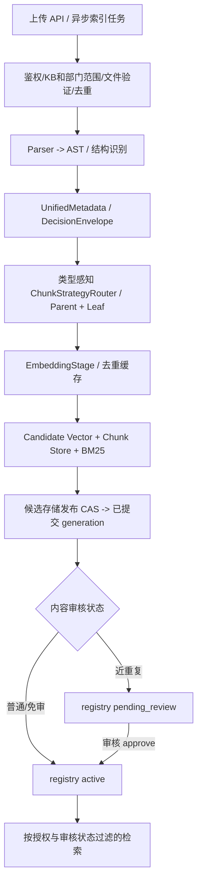

# RAG 域

## 入口与当前链路

- 检索问答链位于 backend/rag/chain.py，Pipeline 与索引能力位于 backend/rag/。
- 独立服务入口为 backend/services/rag_server.py；客户端、远程模式和服务挂载分别核对 backend/rag/client.py 与 API 路由。
- 当前存储、解析器和检索策略以实现及配置为准，不在本文手工维护模型、集合或 Provider 数量。

## 约束与错误边界

MultiQuery 改写使用 `multi_query` 角色、temperature=0、3 条查询和至少 1024
输出 tokens；默认子预算 6000ms，取角色策略与共享 8000ms 检索 deadline
剩余量的最小值。生产与评测使用同一口径，评测直接调用 retriever 时也绑定
该 deadline。达到输出上限回退原问题，查询不足标记 `rewrite_truncated`，
不计为完整改写成功。Trace 记录终止原因、用量、有效上限、耗时、查询数与
Prompt 模板 Hash/版本/来源；多查询重排诊断只复制候选 ID、文件名和分数，
不复制候选完整正文或私有 runtime 元数据。缺失或非法分数使评分状态降级。

云端三查询全候选评分使用独立线程池，进程内最多3路并发，共享原检索
deadline；按原问题优先消费结果，max聚合和阈值保持不变。原问题评分失败
仍降级透传，不能用变体评分冒充基线成功。每次Provider尝试独立预占和
结算；排队或预占后时间不足则不外呼，已发出的迟到调用仅结算usage，
不得修改已返回的文档。此并发策略不用于本地模型及无deadline的旁路调用。

普通混合召回等待沿用同一个共享 deadline；保留已完成路径，取消尚未启动
任务，全部超时且无证据时明确失败，不再启动降级召回。完整链路评测中
重排错误会阻断 case 通过，保留原质量指标并记录 `execution_complete=false`；
启用多查询的完整评测中，改写超时或错误退回原问题也记录未完成并阻断通过；
正常拒答、未触发改写的简单查询和显式消融实验按原契约处理。

向量过滤的 metadata 字段名仅接受 ASCII 字母/数字/下划线；`$contains`
按字面子串匹配，转义 SQL LIKE 通配符。多轮 contextualize 的 system/human
均来自当前治理模板，保留 history 占位符，无效模板回退内置默认。

解析分块缓存使用 v4 JSON，旧 pickle 不加载，失效后按正常流水线重新构建（切分/溯源语义变更时同步递增缓存版本）。
BM25 pickle 只可来自受信任服务目录：SHA256 缺失或不匹配均拒绝加载并走
既有重建/旧快照降级；SHA256 是损坏检测，不是来源认证。

远端 `/ask` 记录服务接收至 handler 等待、pipeline 获取、服务总耗时；客户端
按既有子 Trace 关联记录 HTTP 往返与服务外差值。该差值不能单独归因于网络、
连接池或上游排队；先按实际 Trace 定位，不预设历史 4 秒缺口的根因。

检索结果作为生成依据；遵循当前 Evidence Gate、引用和拒答契约。索引不可用、证据不足、模型拒答与基础设施错误要按既有结果类型处理，不能将无证据回答伪装为有效检索结果。

Evidence Gate 的行为实现位于 `backend/rag/evidence_gate/`，RAG 链路由 `backend/rag/chain.py` 调用；修改拒答、引用或降级行为时，检查 `backend/tests/rag/` 中对应契约测试。

## 上传元数据与级联决策

上传元数据契约仍使用 `UnifiedMetadata`（`backend/rag/preprocessing/metadata_schema.py`），并保留 `doc_type`、`business_domain` 等历史字段。当前入库分类和业务域以规则分类器及 taxonomy 规范化结果为唯一事实源；LLM 不做第二次分类。`ENABLE_LLM_METADATA_EXTRACT` 只控制一次可选增强调用，用于摘要、精确实体、风险和时间信号；短文本和已有结构化 Q/A 的 FAQ 跳过调用，失败后用规则实体和抽取式摘要继续。LLM 实体/时间/风险依据须能在原文中精确匹配；关键词字段只保留原文精确匹配的格式标识符，或由 LLM 标注为组织、产品、制度/标准的专名，不填普通主题词。Schema 限制输出字段长度和数量，`backend/tests/rag/` 覆盖分类权威、降级与精确匹配。

文档读写执行资源级授权和租户范围校验。管理端索引与发布操作遵循现有审批及状态管理。

知识库目录由 `auth.knowledge_bases` 提供运行时授权事实源，初始数据来自
`backend/config/knowledge_base.py` 的迁移基线。`owner_depts` 可关联多个部门，
`all` 作为独占标记代表全部启用部门；上传弹窗切换知识库后，部门候选按当前
租户启用部门重新计算，普通员工只看到自己的部门，管理员可在知识库授权范围内
选择一个部门作为本次文档归属。上传接口再次校验知识库、部门归属和部门启用状态。
管理页支持创建、编辑、停用和恢复，停用保留文档；目录变更使用版本号 CAS，并在
同事务写入 `auth.knowledge_base_audits`。目录是平台级共享配置，与现有 RAG KB
和索引标识语义一致；创建、编辑、停用和恢复仅允许 `super_admin`，普通租户管理员
可查看目录但不能改写全平台配置。新增库可显式选择上传与检索，自动问答路由仍需配置相应关键词规则。

## 维护与验证

- RAG 设计细节与检索契约：以本文、backend/rag/ 和 backend/services/rag_server.py 为准。
- 定向测试入口：backend/tests/rag/ 及 backend/tests/ 中对应的远程模式、上传和授权用例。

## 上传、解析、切分和索引的完整开发契约

### A. 写入链路及事实源

- API 入口：`backend/app/api/routes/rag_upload.py`、`rag_documents.py`、`rag_lifecycle.py`，异步索引及任务跟踪以当前 Celery 配置为准。不能只凭 HTTP 200 判断“上传即 active”。
- 操作可见性：`GET /api/v1/rag/documents/operations` 同时返回终态日志 `items` 和现有 `rag_index_runs` 中的活动上传 `active_uploads`；后台上传被接受后操作面板轮询活动记录，展示文件、upload ID、Celery task ID、状态与阶段，终态继续沿用原操作日志和 Trace 链接。普通用户的日志与活动记录按可信租户、知识库、部门及文档授权范围过滤；有文档 ID 的日志须能在注册表中确认授权范围，无文档 ID 的日志仅对记录操作者可见。当前租户 admin 可查看该租户全部记录；跨租户访问仍须单独授权。
- 解析与文档策略：`backend/rag/preprocessing/parser/`、`structure_analyzer.py`、`chunking.py::ChunkStrategyRouter`；按真实 AST/类型选择 Manual/Legal/QA/Table/Generic 等已注册策略。**不在单个上传接口写第二份固定切分逻辑。**
  - 统一结构来源（2026-10-22）：`parse_file` 为 AST 节点确定性生成 `node_id`、父节点/章节 ID、章节树和字符跨度；格式解析器另提供 PDF 页/bbox、DOCX 正文序号、表格行列、HTML DOM 路径、PPTX 幻灯片/形状、JSON 路径或 XML XPath。章节树写入质量记录，Section 带 `section_type`（section/clause/slide/record/element），Leaf/Parent 保存标量章节 ID 与 JSON 来源定位；合同条款、JSON 记录等非显式章节按完整标题路径派生稳定章节 ID，并回写章节树。无法唯一回源时不猜页码或节点。
  - 解析入口新增 HTML/HTM、PPTX、JSON、XML，上传 MIME 白名单仍只从 Parser 注册表派生；OOXML 继续做 ZIP 魔数校验，文本类继续拒绝 NUL/UTF-16 伪装。HTML 排除导航、页脚、脚本及 class/id/role 标识的广告位；Markdown 解析 fenced code 与 pipe table；PPTX 每页都生成 slide section（无标题页使用“幻灯片 N”并标记 heading_source），并提取可见文本、表格、图表缓存值、演讲备注及有说明的图片，未识别图表/无说明图片写质量告警；JSON/XML 保留字段路径与数组记录边界，无 id/name 的记录使用“记录 N”并标记来源，XML 拒绝 DTD/ENTITY，JSON/XML 的结构上限触发时明确标记 partial 并阻止当作完整解析发布。
  - 上传弹窗文件选择器与后端注册表同步开放 PDF、Markdown、TXT、DOCX、XLSX、CSV、HTML、PPTX、JSON、XML。RapidOCR 保留区域平均置信度并汇总最低值；低于 0.7 标记 `ocr_confidence_low`，云端未返回分数时标记 `ocr_confidence_unavailable`，不伪造置信度。
  - 嵌套混合结构按 AST 递归分派：FAQ、法律条款、表格、步骤和普通章节可在不同子章节选择各自策略，同时保留完整祖先标题路径。完整 FAQ Q+A 仍为一个 Leaf，并保存问题文本与 FAQ ID；混合文档中 FAQ 与非 QA 内容分开处理，不重复产出同一 Q+A。表格行使用 `table_node_id` 绑定到具体表格节点，保留表头、行序、表格 ID 与来源定位；同章节多表不再回退到第一张表。
  - 三种文本职责分开：`page_content`/`content_for` 是可引用原文；`EmbeddingStage.embedding_text_for` 只为向量输入添加必要文档/章节上下文；BM25 使用 `search_text_for` 返回原文。Chunk 保留内容 Hash、chunk_type、精确标识符、Parser/切分策略版本、章节 ID、来源节点/跨度/格式定位；普通 Leaf 至少标记 paragraph/list/code/step/legal_clause 之一。Document 级 `title/language/source_format/parser_version`，以及 Chunk 索引期的 `chunk_policy_version/embedding_model/embedding_version/index_generation/indexed_at` 同时写入 registry 与质量记录（registry 存量表由惰性列迁移补齐）。实体候选按原文逐字匹配后才绑定到 Chunk。候选代次仍以发布协议和 registry Active 指针为权威，tenant、权限和审核状态仍从可信服务端上下文继承。
  - FAQ 识别为**局部配对**（`_qa_patterns.annotate_qa_nodes`）：parser 一律走正常结构解析，命中 Q/A 形态的段落转 qa 节点、其余章节/段落原样保留——混合文档不得因 FAQ 判定丢内容（P0-01，2026-10-13）。
  - 识别到的 FAQ 问答以每个完整 Q+A 对作为独立 Leaf；不再为整份 FAQ 生成只列问题、不含答案的虚拟 Parent，避免一个 FAQ 命中后把所有问题都附加到回答上下文。Parent-Child 仍用于有实际跨块上下文价值的其他策略。
  - DOCX/PDF 表格按文档原始阅读顺序归属章节（docx 按 body XML 单遍遍历；pdf 按 页序+页内y 统一事件流），不得先处理全部段落再把表格堆到最后一个 section（P0-04）。
  - Structure Profile（`StructureReport.profile`）承载章节/表格/QA/条款/SOP 结构信号。普通文档保留既有主路由；多个嵌套章节命中不同内容类型时，由 `ContentUnitDispatchStrategy` 按单元局部调用 QA、Legal、Step、Table 或 Structure 处理器。局部策略重新编号时必须把 `content_unit_id` 纳入 `chunk_id`、Parent 和表格 ID 命名空间；最终完整性边界还会消歧残余重复 ID 并同步修复引用。`route_with_decision` 记录各单元选择的策略、结构信号和处理范围。结构置信度只代表 AST 结构启发式，不代表源文件覆盖率或语义质量。
  - 解析结果契约：Parser 输出 `DocumentAST`，PDF 节点 `page_number` 为 1-based，`bbox` 使用 PDF 页面坐标；Chunk 以标量 `pages` 和 `source_locations_json` 传递页码与 bbox，避免向量库对 list/dict metadata 的后端差异。Chunk 生成时优先从 AST 节点透传位置；硬切按原文跨度映射位置。表格节点改写成摘要/行块前也要先继承来源位置。文本回映射遇到跨页重复页眉/页脚或相同正文时，歧义文本不作为定位证据，避免一个 Leaf 错标到多个页面。质量记录另存 `parse_status`、按页 `parse_issues`、OCR 状态、图片页、空白页、未解析内容页、布局回退页、表格检测失败页和跳过页；问题记录只保存代码、严重度、页码及短说明，不复制正文。
  - PDF OCR 按页和图片区域判定：低文本量扫描页识别页内图片；文字层充足但含大面积图片的页面只裁剪图片 bbox 做 OCR；没有图片块但渲染后可见、或文字层稀疏且矢量图形密集的页面走整页 OCR。低分辨率渲染区分纯空白页与疑似内容页，空白页不计为丢页。本地 RapidOCR 对空结果或单页异常只重试一次，并提高渲染 DPI；云端 OCR 不自动重试，避免不确定请求重复计费。供应商不可用、页数上限、区域识别失败或有内容页面最终无 AST 节点均为质量硬异常。OCR 只提取图中文字，不声称能还原图表语义。
    - OCR 页预算默认使用 `RAG_OCR_MAX_PAGES`（默认 100）。管理员可在单次 PDF 上传时显式指定 `ocr_page_budget`（1–500 页；管理端提供 200/300/500 选项）；该值随 Celery 任务和重投持久化，只影响该次 PDF。未指定时不变更全局默认。预算、来源、所需页数和遗漏页数进入 AST 质量记录与 OCR 血缘 Trace；超预算或 OCR 失败仍触发硬门禁，不能发布部分索引。提高预算可能增加处理时间及云端 OCR 用量。
  - PDF 阅读顺序：普通页走 PyMuPDF 快速块解析；检测到左右栏块及纵向重叠时，使用本地 bbox 几何布局排序并保留页码/bbox。该回退能处理常见双栏顺序，不等同于 Document Intelligence 等语义版面模型；复杂表格检测失败按页告警并保留原生文本流，待后续 Layout 引擎接入。
  - 原文到 AST 审计：PDF 另用 PyMuPDF `get_text("text")` 原生文本路径逐页对照 AST 事件流，按行滑窗记录 `coverage_rate`、缺失页和未验证页；OCR 参与的页面明确列为未验证，不把原生文本层覆盖率冒充全文件覆盖率。超大文档 AST→Leaf 抽样审计仍显式 `sampled=true`，覆盖率置空；抽样不代表全量通过。
  - 质量指标分开记录 `structure_confidence`、`content_coverage`（仅审计完整时赋值）、`content_coverage_observed`（注明原生文字层范围及 partial 状态）和 `semantic_quality`；当前没有独立语义评估器时 `semantic_quality=null`。旧 `completeness` 字段暂保留为结构置信度兼容别名，不能解读为内容完整率。
  - 制度边界归一化与校验：同一解析叶子包含多个行首「第 N 条」时，`StructureAnalyzer` 在副本 AST 中拆成独立条款叶子，原始 AST 保持不变；`LegalChunkStrategy` 为每条款生成独立 Leaf，超长条款拆分时保留同一 `section_title`。`audit_legal_chunk_boundaries` 独立于字符覆盖率，跨条款合并或源条款缺失会在 embedding 前作为硬异常拦截。
  - 合同表格切分（2026-10-20）：多条款合同优先按条款规划；能放入 Leaf 预算的短表跟随所属条款，索引正文只保留一份 Markdown 表格，原始单元格矩阵另存于 `table_rows_json`/`table_structures_json`，不再重复生成逐行 NL 与 CSV；超预算表按数据行分组并重复表头，每组共享 `table_id` 和行范围。已关联表格的 `SENTINEL-TABLE-REF` 只从标准化索引文本移除，上传原文不变。Chunk 元数据分别保存 `document_title`、真实 `section_title`、`granularity` 与 Parent 的 `parent_scope`；文档级 Parent 不把文档标题写入章节字段，Trace 展示从结构字段映射“📄 文档”或“📑 章节”。完整合同 Parent 保存全部条款文本及表格矩阵，仅进入 ChunkStore 作为上下文，不独立进入向量/BM25；Parent 不参与模拟问题生成。合同模拟问题只对达到 80-token 阈值的 Leaf 生成。条款出现“上表”等引用时记录 `references=[{table_id, relation: refers_to}]`，命中后从同文档 ChunkStore 加载关联表格 Leaf，再执行已有知识库、权限和审核过滤。
  - 切分覆盖对账：`coverage_audit` 只核对实际输出 Leaf，不把 Parent 计入覆盖；文本按窗口检查，表格按行与单元格检查。抽样结果显式标记 `sampled`，不宣称全量 100%。覆盖缺口或审计失败进入 Quality Record 和 Trace；普通索引路径同步 `quality_issues`/`quality_status` 并由现有 QualityGate 阻止进入 `active`。候选失败时问题码保存在 Quality Record、Trace 和失败上传运行记录，不改写同路径旧版本 registry 行（P0-02）。
  - 清洗边界与清洗对账（2026-10-18）：Cleaner 按**节点**执行（`structured=True`），结构化节点自带语义边界、没有版面上下文，依赖「前后空行」的孤立图注启发式在节点级不成立必须停用；节点内的模板行/维基噪音/页码页脚等形态确定性噪音照旧清洗，删除证据（操作名/分类/原行样本）记入 `node.cleaning_dropped` 与质量记录 `cleaning.dropped_*`。新增 `cleaning_coverage_audit`（Raw AST → 清洗输出）独立于 `coverage_audit`：规范化差异与确定性噪音删除算合法，其余消失正文计入 uncovered 并以 `cleaner_content_loss`/`cleaning_audit_failed` 硬异常阻断——**不允许**通过清空节点让覆盖审计分母缩水来假通过。
  - 过滤器边界（2026-10-18）：Parent 与 Leaf 各自独立的 SimHash 已见集合（Parent 文本包含 Leaf 正文，不能作为 Leaf 的判重依据）；表格 row chunk 与「承载事实的 Leaf 短文本」（短段落/状态值/编号/英文技术字段）不套用正文长度与中文占比阈值，去重仍对正文 Leaf 生效。带 `split_group_id` 的来源切片是同一原始叶子的连续部分，不能因长度、符号占比、语言比例或重复度过滤任一片段。解析/清洗/切分/过滤已确定内容缺失时，索引器在元数据 LLM 与 embedding 之前用 `coverage_audit`+`audit_chunk_integrity`+`cleaning_coverage_audit` 失败（付费前预检），付费后与写库前门禁保留。
  - Token 上限统一走 `_split_to_budget`（语义切分 + `_hard_split_by_budget` 整串口径硬切收口），Leaf 和实际生成 Parent 的路径（含 Step/Legal/表格兜底/虚拟 parent）严格 ≤ 配置预算；FAQ 长答案继续拆为带问题前缀的 Leaf，不生成问题目录 Parent。chunk 级截断（超 MAX_CHUNKS_PER_DOC）是质量门禁**硬异常**——文档进 failed，不得以截断状态 active（P0-05/超长文档收口）。
  - 大表解析资源上限：`RAG_TABLE_MAX_ROWS` / `RAG_TABLE_MAX_CELLS` 按 Workbook 累计；Excel 在达到限制时停止读取后续行/Sheet，报告已扫描与至少截断下界，总量未知会明确标记。CSV 使用标准库逐行流式读取，在有界缓冲下保留 UTF-8 BOM/GBK、SKU 前导零及长订单号，并完整流式计数以精确记录截断量。行/单元格截断、OCR 页数超限或识别失败均进入质量硬异常，文档失败，不以部分内容标成 `active`。
- 元数据：`metadata_schema.py::UnifiedMetadata/DecisionEnvelope`、taxonomy 与当前源文档/chunk contract 为事实源。必要检索键至少保持可溯源 doc/chunk/source、KB/部门/权限、版本/代次等已有字段；具体必填性按 schema 检查，不从本段临时发明字段。
- 文档级元数据不再生成复杂度评分；FAQ、法律及合同模板不生成文档级摘要，问答对/条款作为检索单元；保留轻量章节概览，用于识别文档和导航。
- Trace 的质量记录评分按 `max(0, 100 - 40×硬异常数 - 10×告警数)` 计算；它反映解析与索引校验异常，不代表答案语义正确或检索召回效果。
- 索引与发布：`backend/rag/indexing/indexer.py`、`stages/`、`publish.py`、`lifecycle.py`。候选存储在物理发布前不可作为正式检索源；`publish_candidate` 的 registry CAS 是**索引代次发布提交点**：提交前失败清理候选、旧版可用，提交后失败需续跑幂等收尾。**内容审核可见性是另一个独立状态**：近重复文档即便代次已发布，registry 仍可能是 `pending_review`，检索必须按审核状态过滤；`review_pending_doc(..., "approve")` 更新文档状态并失效审核缓存，不是第二次调用 `publish_candidate`。不能把代次发布等同人工批准，也不能擅自回滚已提交代次。Parent-Child 身份契约：索引期 `apply_index_chunk_identity` 覆盖 chunk_id 时同步改写 parent_chunk_id，检索端 `attach_parent_context` 的 `$in` 查询才能命中（P0-03）；Parent 扩展结果由 `apply_review_visibility` 在扩展后统一复核，pending_review 不得经 Parent 通道绕过。文档级元数据的全文输入为**纯 leaf 拼接**（parent 章节全量不重复计入）；超长文档摘要采样走 `summary_sampling`（头+章节目录+分层采样+尾，标注覆盖范围）；模拟问题 LLM 选块均匀分布且规则降级不产占位问句。
- 状态机：草稿/审核/active/deprecated/deleted 的合法迁移由现有 lifecycle/review 服务管理。正式删除需连同向量、BM25、文档及注册元数据按现有路径处理。删除接口明确区分 `success`、`partial`、`failed` 与 `unknown`；远端清理请求发出后连接中断时返回 `502 + operation_state=unknown`，前端刷新列表并提示核对，不可假报成功或盲目重试。操作记录对部分清理异常和待核对状态分别标记。重试、覆盖、同名不同内容和文件质量缺陷必须有可复现证据。
- Embedding/model 变更需核对维度、模型版本、索引兼容与重建策略；未经兼容检查不能用旧向量宣称新模型检索准确。

### B. 检索与回答链路

- 实现见 `backend/rag/chain.py`、`backend/rag/retrieval/query_router.py`、`hybrid.py`、`enhanced_hybrid_retrieval.py`、`backend/rag/evidence_gate/`；查询分类、RRF、rerank、top_k、阈值必须走已有配置/单一事实源，不在不同端点手写一套。
- 云端 rerank 的输入保留已授权候选的标题或来源文件名，并在现有 2000 字符上限内附带正文；不发送来源目录，不修改原始文档内容。embedding 与 rerank 的实际云端调用复用统一预算及预占账本，缓存命中不重复预占；估算 embedding token 明确标为 `estimated`。
- 向量/BM25/文档检索前后的 **tenant、kb_id、department、permission_scope** 过滤都要可证实；缓存键不能缺少授权范围、模型/索引版本而引发跨用户泄漏。检索 trace 应展示 route、候选数、证据 chunk、引用来源、索引代次和耗时。
- 结果包括成功、empty、evidence insufficient、Provider failed、degraded 等不同语义；没有可信证据时拒答或标明不确定，不让 LLM 根据用户问题捏造引用。不能把跨文档、表格和精确标识检索都当普通 FAQ。

### C. 上传与检索验收

| 编号 | 预期 |
| --- | --- |
| RAG-01 | 不支持格式、过大、伪造魔数、恶意路径、无权限的上传安全拒绝 |
| RAG-02 | SHA 去重、同名新版本、跨 KB 隔离与并发上传有确定结果 |
| RAG-03 | 文档类型策略正确；制度条款不跨 Leaf 合并；Parent/Leaf、表格/QA/长文边界、页码/bbox 定位及 metadata 可复查 |
| RAG-04 | 元数据 taxonomy/schema 和 LLM fallback 的来源、版本、耗时可追溯 |
| RAG-05 | 索引发布前候选不可见；已发布但 `pending_review` 的文档仍不得越过审核过滤；故障恢复遵循代次提交点 |
| RAG-06 | 代次 CAS 冲突与提交点后失败可恢复；审核批准只变更 registry 状态并刷新过滤缓存，不重复发布 |
| RAG-07 | dense/BM25、RRF、rerank、检索命中、答案依据、引用/拒答在对应 Golden 集达到有效门禁；工程质量分不替代检索/答案评测 |
| RAG-08 | 精确 ID、跨文档、表格、无答案、过期信息及非法问题覆盖 |
| RAG-09 | 同租户越权、跨租户/部门/KB 搜索、缓存命中均不得泄漏 |
| RAG-10 | 本地/remote RAG 与 SSE/API/Tool 结果语义一致，Provider 失败不假成功 |
| RAG-11 | Index/Query Trace 具备来源、耗时、失败阶段、代次、模型版本和证据归因 |
| RAG-12 | 真实索引 fixture、检索指标、断点续跑、环境不可用分别留有证据 |

RAG 质量评测与发布有效性统一按 [评测治理](../evaluation/evaluation-governance.md)；本文件管领域行为，不重复写阈值和 Golden 数据表。切分/元数据改动应优先运行受影响的 `backend/tests/rag/` 及 `backend/evaluation/datasets/rag/`，只在触及真实索引行为时启动隔离知识库，不对共享线上库直接重建。
