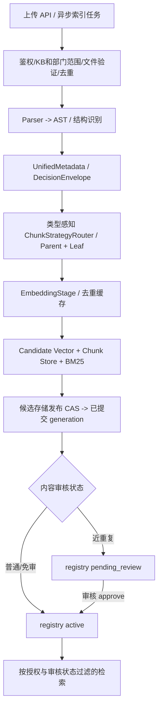

# RAG 域

## 入口与当前链路

- 检索问答链位于 backend/rag/chain.py，Pipeline 与索引能力位于 backend/rag/。
- 独立服务入口为 backend/services/rag_server.py；客户端、远程模式和服务挂载分别核对 backend/rag/client.py 与 API 路由。
- 当前存储、解析器和检索策略以实现及配置为准，不在本文手工维护模型、集合或 Provider 数量。

## 约束与错误边界

检索结果作为生成依据；遵循当前 Evidence Gate、引用和拒答契约。索引不可用、证据不足、模型拒答与基础设施错误要按既有结果类型处理，不能将无证据回答伪装为有效检索结果。

Evidence Gate 的行为实现位于 `backend/rag/evidence_gate/`，RAG 链路由 `backend/rag/chain.py` 调用；修改拒答、引用或降级行为时，检查 `backend/tests/rag/` 中对应契约测试。

## 上传元数据与级联决策

上传元数据统一使用 `UnifiedMetadata` 和 `DecisionEnvelope`（`backend/rag/preprocessing/metadata_schema.py`）；分类词表由 taxonomy 模块维护，规则词典和 taxonomy 的一致性由测试守护。级联决策可能来自规则、相似度分类、LLM、fallback 或人工复核；各来源都归一到同一 envelope，并保留证据、版本、耗时和 LLM 调用数。阈值、灰度比例、外部模型开关及影子模式从 `backend/config/rag.py` 读取，不在文档维护静态阈值。改动前检查 `metadata_router.py`、索引 metadata stage、`backend/tests/rag/` 与 `backend/eval/metadata_baseline/`。

文档读写执行资源级授权和租户范围校验。管理端索引与发布操作遵循现有审批及状态管理。

## 维护与验证

- RAG 设计细节与检索契约：以本文、backend/rag/ 和 backend/services/rag_server.py 为准。
- 定向测试入口：backend/tests/rag/ 及 backend/tests/ 中对应的远程模式、上传和授权用例。

## 上传、解析、切分和索引的完整开发契约

### A. 写入链路及事实源

- API 入口：`backend/app/api/routes/rag_upload.py`、`rag_documents.py`、`rag_lifecycle.py`，异步索引及任务跟踪以当前 Celery 配置为准。不能只凭 HTTP 200 判断“上传即 active”。
- 解析与文档策略：`backend/rag/preprocessing/parser/`、`structure_analyzer.py`、`chunking.py::ChunkStrategyRouter`；按真实 AST/类型选择 Manual/Legal/QA/Table/Generic 等已注册策略。**不在单个上传接口写第二份固定切分逻辑。**
- 元数据：`metadata_schema.py::UnifiedMetadata/DecisionEnvelope`、taxonomy 与当前源文档/chunk contract 为事实源。必要检索键至少保持可溯源 doc/chunk/source、KB/部门/权限、版本/代次等已有字段；具体必填性按 schema 检查，不从本段临时发明字段。
- 索引与发布：`backend/rag/indexing/indexer.py`、`stages/`、`publish.py`、`lifecycle.py`。候选存储在物理发布前不可作为正式检索源；`publish_candidate` 的 registry CAS 是**索引代次发布提交点**：提交前失败清理候选、旧版可用，提交后失败需续跑幂等收尾。**内容审核可见性是另一个独立状态**：近重复文档即便代次已发布，registry 仍可能是 `pending_review`，检索必须按审核状态过滤；`review_pending_doc(..., "approve")` 更新文档状态并失效审核缓存，不是第二次调用 `publish_candidate`。不能把代次发布等同人工批准，也不能擅自回滚已提交代次。
- 状态机：草稿/审核/active/deprecated/deleted 的合法迁移由现有 lifecycle/review 服务管理。正式删除需连同向量、BM25、文档及注册元数据按现有路径处理。重试、覆盖、同名不同内容和文件质量缺陷必须有可复现证据。
- Embedding/model 变更需核对维度、模型版本、索引兼容与重建策略；未经兼容检查不能用旧向量宣称新模型检索准确。

### B. 检索与回答链路

- 实现见 `backend/rag/chain.py`、`backend/rag/retrieval/query_router.py`、`hybrid.py`、`enhanced_hybrid_retrieval.py`、`backend/rag/evidence_gate/`；查询分类、RRF、rerank、top_k、阈值必须走已有配置/单一事实源，不在不同端点手写一套。
- 向量/BM25/文档检索前后的 **tenant、kb_id、department、permission_scope** 过滤都要可证实；缓存键不能缺少授权范围、模型/索引版本而引发跨用户泄漏。检索 trace 应展示 route、候选数、证据 chunk、引用来源、索引代次和耗时。
- 结果包括成功、empty、evidence insufficient、Provider failed、degraded 等不同语义；没有可信证据时拒答或标明不确定，不让 LLM 根据用户问题捏造引用。不能把跨文档、表格和精确标识检索都当普通 FAQ。

### C. 上传与检索验收

| 编号 | 预期 |
| --- | --- |
| RAG-01 | 不支持格式、过大、伪造魔数、恶意路径、无权限的上传安全拒绝 |
| RAG-02 | SHA 去重、同名新版本、跨 KB 隔离与并发上传有确定结果 |
| RAG-03 | 文档类型策略正确；Chunk parent/leaf、表格/QA/长文边界及 metadata 可复查 |
| RAG-04 | 元数据 taxonomy/schema 和 LLM fallback 的来源、版本、耗时可追溯 |
| RAG-05 | 索引发布前候选不可见；已发布但 `pending_review` 的文档仍不得越过审核过滤；故障恢复遵循代次提交点 |
| RAG-06 | 代次 CAS 冲突与提交点后失败可恢复；审核批准只变更 registry 状态并刷新过滤缓存，不重复发布 |
| RAG-07 | dense/BM25、RRF、rerank、引用/拒答在对应 Golden 集达到有效门禁 |
| RAG-08 | 精确 ID、跨文档、表格、无答案、过期信息及非法问题覆盖 |
| RAG-09 | 同租户越权、跨租户/部门/KB 搜索、缓存命中均不得泄漏 |
| RAG-10 | 本地/remote RAG 与 SSE/API/Tool 结果语义一致，Provider 失败不假成功 |
| RAG-11 | Index/Query Trace 具备来源、耗时、失败阶段、代次、模型版本和证据归因 |
| RAG-12 | 真实索引 fixture、检索指标、断点续跑、环境不可用分别留有证据 |

RAG 质量评测与发布有效性统一按 [评测治理](../evaluation/evaluation-governance.md)；本文件管领域行为，不重复写阈值和 Golden 数据表。切分/元数据改动应优先运行受影响的 `backend/tests/rag/` 及 `backend/evaluation/datasets/rag/`，只在触及真实索引行为时启动隔离知识库，不对共享线上库直接重建。
