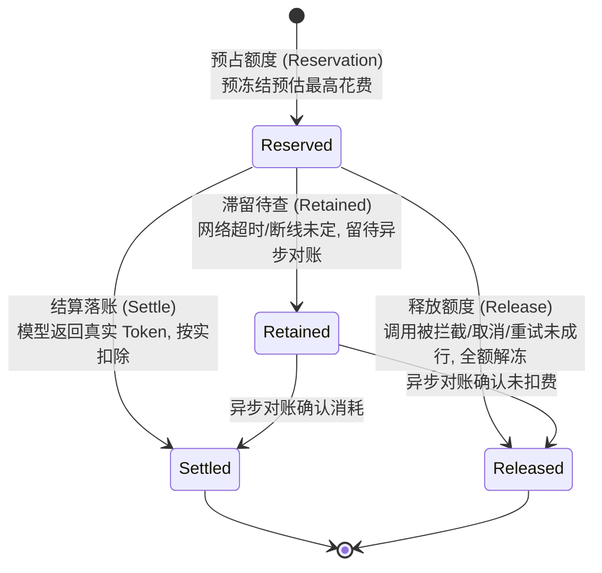

# 大模型预算门禁、Token 计量与财务账本治理规范

本文档系统规范全平台在大模型调用（LLM Invocation）过程中的**五级预算防御拦截**、**Token 用量精准计量**、**数据库级不可篡改账本状态机**以及**动态价格版本控制体系**。核心代码落地于 `backend/infra/llm/gateway/budget_guard.py`、`backend/infra/llm/gateway/accounting.py` 及数据库迁移 053、144~146、149。

---

## 一、 五级预算拦截与防护体系（`budget_guard.py`）

平台杜绝“先调用大模型、事后再看账单超标”的被动失控模式，在 LLM 网关层构建了**调用前、调用中、调用后全生命周期的五级硬防御门禁**：

```
[请求准备调用大模型]
        │
        ▼
Level 1: 物理速率与并发门禁 (_enforce_rate_limit)
  └─► Redis 分布式滑动窗口 / 令牌桶算法，防止单租户突发请求击穿供应商 QPS
        │
        ▼
Level 2: 租户与用户额度预检 (_preflight_context)
  └─► 预读当前租户/用户的日预算与月预算余额，余额不足直接 Fail-Closed 拒答
        │
        ▼
Level 3: 模型输入价格分级门禁 (enforce_model_input_price_tier)
  └─► 依据模型登记输入单价做白名单等级过滤，阻断普通业务越权调用超昂贵旗舰模型
        │
        ▼
Level 4: 上下文预算与动态滑动截断 (_truncate_messages_to_budget)
  └─► 严格校验当前消息历史 Token 总量，超预算时按滑动窗口自适应压缩历史
        │
        ▼
Level 5: 增量摘要与终极物理熔断 (_l5_trigger_ratio + _reject_overbudget)
  └─► 达到 90% 物理警戒线时触发异步单飞摘要，极端突破物理限制直接硬异常阻断
```

### 1. Level 1：分布式速率与并发限流（Distributed Rate Limit）
- **实现算法**：基于 Redis 7 执行分布式滑动窗口算法（`_try_distributed_rate_limit`）；
- **双重维度限制**：支持每秒请求数（RPS）与每分钟 Token 数（TPM）双轨约束；
- **超限行为**：触发限制时抛出 `RateLimitError`，并在响应头中返回 `Retry-After`，配合客户端指数退避重试，防止突发流量引发云端供应商 429 惩罚性拉黑。

### 2. Level 2：额度预检与预占机制（Preflight Budget Check）
- 在真正发起云端 API 外呼前，调用 `_preflight_context`：
  - 检查租户账户状态是否有效（非欠费冻结）；
  - 依据当前模型的每千 Token 单价及 Prompt Token 预估本次调用的最大成本预占（Reservation）；
  - 若预估成本超出当前可用预算，系统立即终止调用并记录 `preflight_budget_exceeded`，绝不发生透支调用。

### 3. Level 3：模型输入定价等级门禁（Model Input Price Tier）
- 为防止普通低优先级意图（如闲聊、简单意图提取）盗用高成本模型（如 GPT-4o、Claude-3.5-Sonnet、o1），网关在 `enforce_model_input_price_tier` 中进行硬分级匹配：
  - **Tier 1（极低成本）**：输入单价 $\le 0.005$ 元 / 千 Token（如 GLM-4-Flash、Qwen-Turbo）；
  - **Tier 2（中等成本）**：输入单价 $0.005 \sim 0.03$ 元 / 千 Token；
  - **Tier 3（高昂成本）**：输入单价 $> 0.03$ 元 / 千 Token；
  - 未经管理员显式特批的业务角色调用 Tier 3 模型直接被拦截。

### 4. Level 4：上下文滑动窗口与动态截断
- 网关在 `_truncate_messages_to_budget` 中结合配置参数与当前会话历史：
  - 保持 System Prompt 与最新用户提问绝对不动；
  - 沿历史对话的最早轮次逐步向后剔除冗余问答，或剔除工具执行结果中非关键的内容，将总 Token 牢牢压制在上下文安全预算线（如 4096 或 8192）以内。

### 5. Level 5：L5 增量摘要与终极物理熔断
- 当上下文总长度突破模型最大物理窗口的 **90%**（`_l5_trigger_ratio=0.9`）时，系统自动启动轻量模型异步独立运行增量摘要，并程序化贴附 **40 类业务受保护事实（Protected Facts）**；
- 若经过全量压缩与截断后仍然突破物理上限，网关执行 `_reject_overbudget`，直接抛出无法截断的硬异常，拒绝超长发送以保护模型的输出确定性。

---

## 二、 不可篡改财务账本与预占结算状态机（`accounting.py`）

平台采用银行级**两阶段预占与结算（Reservation & Settlement）事务模型**，确保无论发生系统崩溃、用户中途取消还是网络中断，每一笔资金都有迹可循：



### 1. 数据库物理级防篡改触发器（迁移 144~146）
针对财务合规审查，平台在 PostgreSQL 数据库底层通过触发器固化了**账本绝对不可篡改（Append-Only）约束**：
- **流水表 `budget_reservation_resolutions`**：记录每一笔预占从冻结到结算、释放的生命周期（`resolution_status` 与 `settlement_kind`）；
- **物理禁止修改与删除触发器（`trg_budget_resolution_audit_append_only`）**：
  ```sql
  -- 迁移 146: 在 PostgreSQL 底层彻底剥离 UPDATE 和 DELETE 权限
  CREATE OR REPLACE FUNCTION tf_budget_resolution_audit_append_only()
  RETURNS TRIGGER AS $$
  BEGIN
      RAISE EXCEPTION 'budget_reservation_resolutions 为只追加不可变账本，严禁 UPDATE 或 DELETE！';
  END;
  $$ LANGUAGE plpgsql;

  CREATE TRIGGER trg_budget_resolution_audit_append_only
  BEFORE UPDATE OR DELETE ON budget_reservation_resolutions
  FOR EACH ROW EXECUTE FUNCTION tf_budget_resolution_audit_append_only();
  ```
  该触发器由迁移 146 植入，即使数据库管理员或应用发生 SQL 注入，也绝对无法通过 `UPDATE` 或 `DELETE` 篡改历史扣费证据，切实守住审计红线。

### 2. 业务域额度轴（迁移 149：Domain Budget Axis）
迁移 149 为 `budget_policies`、`budget_ledger` 与 `budget_reservations` 增加了独立的 `domain` 列：
- **三大多域独立配额**：支持 `main`（主助手）、`travel`（旅游 V2）与 `customer_service`（智能客服）分别配置独立预算限额与消耗告警阈值；
- **域隔离与租户兜底**：主图与各业务子图并发独立记账，各域消耗优先扣减本域配额；域配额耗尽时按租户策略配置决定是否允许租户全局资金池介入兜底，杜绝单一业务突发流量吃光全租户预算。

---

## 三、 流式 Token 动态估算与对账纠偏机制

在调用部分云端模型或遭遇流式中断时，供应商可能不返回最终的 `usage` 结构。平台设计了严密的**三级用量事实等级与对账机制**：

1. **三级用量事实等级**：
   - **Level 1（实测值，`measured`）**：供应商 API 原生返回了 `prompt_tokens` 与 `completion_tokens`，可信度最高；
   - **Level 2（估算值，`estimated`）**：供应商未返回 usage，系统按输入输出文本字符数结合分词比率（中文字符约 0.6~0.7 Token，英文字符约 0.3~0.4 Token）进行估算，并显式标记 `is_estimated = true`；
   - **Level 3（待对账，`needs_review`）**：调用中途发生网络断开，无法获得完整生成结果，记入滞留账本并触发对账警报。
2. **流式用量后置结算（`_settle_estimated_stream_usage`）**：
   - 在流式传输过程中，网关持续通过 `_accumulate_turn_usage` 累加文本分片与思维链分片；
   - 在流结束（`done`）事件触发时，立即将实测/估算值写入 `llm_usage` 表，结算并释放多余的预占额度。

---

## 四、 模型价格不可变版本化管理（迁移 053）

模型的计费单价不是静态数字，而是随时间演进的商业契约：
1. **价格历史不可变触发器（迁移 053：`trg_model_price_immutable_trigger`）**：
   - 数据库禁止直接原地修改 `llm_models` 表中的价格字段；
   - 任何价格变动必须作为**新价格版本**插入，并指定生效时间戳（`effective_from`）；
   - 历史调用记录强绑定当时的调用时点单价版本，杜绝因供应商调价导致历史账单重新计算发生偏差。
2. **前后向兼容与输入分拆计费**：
   - 价格结构明确拆分为：`input_price_per_1k`（常规输入）、`cache_input_price_per_1k`（命中前缀缓存的输入）、`output_price_per_1k`（常规输出）；
   - 充分利用云端厂商 Prefix Caching 带来的 50%~80% 价格折扣，直接在账本中体现降本实效。
