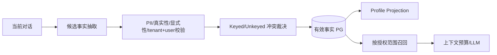

# 用户三层记忆、画像更新和隔离治理规范

> 与 `backend/memory/` 当前实现对齐的**目标契约**。L1/L2/L3 与上下文预算的 L1～L5 压缩是不同体系，不可混为一谈。详细实现入口：`manager.py`、`service.py`、`short_term.py`、`session.py`、`long_term.py`、`conflict.py`、`profile.py`。

## 三层职责

| 层 | 保存对象 | 权威范围 |
| --- | --- | --- |
| L1：请求/短期缓冲 | 单次调用临时装配的最近轮次、当前任务上下文、用户即时更正 | 单次 `ask()` / 当前图运行内，无独立跨请求持久化；由 L2/L3 重新装配 |
| L2：会话记忆 | 当前 session 历史、主题、状态与跨轮引用 | 会话所属 tenant/user，PG 持久会话记录 |
| L3：长期事实/画像 | 显式用户偏好、持续性个人资料、可更正的结构化记忆 | PG 持久结构化事实；画像由有效事实**投影**，不是另写第二份权威 |
 
L1 缓冲虽然可包含从历史会话装配的最近消息，**并不因此成为跨请求的独立权威记忆存储**；跨轮持久化属于 L2/L3。

## 记忆事实生命周期

- `backend/memory/conflict.py` 已按 tenant→user→active→memory_key→normalized value→origin priority→confidence 裁决。用户**显式更正**优先于从行为推断的旧偏好；embedding 相似度只可帮助非结构化近重复识别，不能替代事实版本判断。
- `backend/memory/profile.py::build_profile_projection` 只从有效结构化记忆构建画像。画像重新投影不会自行覆盖用户过去明确更正。
- 记忆写入任务可由 `backend/tasks/memory_extraction_tasks.py`、维护任务异步运行，失败不得导致主请求“成功写入长期记忆”的虚假声明。需要追踪提取来源、版本、写入/冲突裁决、用户主体以及失败原因。
- 成功轮次的L2消息、幂等收据与L3提取outbox先在同一事务提交；提交后异步尝试向队列投递job UUID，回答收尾不等待Broker。进程退出或投递失败时由既有持久outbox恢复扫描补投，不能用未持久化的后台协程代替该记录。L2可读不代表L3事实已提取完成。
- 存储与召回应以**服务端验证的 tenant/user** 为主体隔离边界；领域提示（domain hint）是辅助检索维度，不应未经查询审计就宣称等同于强制 ACL；历史会话和向量缓存不能跨账号召回。
- 时效性、敏感度与保留策略由实际配置/隐私规则确定。个人记忆的更正、停止使用/删除操作应有可追溯的结果语义；衍生的缓存、Profile Projection 及时失效，审计留存另按政策。
- LLM 整理或压缩不得把臆测当事实，不允许把单轮旅游偏好无条件升级为持久人格偏好；过期事实在授权更新之前不能靠高相似度“复活”。

## 隔离范围与未来演进

- **当前范围**：tenant/user 是已实现的主体归属边界，现有 domain hint 辅助领域检索；**本版不新增 agent_id 列、不强制不同 Agent 独立记忆空间**。是否对全部记忆路径形成强隔离必须按查询链验证。
- **重新决策触发条件**：引入第二个需要私有 L3 的 Agent、明确跨 Agent 串扰或法律/业务隔离要求时，先定义哪些 Agent 共享何种记忆的授权矩阵，评估迁移、回滚和召回质量后再设计 schema。
- MM-05 必须用用户/租户交叉召回和缓存实验验证，不能只依赖静态源码确认。

## MM-01～MM-10 验收

| 编号 | 预期 |
| --- | --- |
| MM-01 | L1→L2→L3 提取/写入/读取有真实状态、来源和归因 |
| MM-02 | 明确用户更正能按冲突规则使旧事实失效、画像同步 |
| MM-03 | 推断事实不能覆盖更高优先级的用户显式偏好 |
| MM-04 | 重复/相似记忆不无限增长，也不误删不同事实 |
| MM-05 | 用户/租户跨会话、cache/向量检索不得串数据 |
| MM-06 | 异步提取失败、DB 不可用不会产生幽灵记忆或假成功 |
| MM-07 | 删除/更正请求与派生画像/缓存失效符合实际隐私策略 |
| MM-08 | 长上下文压缩不遗漏 pin 的安全/业务约束且成本可度量 |
| MM-09 | 画像在数月更新下保留清晰版本/来源，冲突可定位 |
| MM-10 | 提取模型/Prompt 变更关联评测集、Trace、Token/成本与回滚 |

实施以 `backend/memory/` 与 `backend/tests/memory/` 为事实源；历史变更记录已归档（2026-10-20，Git 历史可检索 `docs/tasks/memory-system-profile-upgrade/`），本规范不被任何任务文件替代。
