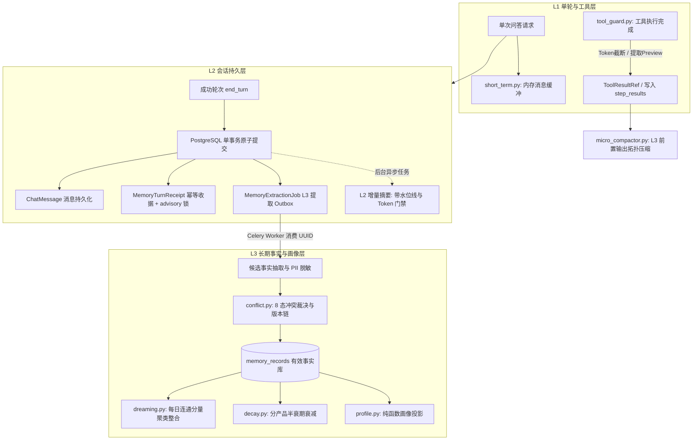
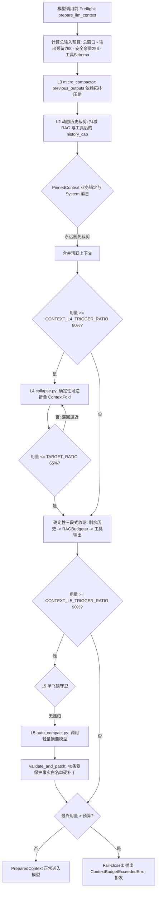

# 全平台 L1～L5 统一记忆、上下文预算与画像治理规范

> 本规范以 `backend/memory/` 与 `backend/context_budget/` 的最新源码为唯一事实源，统一阐明全平台从**单轮工具截断（L1）**到**会话历史（L2）**、**长期事实与输出拓扑（L3）**、**可逆上下文折叠（L4）**直至**AutoCompact 增量摘要与硬门禁（L5）**的全生命周期治理体系。
> 核心实现入口：
> - 记忆持久化与事实流：`backend/memory/`（`manager.py`、`service.py`、`short_term.py`、`session.py`、`long_term.py`、`conflict.py`、`profile.py`、`dreaming.py`、`decay.py`、`keying.py`、`retriever.py`、`importance.py`、`pii_filter.py`）
> - 上下文预算与动态压缩：`backend/context_budget/`（`manager.py`、`tool_guard.py`、`micro_compactor.py`、`collapse.py`、`auto_compact.py`、`rag_budgeter.py`、`models.py`、`metrics.py`）

---

## 一、 L1～L5 五层统一架构与职责分工

平台将大模型上下文生命周期划分为 **L1 到 L5 五个递进层次**。从单步工具输出的物理防护，到跨会话长期记忆与最后一道增量摘要防线，层层收敛、互不越界：

| 层级 | 治理目标 | 核心机制与实现模块 | 存储与生命周期 | 产出事件 / 协议 |
| :--- | :--- | :--- | :--- | :--- |
| **L1：单轮缓冲与工具防护** | 单次调用消息暂存；防止单步工具输出打爆上下文 | `memory/short_term.py`（条数上限与淘汰） `context_budget/tool_guard.py`（Token 截断与预览生成） | 进程内存（单轮请求内有效，不跨轮持久化）；由 L2/L3 重新装配 | `ToolResultRef`（携带 preview 标记） SSE `context` (level=L1, action=tool_compact) |
| **L2：会话记忆与动态裁剪** | 当前会话历史管理；模型调用前语义感知动态裁剪 | `memory/session.py`（PG 会话消息持久化） `context_budget/manager.py`（`history_budget` 与 `_trim_semantic`） `memory/service.py`（后台增量 L2 摘要） | PostgreSQL 权威持久化（`chat_sessions`、`chat_messages`） 按 `(tenant_id, product, session_id)` 隔离 | `PinnedContext` 语义锚定与 System 消息永不丢弃 SSE `context` (level=L2, action=history_trim) |
| **L3：长期事实画像与输出拓扑** | 跨会话偏好画像与版本链；多步技能前置输出拓扑压缩 | `memory/long_term.py`、`conflict.py`（8 态裁决）、`dreaming.py`、`decay.py`、`profile.py` `context_budget/micro_compactor.py`（前置输出拓扑压缩） | PG 持久事实库（`memory_records`） 画像由有效事实实时**投影**（非第二份事实源） Outbox 异步提取解耦 | `StoreOutcome` 8 态版本链（删除屏障、乱序防护） SSE `context` (level=L3, action=output_compact) |
| **L4：零 LLM 可逆折叠** | 预测用量达到阈值时确定性、可逆压缩早期对话 | `context_budget/collapse.py`（`fold_messages` 与 `ContextFold`） | 内存与运行时状态（保留折叠前原始消息 ID 映射，支持完全回滚与逆向展开） | `[Earlier conversation folded]` 折叠块 SSE `context` (level=L4, action=collapse, reversible=True) |
| **L5：AutoCompact 增量摘要与硬门禁** | 上下文超限时的最后一道防线；硬超限 Fail-closed 拦截 | `context_budget/auto_compact.py`（单飞锁守卫与增量摘要） `context_budget/manager.py`（硬门禁抛异常） | PG 持久会话摘要（带版本与有效时刻） | `ProtectedFact` 40 条白名单确定性补丁 SSE `context` (level=L5, action=summary_started/auto_compact/summary_deferred) 超限抛 `ContextBudgetExceededError` |

---

## 二、 L1～L3 记忆持久化与事实生命周期

### 1. 同事务原子提交与 Outbox 防丢
- **单事务一致性**：成功一轮对话时，`MemoryService.end_turn()` 在**同一个 PostgreSQL 事务**内原子提交：
  1. L2 历史消息行（`ChatMessage`，保留消息类型与 LangChain 协议元数据）；
  2. 轮次幂等收据（`MemoryTurnReceipt`，通过 `pg_advisory_xact_lock` 防止并发请求重放）；
  3. L3 长期事实提取任务 Outbox（`MemoryExtractionJob`，记录 `source_trace_id`）。
- **回答不阻塞与补投机制**：事务提交后，回答流立即收尾并断开连接，不等待 Broker 或 Celery 执行；后台通过轻量任务异步触发 Celery 投递（参数仅传 Job UUID）。若进程崩溃或 Broker 离线，持久化扫描器 `recover_memory_extractions()` 自动扫描 `PENDING` / 僵死 `RUNNING` 任务执行重试与补投。

### 2. Keyed / Unkeyed 冲突裁决与 8 态版本链（`conflict.py`）
- **Keyed 事实裁决流水线**：
  1. `lock_memory_identity`：按用户身份加事务锁；
  2. **删除屏障校验**（`delete_tombstone_blocks`）：若用户曾明确删除该键或要求“忘记某事”，写入立即被阻断并返回 `BLOCKED_BY_DELETE`；
  3. `find_active_by_key(for_update=True)`：检索同键当前有效行；
  4. **同值重申**：若新值与旧值一致，调用 `_resolve_reaffirm()`（`REAFFIRMED` 置信度只升不降，否则返回 `DUPLICATE`）；
  5. **乱序事件防护**（`stale_source_event`）：检查事件时间戳，防止晚到的旧轮次覆写新轮次，拦截并返回 `BLOCKED_STALE_EVENT`；
  6. **来源矩阵裁决**：`inferred`（模型推断）撞击 `explicit`（用户明确告知）时直接拒绝，返回 `CONFLICT_BLOCKED_EXPLICIT`；合法覆盖时同事务执行原子 `deactivate (invalid_at=NOW())` → `insert 新事实` → 回填 `superseded_by` 指针。
- **Unkeyed 事实裁决**：
  - 仅余弦相似度 `sim >= L3_SUPERSEDE_THRESHOLD`（高相似）判为 `DUPLICATE`；
  - `[DEDUP, SUPERSEDE)` 中等相似区间改为独立 `INSERT`（不再静默丢弃），永不触发不透明的自动覆盖。
- **`StoreOutcome` 完整 8 态枚举**：
  `INSERTED` / `DUPLICATE` / `REAFFIRMED` / `SUPERSEDED` / `CONFLICT_BLOCKED_EXPLICIT` / `BLOCKED_STALE_EVENT` / `BLOCKED_BY_DELETE` / `REJECTED`。

### 3. Dreaming 整合、差异化半衰期衰减与安全豁免
- **Dreaming 整合（`dreaming.py`）**：每日定时 Beat（03:30 UTC）扫描 unkeyed active 碎片，按 `memory_type` + 向量余弦相似度聚类连通分量，交由 LLM 进行三分类（`merge` / `contradiction` / `independent`）。
  - **安全红线**：命中 `MEMORY_SAFETY_CONTENT_PATTERNS`（过敏史、饮食禁忌、用药、无障碍需求、紧急联系人等）以及包含 `explicit` 事实的聚类**绝对不参与整合**；
  - 整合产生的聚合事实固定标记 `origin="inferred"`、`verification_status="pending"`，所有变更均走 `superseded_by` 版本链，可完整回滚。
- **差异化半衰期衰减（`decay.py`）**：衰减**仅降低**注入排序权重 `importance_score`，**绝不删除、绝不隐藏数据**（废除旧 archive_stale 条款，设置页永久可见）。
  - 分产品衰减周期：`agent` 为 180/90 天；`customer_service` 为 120/60 天；`travel` 为 60/30 天；
  - **安全类记忆永久豁免衰减**，必须永远具备完整重要性并参与上下文注入。

---

## 三、 L2～L5 上下文预算治理与 Preflight 执行流

### 1. 预算计算基准与动态扣减
- **总预算公式**：
  $$\text{Input Budget} = \min(\text{配置窗口}, \text{模型注册窗口}) - 768 (\text{输出预留}) - 256 (\text{安全余量}) - \text{Extra Reserved}(\text{Tools Schema / 响应格式})$$
- **L2 动态历史空间**：
  $$\text{History Cap} = \text{Input Budget} - \text{Previous Outputs Tokens} - \text{RAG Tokens} - \text{Extra Reserved}$$
- **语义锚定（`PinnedContext`）**：对话中的确认态词、最新订单号、系统 Prompt 及用户显式要求锚定的消息，并入 `pins` 集合，在 L2 裁剪与 L4 折叠中**绝对豁免**。

### 2. L4 Context Collapse（零 LLM、确定性、可逆折叠）
- **触发条件**：预测用量达到 `CONTEXT_L4_TRIGGER_RATIO`（默认 0.80）。
- **执行机制**：基于规则将较早的普通对话轮次替换为单条轻量折叠投影块 `[Earlier conversation folded]`，保留精确的 `fold_id`、`message_count` 及原始消息 ID 映射。
- **滞回逼近（Hysteresis）**：若折叠后用量仍高于 `CONTEXT_L4_TARGET_RATIO`（默认 0.65），循环递减保留轮数（`keep_recent_turns` 逐步收紧下限至 1），单次触发即可将用量稳定压入安全区，杜绝下一轮高频震荡重触发。

### 3. L5 AutoCompact（单飞增量摘要与受保护事实补丁）
- **触发条件**：L1-L4 全部执行后，用量仍达到 `CONTEXT_L5_TRIGGER_RATIO`（默认 0.90）时，作为最后一道防线启动。
- **递归防死锁**：通过 `L5_ACTIVE` ContextVar 建立递归守卫，摘要模型自身执行时不递归触发 L5。
- **受保护事实确定性补丁（`validate_and_patch`）**：
  - 摘要生成后，算法从待压缩原文中提取最多 40 条关键事实（用户明确禁令、日期、金额、关键实体）；
  - 若轻量摘要模型漏掉了某条关键禁令或实体，补丁逻辑强制在摘要末尾追加确定性事实锚点，确保大模型上下文压缩**零约束遗失**。
- **硬溢出门禁（Fail-closed）**：全量压缩后若仍有 `used > budget`，系统标记 `overflow=True`，统一由 `_LLMProxy` 拒绝外呼并抛出 `ContextBudgetExceededError`，绝不发生静默截断或天价计费。

---

## 四、 命名空间隔离与可信身份绑定

记忆数据必须在底层建立强隔离边界，禁止跨产品、跨租户穿透：

1. **(Tenant, Product, User) 三元组唯一主键**：
   - 记忆权威存储键必须显式绑定 `(tenant_id, product, user_id)`。
   - `product` 为数据库独立物理列（迁移 143，`user_id` 拆裸），合法产品集合包括 `{"agent", "customer_service", "travel", "public", "internal"}`；
   - `internal` 产品产生的临时交互**绝对不落记忆库**；
   - 入口强制服务端解析，禁止在后台 Loop 中使用 `ContextVar` 兜底 `product`。
2. **生命周期与失效追溯**：
   - 物理行增加 `valid_from` 与 `invalid_at`。被覆盖或失效的记录保持物理保留（`is_active=False`），通过 `superseded_by` 串联完整版本审计链；
   - 召回、画像生成与删除检索五条路径统一使用口径：`invalid_at IS NULL AND valid_from <= NOW()`。

---

## 五、 MM-01～MM-10 验收清单

| 编号 | 验收项 | 源码实现与硬性预期 |
| :--- | :--- | :--- |
| **MM-01** | L1～L5 全链路状态追踪 | L1 工具压缩、L2 历史裁剪、L3 输出压缩、L4 折叠、L5 摘要均具备真实状态、耗时与 Trace 归因 |
| **MM-02** | 明确用户更正与旧事实失效 | 用户显式偏好能触发冲突裁决，使旧事实物理置为无效，画像投影同步刷新 |
| **MM-03** | 推断事实不越权覆盖 | 算法模型推断事实（`inferred`）撞击用户显式事实（`explicit`）返回 `CONFLICT_BLOCKED_EXPLICIT` |
| **MM-04** | 记忆有界与去重 | 重复事实返回 `DUPLICATE`，中等相似区独立 `INSERT`，Dreaming 每日聚类合并碎片 |
| **MM-05** | 产品/租户跨会话强隔离 | `(tenant_id, product, user_id)` 交叉检索测试 100% 隔离，缓存与向量不得串数据 |
| **MM-06** | 异步提取失败不假成功 | 队列或数据库崩溃时，不得向前端宣称成功；Outbox 扫描器持久化恢复补投 |
| **MM-07** | 删除屏障与隐私合规 | 用户要求删除事实后，设立 `tombstone` 屏障（`BLOCKED_BY_DELETE`），彻底防止旧事实因高相似度复活 |
| **MM-08** | 长上下文无损压缩 | L4/L5 压缩过程中，`PinnedContext` 锚定实体与 `ProtectedFact` 40 条白名单事实 100% 留存 |
| **MM-09** | 乱序事件防护 | 迟到的历史消息事件无法覆盖更新的消息状态，拦截并返回 `BLOCKED_STALE_EVENT` |
| **MM-10** | 超限硬门禁 | 上下文超限全量压缩后仍无法容纳时，Fail-closed 拒绝发送，严禁超长外呼与静默截断 |
