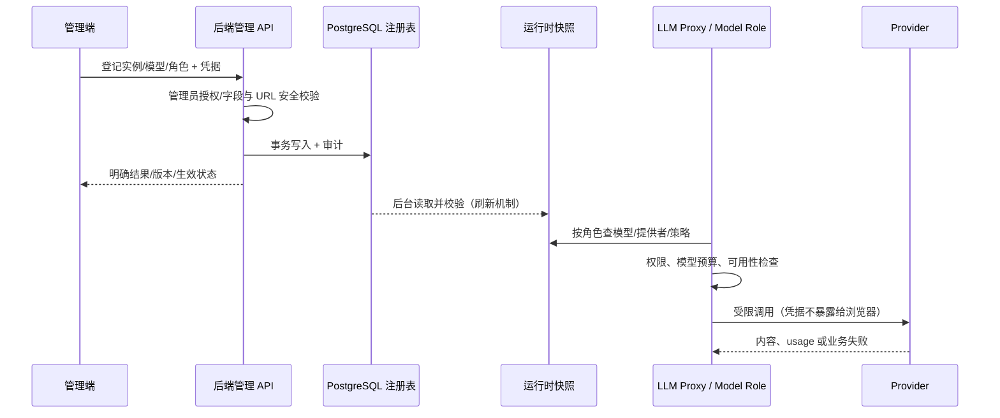

# DB 驱动的模型供应商与模型角色运行规范

> **目标契约；不等于实现已全部验收。** 本文管“供应商实例、数据库模型、角色绑定如何成为真实运行配置”，不复制详细 [模型配置治理设计](../model-config-governance-design.md)，也不承担预算扣费规则（见 [预算与计费](llm-budget-billing.md)）。模型厂商信息必须来自数据库登记和当前运行时注册表，不靠新增文档维护静态清单。

## 1. 三种实体必须区分

| 对象 | 责任与典型字段 | 事实源 |
| --- | --- | --- |
| **Provider Driver**（代码） | OpenAI 兼容/专用协议，流式、Embedding、rerank、超时和 Tool Calling 适配 | `backend/infra/llm/providers/`、`backend/infra/llm/models.py` |
| **Provider Instance**（数据库） | 实例 ID、driver、base_url、网络范围、服务能力、是否启用、加密凭据 | `backend/infra/llm/registry_store.py`、`backend/services/model_config.py`、供应商表/迁移 |
| **Model**（数据库） | 模型名称、provider_id、model_kind、能力、上下文窗口、输入输出限制、价格关联 | 模型注册表 DB、`backend/infra/llm/models.py` |
| **Model Role**（数据库覆盖 + 代码定义） | 例如已注册的 `main`、`doc`、`embedding` 等 role 对应模型及运行策略，Embedding/rerank 独立匹配索引 | `backend/config/model_roles.py`、DB 绑定、`registry_store.py` |
| **Secret / Runtime Snapshot** | 授权的密钥解密、热更新快照、失败时旧值保留及可观测来源 | `backend/infra/llm/credentials.py`、`registry_store.py` |

**数据库是用户配置的持久事实源，代码定义的是合法角色、Provider 驱动及安全约束**，进程快照是热路径投影，不是另一套可任意改写的配置真相。代码默认值和角色继承是兼容/缺省语义，不可无审计地把未登记或无凭据的模型当作健康可用模型。

## 2. 正常读写时序

- **管理面**：`/sys/providers` 与 `/sys/model-roles` 是列表/校验等入口；真实创建/编辑 API 由 `backend/services/model_config.py` 与对应路由提供。不能只根据前端 UI 展示“已保存”认定所有 worker 已生效。
- **热路径**：`backend/config/model_roles.py` 明确保持 stdlib 轻量、禁在模块顶层导入重量 `infra.llm`；DB 注册表由 `registry_store.refresh_registry()` 维护进程快照，业务消费统一模型解析/代理，不能让每个 Agent 自建数据库查询、独立厂商 SDK 或 `.env` 覆盖。
- **刷新失败**：当前 `registry_store` 表示 DB 抖动时保留旧快照而非清空；但**凭据解密失败、绑定不存在或模型未注册不能假成功/回退到不安全的环境密钥**。管理端应展示最后刷新版本、失败原因以及“旧快照仍有效”的区别。
- **模型探测**：真实推理探测与“列出模型目录”是两个能力；后者失败不等于供应商不可用。带密钥的草稿探测必须经过管理员闸、受限 URL/SSRF 策略、低速率及请求体白名单。
- **模型能力**：Chat、Vision、Embedding、rerank、Tool Calling、结构化输出、流式 usage 能力按该模型真实声明和实测判定。Embedding/rerank 的模型变化要检查向量维度和索引版本；不兼容时拒用或经正式迁移重建，不能直接替换后保留旧向量。

## 3. 配置、凭据与模型调用红线

1. 浏览器仅使用 BFF/API；服务器端 decrypt，不返回原始密钥。入站 API Key、出站供应商 API Key 不混淆；审计日志记录操作者/实例/安全探测结论但不记录密钥明文或完整敏感 payload。
2. 管理端写入模型、凭据、价格、角色绑定按既有权限、幂等与审计机制；`editor` 的会话级选择不等于改变全局默认。
3. `base_url`、网络范围、重定向、域名/DNS/private IP 的风险在每一次出站探测的可信边界校验；不能通过目录端点绕过 SSRF。
4. 调用前固定本次 model/provider/role/Prompt/price snapshot 的相关版本与归因；fallback 只能选注册且授权的模型，遵守预算和能力兼容，不换用不同模态冒充成功。
5. 价格、缓存 token、订阅制及 CNY 折算按专门计费文档执行；模型“健康”不证明账单结算正确。Trace 标明 requested/upstream model 与版本，不泄露密钥。

## 4. 验收（MP-01～MP-12）

| 编号 | 最低证明 |
| --- | --- |
| MP-01 | DB 新增 provider/model 后管理端可见；运行时快照刷新，新请求真正使用绑定版本 |
| MP-02 | DB 改 role、删除/停用被占用模型时拒绝悬空引用；旧请求/新请求版本行为清晰 |
| MP-03 | Redis/DB 抖动保留合法旧快照并标记陈旧；恢复后刷新；不静默取旧环境密钥 |
| MP-04 | 缺密钥、错误密钥、解密异常可诊断，不泄漏敏感数据，也不绕到未知提供商 |
| MP-05 | Admin 写、Editor 会话临时覆盖、Viewer 只读/无权动作权限边界正确 |
| MP-06 | SSRF：公网/私网范围、重定向和非法 URL 拒绝；model-catalog 不绕探测闸 |
| MP-07 | 200 + 非模型响应、错误模型、401/429/5xx、超时和模型无流式能力真实分类 |
| MP-08 | 流式/非流式、工具调用、Embedding/rerank/Vision 能力不兼容可见且拒用 |
| MP-09 | Embedding 模型更换触发索引兼容检查；不在不兼容向量上继续检索 |
| MP-10 | 真实模型调用的 token、价格版本、计费与 Trace requested/upstream 归因一致 |
| MP-11 | 多 worker 热更新、缓存失效、回滚与并发请求隔离满足已公布契约 |
| MP-12 | 模型数据库不可用、备份/恢复及发布回滚有可核验证据 |

验收先跑 isolated unit/DB integration，再用至少一个授权真实 Provider 测试（需要本机凭据时标 `BLOCKED`）。新增厂商不是给调用点新增第二份 Provider 配置表；应从实际运行 `ModelRole → Registered Model → Provider Instance → Driver` 链路证明。
